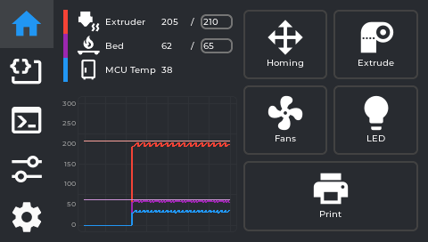
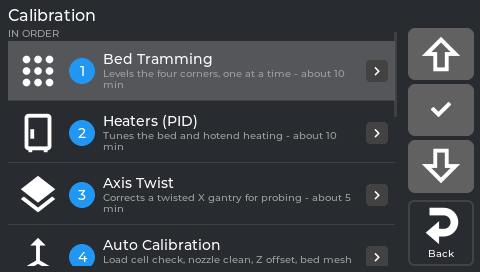
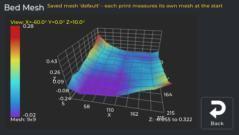
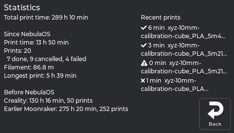

<h1 align="center">NebulaOS</h1>

  <b>Your Ender-3 V3 KE has good hardware. NebulaOS gives it the software to match.</b> 
  A complete new system for the printer: a real-time Linux kernel, current upstream Klipper,
  a touchscreen app that guides you through calibration, and Mainsail in your browser.

  
  
  

<table>
  <tr>
    <td></td>
    <td></td>
  </tr>
  <tr>
    <td align="center">NebulaScreen, built for the KE's 4.3" display</td>
    <td align="center">Guided calibration, in the order a new printer needs it</td>
  </tr>
  <tr>
    <td></td>
    <td></td>
  </tr>
  <tr>
    <td align="center">Your bed mesh in 3D, right on the printer</td>
    <td align="center">Print statistics, history from stock and OpenKE included</td>
  </tr>
</table>

## Why NebulaOS

- 🎯 **Better first layers, less fiddling.** Load-cell probing on upstream Klipper, an
  **Auto Calibration** that checks the load cell, cleans the nozzle and measures Z offset and
  bed mesh, and live Z adjustment while the first layer goes down.
- 📐 **Every calibration guided on the screen.** Bed tramming that tells you which screw to turn,
  PID, input shaper with graphs, E-steps, skew, axis twist, TMC autotune. The menu remembers
  what you did and tells you when something needs redoing.
- 🛡️ **Updates you don't have to be afraid of.** Two system slots: an update goes into the other
  one and starts on trial. If it doesn't come up healthy, the printer goes back by itself.
  One tap installs the next version from the touchscreen.
- ⚡ **Prints that survive a power cut.** After an outage the printer offers to resume: bed first,
  nozzle heated only when parked, mesh, excluded objects and timelapse kept.
- 🔓 **Standard, open, yours.** Unmodified upstream Klipper and Moonraker, so every Klipper guide,
  macro and tool works. OrcaSlicer upload, Spoolman, phone apps and home automation connect
  directly. No cloud.
- 📷 **Camera and timelapse built in.** Creality's Nebula camera with its own settings page, USB
  webcams, and a timelapse that needs no slicer setup.

| | Stock Creality | **NebulaOS** |
|---|---|---|
| Linux kernel | 4.4.94 (2017) | **6.6 real-time**, 120+ KE-specific changes |
| Klipper | Creality's old fork | **Unmodified upstream** |
| Calibration | A few routines | **Full guided suite with history** |
| Live first-layer Z | – | ✅ in 0.001 mm steps |
| Updates | Creality's updater, no rollback | **One tap, automatic rollback** |
| Power-loss resume | Basic | **Safe order, mesh and objects kept** |
| Web interface | Creality's | **Mainsail + full Moonraker API** |

## Get started

1. **Download** the [latest release](https://github.com/NebulaOS-KE/NebulaOS/releases/latest).
2. **Install** it: [Installing NebulaOS](https://github.com/NebulaOS-KE/NebulaOS/wiki/Installing-NebulaOS).
   Your old system stays in the other slot, so you can [go back](https://github.com/NebulaOS-KE/NebulaOS/wiki/Going-Back).
3. **Print.** The [manual](https://github.com/NebulaOS-KE/NebulaOS/wiki) takes you from the first
   start through calibration and your slicer to your first print.

**Which file?**

| You are on | Download |
|---|---|
| Creality's stock firmware | `NebulaOS-Ender3V3KE-F005_ota_img_V9.<version>.img`. Put it on a USB stick **without renaming it** and install it from the stock touchscreen. When NebulaOS is up, switch the printer off and on once. |
| OpenKE | `NebulaOS-Ender3V3KE-<version>.img`, installed with Creality's updater over SSH |
| NebulaOS already | Nothing: **Settings → Updates** finds new versions by itself |
| A printer that no longer starts | `NebulaOS-Ender3V3KE-<version>.ingenic`, the USB recovery image. It **erases the whole printer**, so use it only when nothing else works: [Recovery](https://github.com/NebulaOS-KE/NebulaOS/wiki/Recovery) |

**Supported: the Ender-3 V3 KE only** (not the V3 SE). NebulaOS is community software, not made
or supported by Creality.

## Help

- [Troubleshooting](https://github.com/NebulaOS-KE/NebulaOS/wiki/Troubleshooting)
- Found a bug? [Open an issue](https://github.com/NebulaOS-KE/NebulaOS/issues). The touchscreen's
  **Settings → System → Report a problem** collects the logs to attach.

## For developers

Everything is open source, and reproducible: two independent builds of a release come out
byte-identical. The image is built and put together in
**[NebulaOS-firmware](https://github.com/NebulaOS-KE/NebulaOS-firmware)**: the architecture,
the other repositories, how to build an image and how a release is made all start there.

## License

See each repository's own license.
