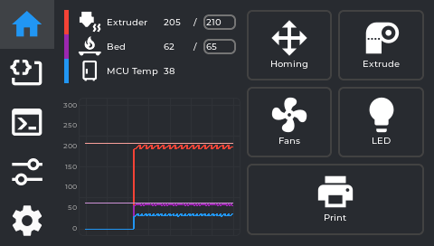
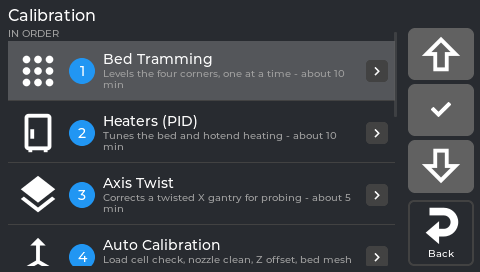
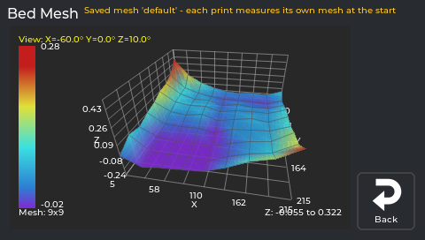
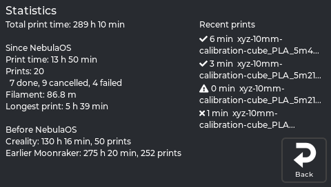

<h1 align="center">NebulaOS</h1>

  <b>An open system for Creality's Nebula Pad: built into the Ender-3 V3 KE, and the upgrade for the Ender-3 V3 SE.</b> 
  Your printer has good hardware. NebulaOS gives it the software to match: a new Linux 6.6 kernel,
  current upstream Klipper, a touchscreen app that guides you through calibration, and Mainsail
  in your browser.

  
  
  
  

<table>
  <tr>
    <td></td>
    <td></td>
  </tr>
  <tr>
    <td align="center">NebulaScreen, built for the 4.3" touchscreen</td>
    <td align="center">Guided calibration, in the order a new printer needs it</td>
  </tr>
  <tr>
    <td></td>
    <td></td>
  </tr>
  <tr>
    <td align="center">Your bed mesh in 3D, right on the printer</td>
    <td align="center">Print statistics, history from stock and OpenKE included</td>
  </tr>
</table>

## Printers

NebulaOS runs on the **Nebula Pad**, Creality's touchscreen computer. The Ender-3 V3 KE has it
built in. The Ender-3 V3 SE shipped with Marlin, and the Nebula Pad (Creality's *Nebula Smart
Kit*) is its upgrade to Klipper. It's the same pad hardware, so it's the same NebulaOS: what
differs per printer is the mainboard firmware and the printer configuration.

| Printer | Status | Start here |
|---|---|---|
| **Ender-3 V3 KE** | **Made and tested by us**, on our own test printer, for every release | [Installing NebulaOS](https://github.com/NebulaOS-KE/NebulaOS/wiki/Installing-NebulaOS) |
| **Ender-3 V3 SE** with the Nebula Pad upgrade | **Community port**, in daily use by SE owners. The SE mainboard firmware is ready-made in every release | [NebulaOS on the Ender-3 V3 SE](https://github.com/NebulaOS-KE/NebulaOS/wiki/Ender-3-V3-SE) |
| **Your printer?** | Any printer that can take a Nebula Pad could be next | [Bring it as a community port](#join-in) |

**Community port** means: owners built it, run it every day and keep it working, and it ships
in every NebulaOS release. There's no guarantee, and owners help each other on
[Discord](https://discord.com/invite/k3HdqpdB). Thank you **Hazok652**, who made the first SE
setup, and everyone who tested and shared fixes.

## Why NebulaOS

- 🎯 **Better first layers, less fiddling.** Load-cell probing on upstream Klipper, an
  **Auto Calibration** that checks the load cell, cleans the nozzle and measures Z offset and
  bed mesh, and live Z adjustment while the first layer goes down.
- 📐 **Every calibration guided on the screen.** Bed tramming that tells you which screw to turn,
  PID, input shaper with graphs, E-steps, skew, axis twist, TMC autotune. The menu remembers
  what you did and tells you when something needs redoing.
- 🛡️ **Updates you don't have to be afraid of.** Two system slots: an update goes into the other
  one and starts on trial. If it doesn't come up healthy, the printer goes back by itself.
  One tap installs the next version from the touchscreen.
- ⚡ **Prints that survive a power cut.** After an outage the printer offers to resume: bed and
  nozzle heated before anything moves, mesh, excluded objects and timelapse kept.
- 🔓 **Standard, open, yours.** Unmodified upstream Klipper and Moonraker, so every Klipper guide,
  macro and tool works. OrcaSlicer upload, Spoolman, phone apps and home automation connect
  directly. No cloud.
- 📷 **Camera and timelapse built in.** Creality's Nebula camera with its own settings page, USB
  webcams, and a timelapse that needs no slicer setup.

| | Creality stock | **NebulaOS** |
|---|---|---|
| Linux kernel | 4.4.94 (2017) | **6.6**, 120+ changes for this hardware |
| Klipper | Creality's old fork | **Unmodified upstream** |
| Calibration | A few routines | **Full guided suite with history** |
| Live first-layer Z | – | ✅ in 0.001 mm steps |
| Updates | Creality's updater, no rollback | **One tap, automatic rollback** |
| Power-loss resume | Basic | **Safe order, mesh and objects kept** |
| Web interface | Creality's | **Mainsail + full Moonraker API** |

## Get started

1. **Download** the [latest release](https://github.com/NebulaOS-KE/NebulaOS/releases/latest).
2. **Install** it: [Installing NebulaOS](https://github.com/NebulaOS-KE/NebulaOS/wiki/Installing-NebulaOS)
   on the KE, or the [SE guide](https://github.com/NebulaOS-KE/NebulaOS/wiki/Ender-3-V3-SE).
   Your old system stays in the other slot, so you can [go back](https://github.com/NebulaOS-KE/NebulaOS/wiki/Going-Back).
3. **Slice.** Using OrcaSlicer? Import our ready-made
   [OrcaSlicer profiles](https://github.com/NebulaOS-KE/NebulaOS/wiki/Quickstart-OrcaSlicer)
   (`NebulaOS-Ender3V3KE-OrcaSlicer.orca_printer` in the release; the SE profile is in the SE
   guide) - a good starting point, not a perfect tune.
4. **Print.** The [manual](https://github.com/NebulaOS-KE/NebulaOS/wiki) takes you from the first
   start through calibration and your slicer to your first print.

**Which file?**

| Printer | You are on | Download |
|---|---|---|
| KE | Creality's stock firmware | `NebulaOS-Ender3V3KE-F005_ota_img_V9.<version>.img`. Put it on a USB stick **without renaming it** and install it from the stock touchscreen. When NebulaOS is up, switch the printer off and on once. |
| KE | OpenKE | `NebulaOS-Ender3V3KE-<version>.img`, installed with Creality's updater over SSH |
| SE | A Nebula Pad on Creality's software | `NebulaOS-NebulaPad-NEBULA_ota_img_V9.<version>.img` for the pad, plus the `nebulaos-ender-3-v3-se-….bin` for your mainboard's chip. The [SE guide](https://github.com/NebulaOS-KE/NebulaOS/wiki/Ender-3-V3-SE) shows how to find your chip. The wrong `.bin` won't harm the board but won't work either: flash the right one with a new name. |
| Any | NebulaOS already | Nothing: **Settings → Updates** finds new versions by itself |
| Any | A pad that no longer starts | `NebulaOS-Ender3V3KE-<version>.ingenic`, the USB recovery image. It **erases the whole pad**, so use it only when nothing else works: [Recovery](https://github.com/NebulaOS-KE/NebulaOS/wiki/Recovery). On the SE, set up the SE configuration again afterwards (step 4 of the SE guide); the mainboard firmware is not touched. |

NebulaOS is community software, not made or supported by Creality.

## Join in

**We're always looking for help and contributions**, big or small:

- **Test and report.** Tell us what works and what doesn't on your printer:
  [It works on my printer](https://github.com/NebulaOS-KE/NebulaOS/issues/new?template=community-works.yml),
  [I found a fix](https://github.com/NebulaOS-KE/NebulaOS/issues/new?template=community-fix.yml),
  or a [bug report](https://github.com/NebulaOS-KE/NebulaOS/issues).
- **Help other owners** on [Discord](https://discord.com/invite/k3HdqpdB): your answer is often
  the one someone else is looking for.
- **Improve the manual.** Spotted something wrong or missing in the
  [wiki](https://github.com/NebulaOS-KE/NebulaOS/wiki)? A pull request to the `wiki` folder, or
  just a message, helps.
- **Code.** Everything is open source. Pull requests are welcome in any of the repositories, see
  [For developers](#for-developers).
- **Bring your printer.** NebulaOS is the same on every Nebula Pad and runs unmodified upstream
  Klipper, so another printer with a Nebula Pad mostly needs its own mainboard firmware recipe
  and printer configuration. That is how the SE port came to be. You build and maintain the
  port, and it ships in every NebulaOS release. Start with
  [Other printers](https://github.com/NebulaOS-KE/NebulaOS/wiki/Other-Printers-Experimental)
  and the [community folder](community), then open an issue or ask on Discord.

## Help

- [Troubleshooting](https://github.com/NebulaOS-KE/NebulaOS/wiki/Troubleshooting)
- Found a bug? [Open an issue](https://github.com/NebulaOS-KE/NebulaOS/issues). The touchscreen's
  **Settings → System → Report a problem** collects the logs to attach.
- Questions, tips and community ports: [Discord](https://discord.com/invite/k3HdqpdB).

## For developers

Everything is open source, and the build is reproducible - measured, not asserted: 1.0.2 built
twice from the same source gave the same kernel and the same root filesystem, byte for byte.
The image is built and put together in
**[NebulaOS-firmware](https://github.com/NebulaOS-KE/NebulaOS-firmware)**: the architecture,
the other repositories, how to build an image and how a release is made all start there.

## License

See each repository's own license.
