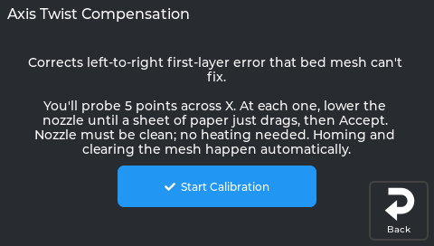

# Axis Twist Compensation

This guide fixes the single most common Ender-3 V3 KE first-layer complaint: **one side squished, the other side lifting — and bed mesh doesn't help**. If you've re-levelled, re-meshed, and tweaked Z-offset and it *still* looks wrong from left to right, you're in the right place.



*The Axis Twist screen.*

---

## Will this help me?

**Yes, if:** your first layer is inconsistent left-to-right — one side too low, the other too high — even though the bed is clean and not visibly warped, and bed mesh hasn't solved it.

**Probably not the whole story, if:** the bed physically rocks (gently push each corner — any play?), or one specific spot is dramatically high/low. Fix loose hardware first, then come back.

### Why this happens

Your printer probes the bed before each print to build a height map (a *bed mesh*) and follows it with Z corrections. The probe sits a couple of centimetres **behind** the nozzle. Here's the catch: the X-axis bar twists by a tiny fraction of a degree as it moves left to right. That twist tilts the probe just enough that the height it measures **isn't** what the nozzle will actually print at. The bed mesh faithfully records this wrong number — so no amount of re-meshing fixes it.

**Axis Twist Compensation** measures that error at five points across the bed and corrects it, so the probe finally tells the truth.

---

## Before you start

- ⏱️ **Time:** about 15–20 minutes.
- 🧰 **You need:** the printer on your network and a sheet of paper. No tools, no disassembly.
- ↩️ **Safe to try:** fully reversible — see [Undoing it](#undoing-it).

---

## Step 1 — Nothing to install

NebulaOS runs upstream Klipper, which includes `axis_twist_compensation`, and its machine config
(`/etc/nebulaos/klipper/machine.cfg`) has an `[axis_twist_compensation]` section with KE values
(X 20–200 at Y 117.5). The screen entry is **Tune → Calibration → 2 Axis Twist**.

---

## Step 2 — Calibrate (the 5-point paper test)

You only need to do this once per printer lifetime, unless you change the X gantry hardware.

### Option A — from the screen (easiest)


Open **Tune → Calibration → Axis Twist** on the printer screen. The intro screen explains the paper
test; homing and clearing the mesh happen automatically. Start it, and the wizard walks you through
the 5 points on the screen (**Point 1 of 5**, step buttons, **Accept**). At the end it shows the
offsets; **Save** runs `SAVE_CONFIG` (Klipper restarts).

### Option B — from the Klipper console (Mainsail/Fluidd)

Make sure the nozzle tip is **clean** (no plastic blob — wipe it on a paper towel at temperature, then
let it cool). Then in the console:

```
BED_MESH_CLEAR
AXIS_TWIST_COMPENSATION_CALIBRATE SAMPLE_COUNT=5
```

The printer probes, then moves the nozzle to the first of **5 spots** across the bed. A small
**"Manual Probe"** box appears. At each spot:

1. The nozzle starts about 5 mm up. Lower it using the step buttons (or `TESTZ Z=-1`, then smaller
   increments).
2. Slide a sheet of paper under the nozzle and keep lowering in small steps (`-0.1`, `-0.05`, `-0.01`)
   until you feel **light drag** — the same feel as setting Z-offset.
3. Tap **ACCEPT**. The nozzle lifts and moves to the next spot.

> 🎯 **The one trick that matters:** use the *same* paper drag feel at all 5 points. The tool only
> cares about the *difference* between spots, so consistency is everything.

After the 5th point, save permanently:

```
SAVE_CONFIG
```

Klipper restarts.

### After either option — re-mesh before your next print

Your existing bed mesh was measured with the *old*, un-corrected probe readings — it needs to be redone
now that the probe tells the truth. **Re-run your bed mesh** (`BED_MESH_CALIBRATE`, or
**Tune → Bed Mesh → Calibrate** on the screen). If your slicer calls NebulaOS's `START_PRINT`, it probes
a fresh mesh at the start of every print anyway ([Adaptive meshing](Adaptive-Print-Setup)).

Then run a first-layer test that spans the full width — the left-right unevenness should be gone.

> **Small note:** if the overall first-layer height feels slightly different after calibration, just nudge
> your Z-offset as usual. Twist is fixed; this is just fine-tuning.

---

## Undoing it

The saved correction is in the `SAVE_CONFIG` block at the bottom of `printer.cfg`, in an
`[axis_twist_compensation]` section. Delete the saved values there (keep the section in
`machine.cfg`), then restart Klipper. Running the calibration again simply overwrites them.

---

> Next: **[Adaptive Meshing](Adaptive-Print-Setup)** — mesh only the area your print actually
> uses, plus an automatic purge line.
