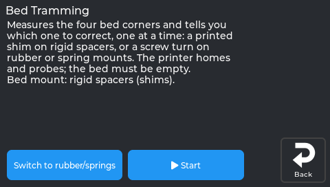
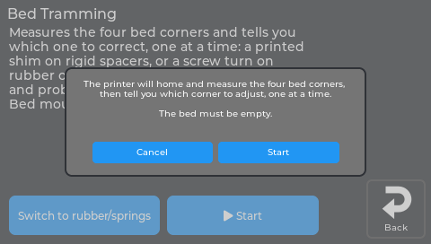
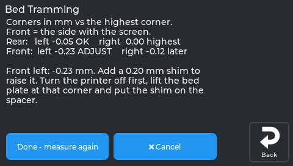
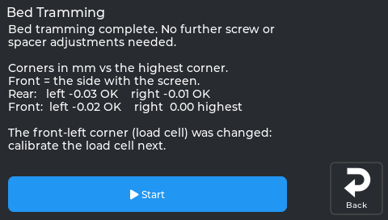

# Bed tramming (level the four corners)

The bed mesh corrects small hills in the bed. **Tramming** makes the four
corners the same height first, so the mesh has less to correct. The printer
measures the corners and tells you exactly what to do, **one corner at a
time**.

*The real screen on a printer running NebulaOS 1.0.1. Bed tramming, before it starts.*

**Start** asks first:

*The real screen on a printer running NebulaOS 1.0.1.*

*The printer tells you which corner to adjust, and by how much.*

*Tramming complete.*

Start it from **Calibration → 1 Bed Tramming** on the screen, or run the
`NEBULAOS_BED_TRAM` macro in Mainsail. The bed must be empty. The printer
homes and probes the four corners.

## Your bed mount (asked once)
- **Rigid spacers.** This is the stock KE: no knobs under the bed. You
  correct a low corner by adding a thin **printed shim** under it.
- **Rubber or springs.** A common upgrade. You correct a corner by turning
  its screw.

The answer is remembered for next time.

## How it works
1. The printer measures all four corners (3 samples each).
2. A corner within **0.10 mm** is **OK** and is never selected again.
3. You get **one instruction** for the worst corner, for example:
   - "Rear right: add a 0.10 mm shim. Unscrew this corner's bed screw, put
     the printed shim on the spacer, and screw it back firmly. Do not touch
     the other corners."
   - "Rear right: turn the screw a quarter of a turn clockwise."
4. Tap **Done - measure again**. Repeat until "Bed tramming complete".

Front is the side with the screen. The bed screws are M4x25.

## Printed shims
Print a few thin washers that fit around the M4 bed screw (hole about
4.5 mm). Two each of **0.10, 0.20 and 0.30 mm** cover most beds. The wizard
rounds its advice **down** to whole 0.10 mm steps, so it never asks for too
much.

## When it stops
- **A corner did not improve after 2 adjustments.** Check that the screw and
  spacer at that corner are tight, and that nothing is bent or loose (bed,
  gantry).
- **A corner that was OK moved after another adjustment.** Check that every
  bed screw is tight, then start again.

## Afterwards
- If the **front-left** corner was shimmed or changed, the printer offers a
  **load cell calibration**. That corner carries the load cell. See
  [Load cell calibration](Load-Cell-Calibration).
- Otherwise it offers **Z offset & bed mesh**. Do that next.
