# Calibration explained

Every calibration NebulaOS has, one section each: what it fixes, what you need, where it is on
the screen, how long it takes, and when to do it again. They all live in one menu,
**Tune → Calibration**, and each runs as a guided page on the screen.

New printer? [First calibration](First-Calibration) is the short path: Auto Calibration, then
fine-tune on the first print. Come here when a print shows a problem - or start from the symptom
in [Improve your prints](Improve-Your-Prints).

> **Golden rule: change one thing, then print a test.** If you change five settings and the next
> print is worse, you will not know which one did it.

> **Before any test print,** set up your slicer once: [Setting up your slicer](Slicer-Setup).
> Without its start and end G-code the print skips the mesh and purge line.

## The Calibration menu

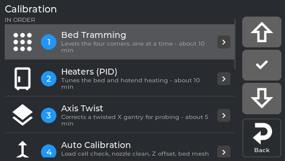

*The Calibration menu, numbered in the order a new printer needs.*

The **IN ORDER** rows are numbered in the order a new printer needs them; below them, **OTHER**
holds three you do not need on day one. The times are the screen's own.

| # | Menu row | You need | The screen says | Section |
|---|---|---|---|---|
| 1 | **Bed Tramming** | an empty bed (and maybe a printed shim) | about 10 min | [Bed tramming](#bed-tramming) |
| 2 | **Heaters (PID)** | an empty, cool printer | about 10 min | [Heaters (PID)](#heaters-pid) |
| 3 | **Axis Twist** | a sheet of paper | about 5 min | [Axis Twist](#axis-twist) |
| 4 | **Auto Calibration** | an empty bed - no tools | about 7 min | [Auto Calibration](#auto-calibration-z-offset-and-bed-mesh) |
| 5 | **Input Shaper** | the accelerometer | about 5 min | [Input Shaper](#input-shaper) |
| 6 | **E-Steps** | a ruler or caliper, a marker | about 5 min | [E-Steps](#e-steps-rotation-distance) |
| 7 | **Skew Correction** | a printed test part, a caliper | about 30 min | [Skew Correction](#skew-correction) |
| - | **Load Cell Calibration** *(OTHER)* | nothing (Automatic) or a 1.5 L bottle and a kitchen scale (Manual) | 1-2 min | [Load cell](#load-cell-calibration) |
| - | **TMC Autotune** *(OTHER, optional)* | nothing | about 1 min | [TMC Autotune](#tmc-autotune) |
| - | **Bed Mesh** *(OTHER)* | nothing | - | [Bed mesh](#bed-mesh) |

Every row except **Bed Mesh** is locked while a print runs.

### The status line under every row

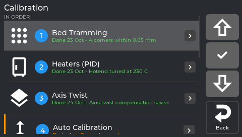

*Status lines: what ran, when, and what it measured.*

- **Done 24 Oct - Z offset 1.752 mm, mesh range 0.16 mm** (green): when it last ran and its result.
- a one-line description and the time it takes (grey): not done yet.
- **Redo: Axis Twist changed** (orange, with a bar on the left): something changed since, run it
  again.

The printer tracks two dependencies for you:

- saving **Axis Twist** marks **Auto Calibration** *Redo: Axis Twist changed*;
- a shim at the front-left corner during **Bed Tramming** marks both **Load Cell Calibration**
  and **Auto Calibration** *Redo: a shim was added at front left*.

Running a calibration clears its own *Redo*. On a printer whose NebulaOS does not keep a
calibration history yet, the rows show the descriptions only.

*From `src/nebulaos_calibration_status.cpp:26-92` and `src/calibration_menu_panel.cpp:205-214` at
screen `fd47cb6`; the dependencies from `extras/nebulaos_calibration_history.py:17-22` and
`extras/nebulaos_bed_tram.py:302-309` at extensions `f498796`.*

## Before you start: touch and mechanics

**Touch.** If taps land slightly away from where you press, run **Settings → Reset → Reset touch
calibration** first. The screen shows three crosshairs in turn - tap the centre of each **three
times** (lift your finger between taps). It takes about 30 seconds and survives reboots.

**Mechanics.** Software cannot fix loose hardware - it can only paper over it.

- **Belts:** firm. A plucked belt should "thunk", not flap, and both sides should sound about the
  same pitch. Slack belts cause layer shift and ringing.
- **Gantry:** square. The X bar should be parallel to the bed, not tilted.
- **Bed:** not rocking. Gently push each corner - no play.
- **V-wheels/rails:** snug but not binding. They should spin with light finger pressure.
- **Nozzle:** clean, no plastic blob.

---

## Bed tramming

| | |
|---|---|
| **Fixes** | One corner of the bed higher or lower than the others |
| **You need** | An empty bed; on the stock KE, a few printed shims |
| **Start it** | **Tune → Calibration → 1 Bed Tramming**, or the macro `NEBULAOS_BED_TRAM` in Mainsail |
| **Takes** | About 10 minutes |
| **Repeat when** | You changed the bed, its spacers or springs, or the first layer is thick on one side |

The bed mesh corrects small hills in the bed. **Tramming** makes the four corners the same height
first, so the mesh has less to correct. The printer measures the corners and tells you exactly
what to do, **one corner at a time**.

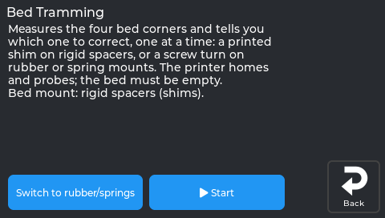

*The real screen on a printer running NebulaOS 1.0.1. Bed tramming, before it starts.*

**Start** asks first:

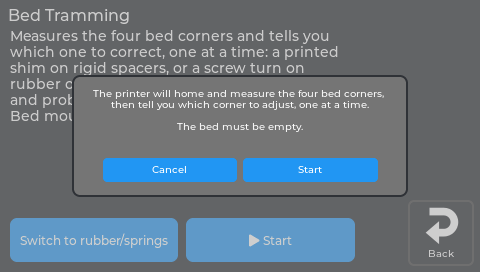

*The real screen on a printer running NebulaOS 1.0.1.*

**Your bed mount (asked once).**

- **Rigid spacers.** This is the stock KE: no knobs under the bed. You correct a low corner by
  adding a thin **printed shim** under it.
- **Rubber or springs.** A common upgrade. You correct a corner by turning its screw.

The answer is remembered; **Switch to rubber/springs** on the page changes it.

**How it works.**

1. The printer homes and measures all four corners (3 samples each).
2. Each corner is shown compared with a reference corner, with a sign: **minus is lower, plus is
   higher**. A corner within **0.10 mm** is **OK** and is never selected again. Example (rigid
   spacers, compared with the highest corner):

   ```
   Rear:   left -0.05 OK    right  0.00 highest
   Front:  left -0.23 ADJUST    right -0.12 later
   ```
3. You get **one instruction** for the worst corner, for example *"Front left: -0.23 mm. Add a
   0.20 mm shim to raise it. Turn the printer off first, lift the bed plate at that corner and put
   the shim on the spacer."* With rubber or springs it says which screw to turn and how far.
4. Correct the corner, tap **Done - measure again**, and repeat until *"Bed tramming complete"*.

Front is the side with the screen. The bed screws are M4x25.

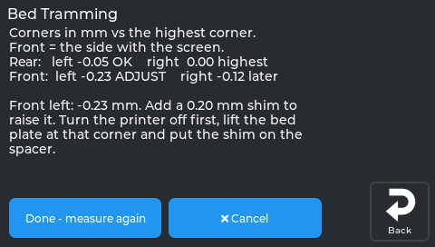

*The printer tells you which corner to adjust, and by how much.*

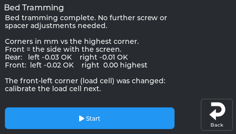

*Tramming complete.*

**Printed shims.** Print a few thin washers that fit around the M4 bed screw (hole about 4.5 mm).
Two each of **0.10, 0.20 and 0.30 mm** cover most beds. The advice is rounded **down** to whole
0.10 mm steps, so it never asks for too much.

**When it stops.**

- *A corner did not improve after 2 adjustments*: check that the screw and spacer at that corner
  are tight, and that nothing is bent or loose (bed, gantry).
- *A corner that was OK moved after another adjustment*: check that every bed screw is tight, then
  start again.

**Afterwards.** If the **front-left** corner was shimmed or changed, the printer offers a
[load cell calibration](#load-cell-calibration) - the load cell sits under that corner. Then run
[Auto Calibration](#auto-calibration-z-offset-and-bed-mesh).

---

## Heaters (PID)

| | |
|---|---|
| **Fixes** | Bed or hotend temperature swinging around the target, which makes extrusion uneven |
| **You need** | An empty, cool printer |
| **Start it** | **Tune → Calibration → 2 Heaters (PID)** |
| **Takes** | The screen says about 10 minutes; the hotend takes a few minutes, the bed longer |
| **Repeat when** | You changed a heater, a thermistor or the hotend |

Two buttons: **Bed 65 C** and **Hotend 230 C** - start with the bed. Each heats and cools a few
times (the temperature going up and down is normal), then saves with one Klipper restart. The
screen shows the progress: "Heating up", then "Measuring: cycle n of 6, about m min left". Each
of the bed's swings takes about 3 minutes. The menu remembers both heaters.

Each button asks first:

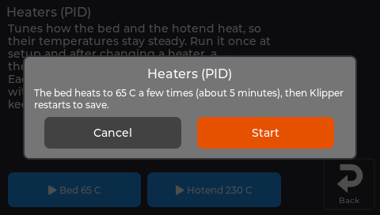

*The real screen app.*

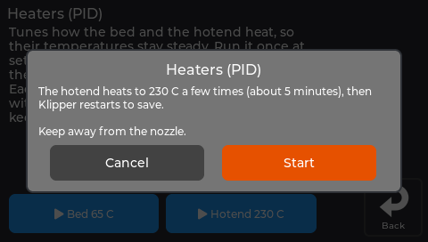

*The real screen app.*

It comes before Auto Calibration on purpose: the hotend oozes during the long hot phase, and Auto
Calibration's nozzle clean removes that before the Z offset is measured.

From the console instead: `PID_HOTEND` (default 230 °C) and `PID_BED` (default 65 °C), each with an
optional `TARGET=`, then `SAVE_CONFIG` (`calibration.cfg:161-178`, firmware `dc868e3`).

**Done when:** the temperature holds flat at the target on the graph.

---

## Axis Twist

| | |
|---|---|
| **Fixes** | First layer squished on one side and lifting on the other, and a new bed mesh does not help |
| **You need** | A sheet of paper |
| **Start it** | **Tune → Calibration → 3 Axis Twist** |
| **Takes** | About 5 minutes |
| **Repeat when** | You changed the X gantry hardware; otherwise once per printer |

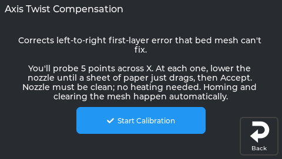

*The Axis Twist screen.*

**Why it happens.** The printer probes the bed before each print and follows the resulting height
map (the *bed mesh*). The probe point sits a little away from where the nozzle prints, and the X
bar twists by a tiny fraction of a degree as it moves left to right. That twist tilts the probe
just enough that the height it measures is not the height the nozzle prints at - so the bed mesh
records the wrong number, and no amount of re-meshing fixes it. Axis Twist measures that error at
five points across X and corrects every probe.

**On the screen.** The intro explains the paper test; homing and clearing the mesh happen
automatically. Start it, and the page walks you through the 5 points (**Point 1 of 5**, step
buttons, **Accept**). At each point lower the nozzle onto a sheet of paper until you feel **light
drag**. Use the *same* drag feel at all 5 points - only the differences between them matter. At the
end it shows the offsets; **Save** runs `SAVE_CONFIG` (Klipper restarts).

**Save also removes the saved bed mesh** (it was measured without the correction) and marks Auto
Calibration *Redo: Axis Twist changed* - run [Auto Calibration](#auto-calibration-z-offset-and-bed-mesh)
next.

**From the console instead** (clean nozzle tip first):

```
BED_MESH_CLEAR
AXIS_TWIST_COMPENSATION_CALIBRATE SAMPLE_COUNT=5
```

A **Manual Probe** box appears at each of the 5 spots: lower in small steps (`-0.1`, `-0.05`,
`-0.01`) to light paper drag, then **ACCEPT**. After the fifth, `SAVE_CONFIG`.

**Undoing it.** The correction is saved in an `[axis_twist_compensation]` section in the
`SAVE_CONFIG` block at the bottom of `printer.cfg`. Delete the saved values there and restart
Klipper; running the calibration again simply overwrites them. NebulaOS's own section, with the KE
values (X 20-200 at Y 117.5), is in `machine.cfg` (`machine.cfg:325-331`, firmware `dc868e3`).

Without that section the row shows *"Axis Twist Compensation isn't enabled. Add
[axis_twist_compensation] to printer.cfg."* instead of opening; NebulaOS ships it.

---

## Auto Calibration: Z offset and bed mesh

| | |
|---|---|
| **Fixes** | The first layer too high or too low everywhere, or patchy adhesion |
| **You need** | An empty bed, no tools |
| **Start it** | **Tune → Calibration → 4 Auto Calibration**, or `NEBULAOS_AUTO_CALIBRATE` in Mainsail |
| **Takes** | About 7 minutes |
| **Repeat when** | New nozzle or build plate, after Axis Twist, after a front-left shim, or when the row says *Redo* |

One button runs, in order: a load cell check, homing, a nozzle clean, heating, a hot load cell
check, the Z offset measurement and a bed mesh, then saves everything with **one** Klipper restart
and verifies it. It also sets your Z adjustment from earlier prints back to 0 - it was made for the
old Z offset. It does **not** do PID, Axis Twist, Bed Tramming or Input Shaper.

The step by step, what the screen asks and what you see at the end: [First calibration](First-Calibration).

If your slicer calls `START_PRINT`, each print also probes a fresh mesh of just the print area, on
top of this saved one - see [Print setup NebulaOS adds](Adaptive-Print-Setup).

### Fine-tuning on the first print

Print something with a large first layer and watch it. On the screen, **Tune → Z Offset** (or the Z
buttons in **Fine Tune**, or tap the Z value on the print screen):

- **Raise** (farther from the bed) when the line is rough or scraped, **Lower** (closer) when it is
  round and does not stick. Steps of 0.01 mm are usually right; 0.005 / 0.001 for the last bit.
- Every tap is **saved immediately**. The page says *Z offset adjustment: -0.040 mm, saved*. The
  value comes back after a Klipper restart, a pause/resume and a power cut.
- **Reset** sets the adjustment back to 0.
- If the line ever says *NOT saved* (orange), the adjustment works for this print but is lost at
  the next restart.

Mainsail: its own Z offset arrows change the offset for the running print only (not saved by
NebulaOS). Its **Save** button folds the current offset into the probe `z_offset` in `printer.cfg`
and sets the NebulaOS adjustment to 0, so nothing is counted twice.

---

## Bed mesh

| | |
|---|---|
| **Fixes** | Nothing by itself - it shows and measures the height map the first layer follows |
| **Start it** | **Tune → Bed Mesh**, or **Tune → Calibration → Bed Mesh** (OTHER) |
| **Repeat when** | Not needed: Auto Calibration saves one, and `START_PRINT` measures one for every print |

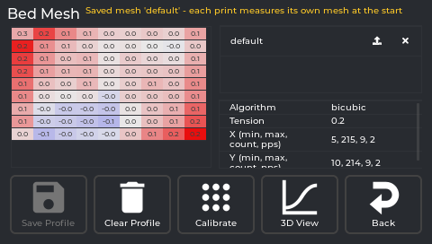

*The real screen app, showing a saved mesh measured on a printer running NebulaOS 1.0.0.*

Klipper does not load a saved mesh by itself after a restart, so after Auto Calibration the page
shows the saved one instead, with *Saved mesh 'default' - each print measures its own mesh at the
start* - nothing is loaded. Only when no mesh was ever saved it says *No bed mesh yet - run
Calibration > Auto Calibration.* It can be viewed during a print. Every control on the page:
[Tune → Bed Mesh](Screen-Tune#bed-mesh).

---

## Load cell calibration

| | |
|---|---|
| **Fixes** | A Z offset measurement that fails, or a load cell check that does not pass |
| **You need** | Automatic: nothing. Manual: a 1.5 L bottle full of water and a kitchen scale |
| **Start it** | **Tune → Calibration → Load Cell Calibration** (OTHER), or `NEBULAOS_LOAD_CELL_CALIBRATE` in Mainsail |
| **Takes** | 1-2 minutes. Nothing moves or heats |
| **Repeat when** | You changed the front-left bed corner (shim, spacer, screw) - the row then says *Redo* |

The KE measures the Z offset by gently touching the bed with the nozzle. The touch is felt by a
**load cell** under the **front-left bed screw**. The page has two choices at the top:

- **Automatic** (the default). The printer checks the sensor by itself on an empty bed: no bottle,
  nothing moves or heats. Tap **Run**. After a passed check the page says *Ready - Automatic needs
  no weight calibration; Auto Calibration uses it.* You do not have to run it by hand: Auto
  Calibration runs the same check first. If the check fails, the page says why and offers **Run**
  again or **Use Manual**.
- **Manual**. The calibration with the bottle and the scale, below. The value you measure is used
  **until you choose Automatic again**.

The choice is saved at once and survives restarts.

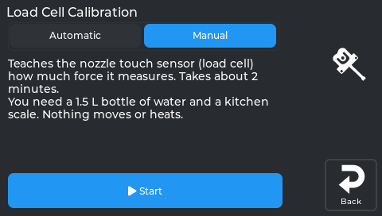

*Load cell calibration, before it starts.*

### Manual, with a water bottle

1. **Empty bed.** Remove everything from the bed; the nozzle must not touch it. Tap **Check**. The
   printer checks the sensor and takes the empty reading.
2. **Bottle on.** Weigh the full bottle on the kitchen scale. Stand it with its **centre roughly
   above the front-left screw head** of the bed. Set the weight from the scale - on the screen,
   type it; in Mainsail, use the -100 … +100 buttons (1500 g is pre-filled). Tap **Weigh**.
3. **Lift it and put it back** in the same place, then tap **Continue**. The printer shows "Printer
   measures N g, your scale said M g". They should agree.
4. **Remove the bottle**, then tap **Continue**. The reading must return to zero.
5. **Optional finger test.** Press the front-left corner gently and tap **Measure**. The printer
   shows the force. Tap **Continue** when done.
6. **Apply & Save.** Klipper restarts with the new calibration.

Nothing is saved before step 6. **Cancel** works at every step.

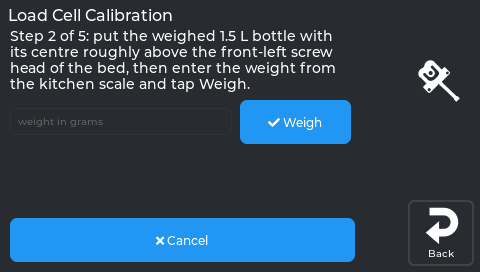

*Entering the weight of your bottle.*

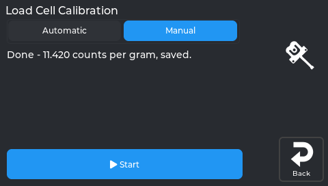

*Calibration complete.*

If a step says **Problem**, it stays where it is. Fix the cause and tap the same button again:

| Message | What to do |
|---|---|
| The load cell sensor is not working properly | Check the cable under the front-left corner. |
| The reading is not stable | Don't touch the printer. Wait until the bottle stands still. |
| Enter the weight in grams, between 1000 and 5000 | You typed a wrong number (for example 150 instead of 1500). |
| The printer barely felt the weight | Put the bottle centred above the front-left screw head, or use two bottles. |
| The weight is too heavy | Use a lighter weight. |
| The printer measures … your scale said … | The bottle moved or touches something. Put it back and try again. |
| The bed does not return to zero | Something is stuck on or under the bed. |

**Why a bottle is good enough.** The Z offset itself does **not** depend on this calibration. It
only sets how hard the nozzle may press (75 g) and the safety limit (2 kg). A bottle a little off
the screw reads low, so the printer stops a touch a little earlier - the safe side. A typed weight
far too low would be unsafe, which is why only 1000-5000 g is accepted.

---

## Input Shaper

| | |
|---|---|
| **Fixes** | Ringing or ghosting: faint echoes trailing sharp corners on fast prints |
| **You need** | The accelerometer |
| **Start it** | **Tune → Calibration → 5 Input Shaper** (the workflow `NEBULAOS_INPUT_SHAPER_CALIBRATE`) |
| **Takes** | About 5 minutes |
| **Repeat when** | You changed the moving mass of an axis (belts, carriage, bed rails) - that axis only |

**The accelerometer is the Creality one for this printer.** NebulaOS configures an ADXL345 on the
KE's own SPI wiring - the same wiring the stock firmware uses - and drives it with **upstream
Klipper's `[adxl345]` and `[resonance_tester]`**. The test runs to 90 Hz at 70 mm/s² per Hz,
the same as Creality's stock firmware (`machine.cfg:62-74`, firmware 1.0.2).

Everything happens on the page, with no popups:

1. **Show graphs** (on by default, remembered): draws a graph of each axis. Off saves a little time.
   It can only be changed between runs.
2. Tap **Start**. The printer homes. Mount the accelerometer firmly on the toolhead and tap
   **Continue**.
3. The page shows what is happening: *Shaking X: 45 Hz (5-135 Hz)*, then *Calculating the best
   shaper for X...*, then *Drawing the X graph...*.
4. The X result (shaper type and frequency, remaining vibrations, smoothing, the highest
   acceleration that shaper allows) with its graph. Tap the graph to see it full screen, tap again to
   close. Move the accelerometer firmly onto the bed and tap **Continue**.
5. The same for Y, then the result is saved with one Klipper restart.
6. The end page shows both results and both graphs.

The graph shows the measured vibration (blue), what is left after the chosen shaper (orange) and
the shaper itself (dashed). The latest graphs are also in Mainsail: **Machine** → config folder
`input_shaper/` (`shaper_x.png`, `shaper_y.png`). If a graph cannot be drawn, the page says why;
the calibration itself still finishes. **Cancel** stops the run. From Mainsail or the console the
run draws no graphs; `NEBULAOS_INPUT_SHAPER_CALIBRATE GRAPHS=1` draws them.

To turn shaping off for one axis, set `shaper_freq_x: 0` (or `_y`) in the config.

---

## E-Steps (rotation distance)

| | |
|---|---|
| **Fixes** | Prints uniformly over- or under-extruded: walls thicker or thinner than sliced everywhere, not just at corners |
| **You need** | A ruler or caliper, and a marker |
| **Start it** | **Tune → Calibration → 6 E-Steps** (the workflow `NEBULAOS_ESTEPS_CALIBRATE`) |
| **Takes** | About 5 minutes |
| **Repeat when** | You changed the extruder gear or the hotend |

1. The hotend heats. Mark the filament at the extruder entry and tap **Start Extrusion**.
2. The printer extrudes a fixed length.
3. Measure how far the mark moved and type it in.
4. The page shows the old and the new `rotation_distance`; **Apply & Save** saves it (Klipper
   restarts).

Repeat once to check. If the result keeps varying between runs instead of converging, that is an
extruder hardware issue (skipping steps, loose grub screw, worn gears), not something calibration
can fix. **Done when:** the extruded length matches what was asked within about 0.5 mm.

---

## Skew Correction

| | |
|---|---|
| **Fixes** | Parts that come out as a slight parallelogram: two diagonals of different lengths |
| **You need** | A printed test square and a caliper |
| **Start it** | **Tune → Calibration → 7 Skew Correction** |
| **Takes** | About 30 minutes, most of it the test print |
| **Repeat when** | You changed or re-squared the frame |

You only need it for parts that must *fit* something - skew is a fraction of a degree, invisible
on a figurine. **Quick check:** measure the two diagonals of any printed square. Equal means no
skew worth fixing.

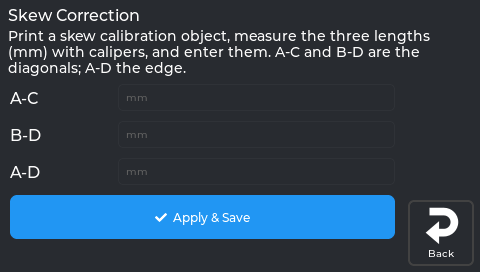

*The Skew Correction screen.*

1. **Print a square** with your normal slicer profile - an *XY skew calibration* model, or a large
   flat square frame a few layers tall. **Bigger is better**: about 150 mm gives far more resolution
   than a small one. Note which corner was at the front left - that is corner **A**.
2. **Measure three lengths**, outer corner to outer corner, as the part sat on the bed (front toward
   you):

   ```
   D (back-left) ───────────── C (back-right)
   │                                       │
   A (front-left) ──────────── B (front-right)
   ```

   | Measure | From → to |
   |---|---|
   | **A-C** | front-left → back-right (one diagonal) |
   | **B-D** | front-right → back-left (the other diagonal) |
   | **A-D** | front-left → back-left (the left edge) |
3. **Enter them**: tap each field and type the value (the keypad has a decimal point).

   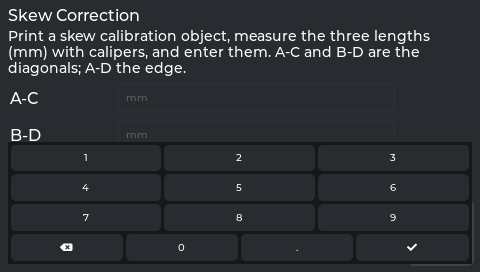

   *The real screen app.*
4. Tap **Apply & Save**. That sends `SET_SKEW` and runs `SAVE_CONFIG` (Klipper restarts).

From the console instead: `SET_SKEW XY=<AC>,<BD>,<AD>`, then `SAVE_CONFIG`. **Undo:**
`SET_SKEW CLEAR=1`, then `SAVE_CONFIG`. The screen handles XY only; Klipper's `XZ` and `YZ` are
console-only.

Without a `[skew_correction]` section the row shows *"Skew correction isn't enabled. Add
[skew_correction] to printer.cfg."*; NebulaOS ships one (`machine.cfg:337`, firmware `dc868e3`).
It does not fix a part that rocks, a loose belt or a bent axis - fix mechanics first.

---

## TMC Autotune

| | |
|---|---|
| **Fixes** | Loud or warm stepper motors. It does not change print quality or dimensions |
| **You need** | Nothing |
| **Start it** | **Tune → Calibration → TMC Autotune** (OTHER, optional) |
| **Takes** | About 1 minute, plus a Klipper restart |
| **Repeat when** | You changed a motor |

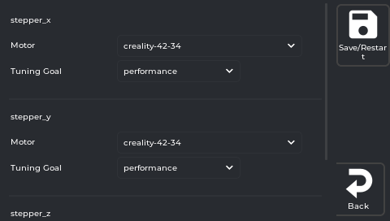

*The real screen app, with NebulaOS's shipped configuration and motor list. A printer that has
saved its own choices shows those instead.*

For each stepper choose the **Motor**, then a **Tuning Goal**, then tap **Save/Restart**. Steppers
without a saved choice are pre-selected with the KE's stock motors; nothing is written until you
save. **Recommended on the KE** (the stock motors):

| Stepper | Motor | Tuning Goal |
|---|---|---|
| `stepper_x` | `creality-42-34` | **performance** |
| `stepper_y` | `creality-42-34` | **performance** |
| `stepper_z` | `creality-42-40` | **silent** |

- **`auto`** picks performance for X/Y and silent for Z - on the KE, exactly the table above.
- **`performance`** - spreadCycle at all speeds (crisp, a bit more audible).
- **`silent`** - stealthChop at all speeds (quietest).
- **`autoswitch`** - experimental in the add-on; not needed on the KE.

The KE's TMC2208 drivers have no StallGuard, so there is no *Sensorless Threshold* field. Expect
"noticeably calmer and cooler", not a different printer.

**Save/Restart** sends `NEBULAOS_TMC_AUTOTUNE STEPPER=… MOTOR=… GOAL=…` per stepper, then
`SAVE_CONFIG`; from then on the tuned driver settings are applied at every boot. **Undo one axis:**
set its **Motor** to *Not Configured* and tap **Save/Restart**.

The row is greyed out only when Klipper has no `motor_database.cfg`; NebulaOS ships it, from
[andrewmcgr/klipper_tmc_autotune](https://github.com/andrewmcgr/klipper_tmc_autotune) in the
extensions. **TMC Metrics** on the Tune tab is a different thing: a live driver dashboard.

---

## Flow, pressure advance and temperature

These are tuned per filament in the slicer, not by NebulaOS. Do them after the first layer and
the calibrations above are right. **Tune → Fine Tune** adjusts speed, flow and pressure advance
live during a print. For the method, use the upstream guides:

- Klipper: [Pressure advance](https://www.klipper3d.org/Pressure_Advance.html)
- OrcaSlicer: [Calibration](https://github.com/SoftFever/OrcaSlicer/wiki/Calibration)

---

## After a hardware change

You do not have to redo everything - only what the changed part affects. Re-running a calibration
overwrites the old value; there is no "reset first" step.

| You changed… | Redo |
|---|---|
| Nozzle, build plate | 4 Auto Calibration, then fine-tune on the next print |
| Heater, thermistor or hotend | 2 Heaters (PID), then 4 |
| Shim at the front-left corner, or bed hardware (spacers, springs, the bed itself) | Load Cell Calibration (Automatic: just **Run**), then 4 |
| Corners uneven (first layer thick on one side) | 1 Bed Tramming, then 4 |
| X gantry, anything that could tilt the X axis | 3 Axis Twist first, then 4 |
| Moving mass on an axis (belts, carriage, bed rails) | 5 Input Shaper |
| Extruder gear or hotend melt zone | 6 E-Steps |
| Frame squareness | 7 Skew Correction |
| A motor | TMC Autotune |

The front-left corner is special: the load cell sits under it, so changing that corner changes
how the load cell is mounted.

**Reset commands (rarely needed):** skew → `SET_SKEW CLEAR=1`; active mesh → `BED_MESH_CLEAR`;
shaper for one axis → `shaper_freq_x: 0` (or `_y`) in the config.

## Next

- [Improve your prints](Improve-Your-Prints) - start from what you see
- [Print setup NebulaOS adds](Adaptive-Print-Setup) - adaptive mesh, purge, bed soak
- Need help? [Troubleshooting](Troubleshooting)
