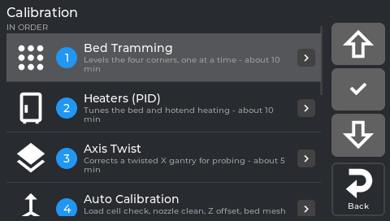
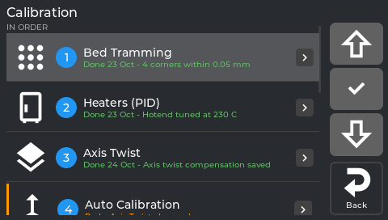

# Calibration guide (the short version)

All calibrations are in **Tune → Calibration**, numbered in the order a new printer needs them:
do 1, 2, 3, ... from the top. For background, every other calibration and troubleshooting, see
the [full calibration walkthrough](Calibration-Explained).



*The Calibration menu, numbered in the order a new printer needs.*



*Status lines: what ran, when, and what it measured.*

| # | Menu row | You need | Time |
|---|---|---|---|
| 1 | **Bed Tramming** | an empty bed (and maybe a printed shim) | 5-15 min |
| 2 | **Heaters (PID)** | an empty, cool printer | hotend a few minutes, bed longer |
| 3 | **Axis Twist** | a sheet of paper | about 5 min |
| 4 | **Auto Calibration** | an empty bed - no tools | about 7 min |
| 5 | **Input Shaper** | the accelerometer | about 5 min |
| 6 | **E-Steps** | a ruler or caliper, a marker | about 5 min |
| 7 | **Skew Correction** | a printed test part, a caliper | about 30 min |
| - | then the first print: **Tune → Z Offset** or **Fine Tune** | a test print | while printing |

Below them, **OTHER**: **Load Cell Calibration** (automatic re-check or manual with a bottle),
**TMC Autotune** (optional, quieter motors) and **Bed Mesh** (view or measure).

### The status line under every row

Each row says where you stand:

- **Done 24 Oct - Z offset 1.752 mm, mesh range 0.16 mm** (green): when it last ran and its result.
- a one-line description and the time it takes (grey): not done yet.
- **Redo: Axis Twist changed** (orange, with a bar on the left): something changed since, run it
  again. Examples: saving **Axis Twist** marks Auto Calibration *Redo: Axis Twist changed*; a
  shim at the front-left corner (Bed Tramming) marks Load Cell Calibration and Auto Calibration
  *Redo: a shim was added at front left*. Running the calibration clears it.

On a printer whose NebulaOS does not keep a calibration history yet, the rows show the
descriptions only.

---

## 1. Bed Tramming

The printer probes the four corners and shows each one compared with a reference corner, with
a sign: **minus is lower, plus is higher**. Example (rigid spacers, compared with the highest
corner):

```
Rear:   left -0.05 OK    right  0.00 highest
Front:  left -0.23 ADJUST    right -0.12 later
```

and below it what to do, one corner at a time:

> Front left: -0.23 mm. Add a 0.20 mm shim to raise it. Turn the printer off first, lift the
> bed plate at that corner and put the shim on the spacer.

With rubber or spring mounts the screen tells you which screw to turn and how far instead.
Correct the corner, tap **Done - measure again**, repeat until every corner says OK.
Details: [Bed tramming](Bed-Tramming).

## 2. Heaters (PID)

Teaches the bed and the hotend heaters to hold their temperature steadily. Two buttons:
**Bed 65 C** and **Hotend 230 C** - start with the bed. Each heats and cools a few times (the
temperature going up and down is normal), then saves with one Klipper restart. The screen shows
the progress: "Heating up", then "Measuring: cycle n of 6, about m min left". The hotend takes a few
minutes; the bed much longer, because each of its swings takes about 3 minutes. The Calibration
menu remembers both heaters. Redo it after changing a heater, a thermistor or the hotend.

It comes before Auto Calibration on purpose: the hotend oozes during the long hot phase, and Auto
Calibration's nozzle clean removes that before the Z offset is measured.

## 3. Axis Twist

A 5-point paper test across X that corrects a slightly twisted gantry for every probe. Its
**Save** also removes the saved bed mesh (it was measured without the correction) and marks Auto
Calibration *Redo: Axis Twist changed* - run step 4 next.

## 4. Auto Calibration

One button does everything (it used to be called *Z-Offset & Bed Mesh*): load cell check (cold
and hot, no bottle, when the load cell is in Automatic mode), nozzle clean, Z offset, bed mesh,
all saved with **one** Klipper restart. Remove everything from the bed and tap **Start**.

While it runs the page shows every step with check marks, the current one in large type with its
live detail, for example:

```
Step 7 of 10                  ✓ Load cell check
Measuring the Z offset        ✓ Homing
touch 2 of 3                  ...
                              > Measuring the Z offset
                                Bed mesh
                                Saving (Klipper restarts)
                                Verifying
```

Heating shows the temperatures (*bed 61/65 C, nozzle 148/150 C*), the mesh the probe point
(*point 41 of 81*). During **Saving** the page says that Klipper restarts and the screen
reconnects by itself - do not switch the printer off. At the end:

- **Done 24 Oct** with the new values, for example *Z offset 1.669 mm (was 1.795)*, *Bed mesh 9x9,
  range 0.16 mm* and *Your Z adjustment was reset to 0.* - the adjustment from the first-print
  step was made for the old Z offset.
- or **Failed: <step>** with *Why*, *What to do* and *Nothing was saved.*

Input Shaper and E-Steps show the same step list.

## 5.-7. Input Shaper, E-Steps, Skew Correction

Guided pages, every step's button on the page (no popups); see the
[full calibration walkthrough](Calibration-Explained). Input Shaper shows what it is doing
(shaking, calculating, drawing) and a graph of each axis next to its result (switch **Show graphs**).
Skew Correction is last because it needs a printed test part from a calibrated printer.

## Load Cell Calibration (OTHER)

The load cell under the front-left bed screw is the sensor that feels the nozzle touch the bed.
The page has two choices at the top:

- **Automatic** (the default). The printer checks the sensor by itself on an empty bed: no
  bottle, nothing moves or heats. Tap **Run**. After a passed check the page says *Ready -
  Automatic needs no weight calibration; Auto Calibration uses it.* You do not have to run it by
  hand: Auto Calibration runs the same check first. If the check fails, the page says why and
  offers **Run** again or **Use Manual**.
- **Manual**. The calibration with a 1.5 L bottle of water and a kitchen scale (about 2 minutes,
  nothing moves or heats): [Load cell calibration (water bottle)](Load-Cell-Calibration).
  The value you measure is used **until you choose Automatic again**.

The choice is saved at once and survives restarts.

## Bed Mesh (OTHER)

Shows the active mesh. Klipper does not load a saved mesh by itself after a restart, so after
Auto Calibration the page shows the saved one instead, with *Saved mesh 'default' - each print
measures its own mesh at the start* - nothing is loaded. Only when no mesh was ever saved it says
*No bed mesh yet - run Calibration > Auto Calibration.*

## Then: fine-tune on the first print

Print something with a large first layer and watch it. On the screen, **Tune → Z Offset** (or
the Z buttons in **Fine Tune**, or tap the Z value on the print screen):

- **Raise** (farther from the bed) when the line is rough or scraped, **Lower** (closer) when it
  is round and does not stick. Steps of 0.01 mm are usually right; 0.005 / 0.001 for the last bit.
- Every tap is **saved immediately**. The page says *Z offset adjustment: -0.040 mm, saved*.
  The value comes back after a Klipper restart, a pause/resume and a power cut.
- **Reset** sets the adjustment back to 0.
- If the line ever says *NOT saved* (orange), the adjustment works for this print but is lost at
  the next restart.

Mainsail: its own Z offset arrows change the offset for the running print only (not saved by
NebulaOS). Its **Save** button folds the current offset into the probe `z_offset` in
`printer.cfg` and sets the NebulaOS adjustment to 0, so nothing is counted twice.

---

## When to redo what

The menu's *Redo* lines cover the common cases; in general:

| What changed | Redo |
|---|---|
| New nozzle, new build plate | 4 Auto Calibration (then fine-tune on the next print) |
| New heater, thermistor or hotend | 2 Heaters (PID), then 4 |
| Shim at the front-left corner, or bed hardware (spacers, springs, the bed itself) | Load Cell Calibration (Automatic: just Run) and 4 |
| Corners uneven (first layer thick on one side) | 1, then 4 |
| Axis Twist saved | 4 (its saved mesh was removed) |

The front-left corner is special: the load cell sits under it, so changing that corner changes
how the load cell is mounted.

## "Not now"

Some actions are refused while the printer is busy - for example **Restart Klipper** or an update
while a heater is on. The screen then shows a **Not now** popup with the reason and nothing
happens:

| Reason | Popup text |
|---|---|
| a print is running | Not possible while a print is running. |
| a print is paused | Not possible while a print is paused. |
| heating or moving (a heater target above 0 counts) | Not while the printer is heating or moving. |
| a calibration is running | Not possible while a calibration is running. |
| an update or MCU flash is running | Another update is running. |
| low memory | Not possible right now: the printer is low on memory. |
| state unknown | Printer state unknown - not possible right now. |

Wait until the print or the calibration ends, or set the heaters to 0, then tap again. Calibration
pages do the same on their own: while a print runs, their **Run**/**Start** buttons are not offered.

## Next step

**Set up your slicer before the first print.** Its start and end G-code must call NebulaOS's
`START_PRINT` and `END_PRINT`, or the print skips the mesh and purge line that this calibration
prepared for: [Setting up your slicer](Slicer-Setup). Then [Printing](Printing).
