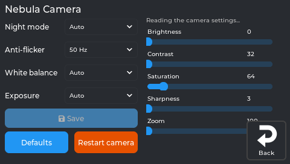
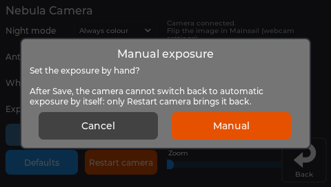
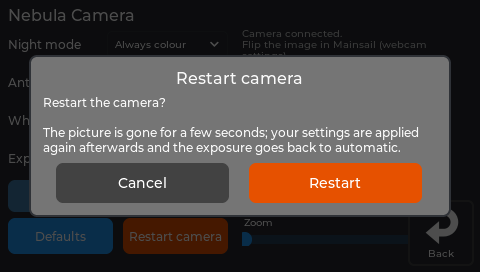
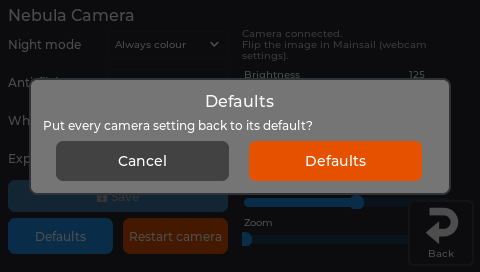

# Camera

NebulaOS streams any USB webcam to Mainsail. For Creality's **Nebula Camera** it also controls the
camera's own settings: night mode, anti-flicker and the picture.

## Settings → Display → Camera (Nebula Camera)

| Setting | Choices |
|---|---|
| **Night mode** | Auto (the camera switches to black-and-white in the dark), Always colour, Always black-and-white |
| **Anti-flicker** | Off, 50 Hz (Europe), 60 Hz (Americas): removes banding from room lights |
| **White balance** | Auto, or Fixed with a **Colour temp.** slider |
| **Exposure** | Auto, or Manual with an **Exposure** slider |
| Sliders | Brightness, Contrast, Saturation, Sharpness, Zoom |

A slider applies when you let go. The page shows whether a Nebula Camera is connected and its
firmware version.

- **Saved:** the settings are kept on the printer and applied again by themselves at every start,
  after unplugging and plugging the camera back in, and after a camera restart. The camera itself
  forgets everything when it loses power. Without a camera connected, changes are saved and applied
  when it is.
- **Manual exposure is one-way:** the camera cannot switch back to automatic exposure by itself.
  The page asks first; only **Restart camera** (or **Defaults**) brings automatic back.
- **Restart camera** restarts the camera's firmware: the picture is gone for a few seconds, then
  your settings come back. Refused while printing (the camera shares the USB hub with the printer
  board).
- **Defaults** puts every camera setting back to its default (asks first).
- **Flip or rotate** the picture in Mainsail's webcam settings.

The three questions the page asks:

*The real screen app, showing data from a printer running NebulaOS 1.0.0.*

*The real screen app, showing data from a printer running NebulaOS 1.0.0.*

*The real screen app, showing data from a printer running NebulaOS 1.0.0.*

## The same from Mainsail: Camera macros

Mainsail's **Camera** macro group has them next to the quality presets:

| Macro | What it does |
|---|---|
| `NEBULA_CAMERA_NIGHT_MODE MODE=AUTO` | Night mode: `AUTO`, `COLOR` or `BW` |
| `NEBULA_CAMERA_ANTI_FLICKER HZ=50` | Anti-flicker: `50`, `60` or `OFF` |
| `NEBULA_CAMERA_RESTART` | Restart the camera (not while printing) |
| `NEBULA_CAMERA_DEFAULTS` | Every camera setting back to its default |

They change the same saved settings as the screen. The console shows the result.

## Stream quality (any webcam)

| Macro | Stream |
|---|---|
| `SET_CAMERA_QUALITY_LOW` | 640×480 (least Wi-Fi traffic) |
| `SET_CAMERA_QUALITY_MED` | 1280×720 |
| `SET_CAMERA_QUALITY_HIGH` | 1920×1080 at 30 fps (the default) |

All camera macros are part of the NebulaOS image (`/etc/nebulaos/klipper/camera.cfg`).

## Recording a print

The same camera can record a timelapse of a print - off until you switch it on, and it needs
no slicer changes. See [Timelapse](Timelapse).
