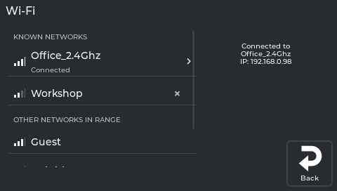
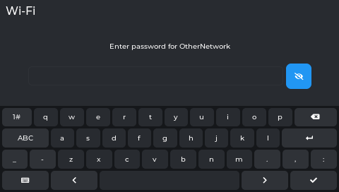
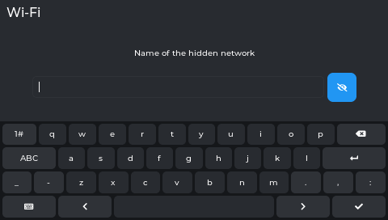
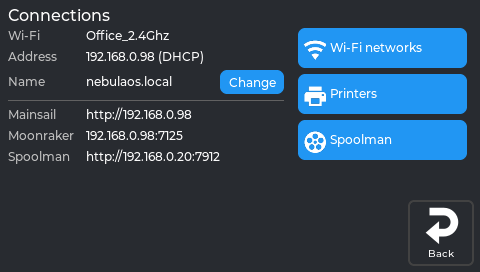
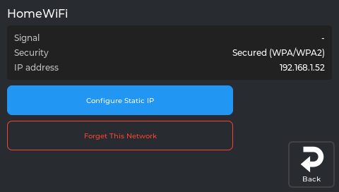
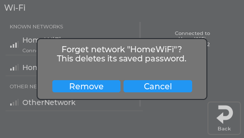
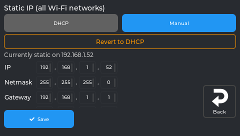
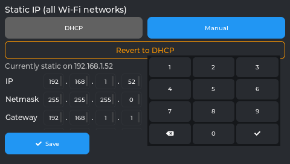
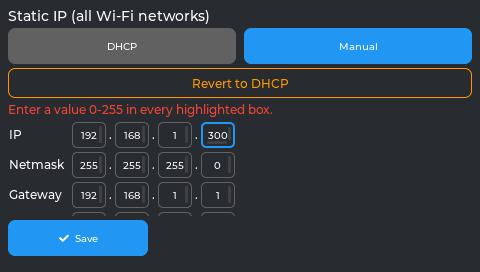
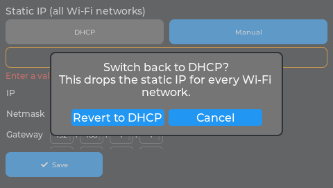

# Connecting to Wi-Fi

## What this guide will help you do

Join your printer to your home wireless network, so you can control it from a browser and
install updates without a USB stick.

## What you need

- Your Wi-Fi network name and password.
- A printer already running NebulaOS. If it is not, start at
  [Installing NebulaOS](Installing-NebulaOS).

Nothing moves and nothing heats up during this. It is safe to do at any time, including
during a print - though a print will not stop if the network drops, so there is no hurry.

## Before you begin

NebulaOS uses **2.4 GHz** Wi-Fi. If your router publishes separate names for its 2.4 GHz and
5 GHz networks, pick the 2.4 GHz one. If it uses a single name for both, you do not need to
do anything.

## Step-by-step

1. On the printer's screen, tap **Settings** (the gear icon).
2. Tap **Connections**. This page shows your current Wi-Fi network, the printer's address, its
   name, and the Mainsail, Moonraker and Spoolman addresses.
3. Tap **Wi-Fi networks**.
4. You now see two groups:
   - **KNOWN NETWORKS** - networks the printer has connected to before and remembers.
   - **OTHER NETWORKS IN RANGE** - everything else it can currently see.

   Each row shows signal strength as bars. More bars is better.
5. Find your network in the list and tap its row.
6. Type the password. The small eye button at the end of the field shows what you have typed,
   which is worth using - a mistyped Wi-Fi password is the single most common reason this step
   fails.
7. Confirm.

*The Wi-Fi networks panel. Saved networks appear first, then everything else in range, each
with signal bars. An example state: the names and signal levels stand in for real ones.*

*Step 6: the password field with its eye button. An example state, for a made-up network.*

### If your network does not appear

Some networks are set not to broadcast their name. For those, scroll to the end of the list
and tap **Other network (hidden)...**, then type the network name and password yourself.

*The real screen app.*

### If the network is open, with no password

Leave the password field empty and confirm.

## Expected result

- Your network moves into **KNOWN NETWORKS** and shows as connected.
- Going back to **Settings → Connections**, the **Address** line now shows an address like
  `192.168.1.42`. Write it down - the next guide needs it.

## Checking it worked, and seeing more detail

Tap the connected network's row - the one with a **›** on it - to open **Network Details**. It
shows signal strength, the security type, and the IP address.

From there you can also:

- **Configure Static IP** - give the printer a fixed address instead of one your router
  assigns. Most people do not need this; see below.
- **Forget This Network** - remove the saved network. The **✕** on a saved network in the list
  does the same; both ask first.

*The real screen app, showing data from a printer. Signal shows `-` here only because the picture was made without a Wi-Fi scan.*

*The real screen app. The network name stands in for a real one.*

## Troubleshooting

| What happens | What to do |
|---|---|
| The password is rejected | Retype it with the eye button on. Check for a capital letter you missed. |
| Your network is not listed | It may be hidden - use **Other network (hidden)...**. Or it may be 5 GHz only. |
| It connects, then drops | Check the signal bars. One or two bars next to a metal-framed printer is often the cause. |
| No **Address** appears after connecting | Wait a few seconds and look again; the address comes from your router. |
| Wi-Fi worked before and now does not | **Settings → System → Logs** can show the Wi-Fi lines of the system log. |

## A fixed address, if you want one

**Network Details → Configure Static IP** lets you set the address by hand. Two things to know
before you do:

- The setting is **global for Wi-Fi**, not per network. The panel is titled *"Static IP (all
  Wi-Fi networks)"* for that reason.
- NebulaOS checks a new setting before keeping it - for a static address, that the gateway
  answers; for DHCP, that a lease arrives - and **undoes it by itself if it does not work**.
  That check can take a couple of minutes, so do not assume a slow result means failure.

You need four values from your router: **IP**, **Netmask**, **Gateway** and **DNS**. Each is
entered as four boxes, and a number outside 0-255 turns red immediately. **Revert to DHCP**
appears once a static address is set.

*The real screen app, showing data from a printer running NebulaOS 1.0.0. Addresses are examples.*

Tapping a box opens a number keypad. A value outside 0-255 is marked, and nothing is sent:

*The real screen app. Addresses are examples.*

*The real screen app. An example state: 300 was typed in for the picture.*

**Revert to DHCP** asks first:

*The real screen app. Behind the question, the error line from the previous picture is still showing.*

Unless you have a reason to need a fixed address, DHCP is the simpler choice.

## Next step

[Opening Mainsail](Opening-Mainsail) - using the printer from a browser on your computer or
phone.
