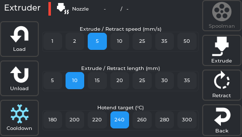
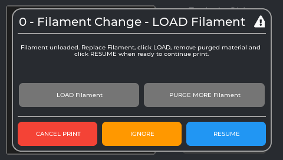
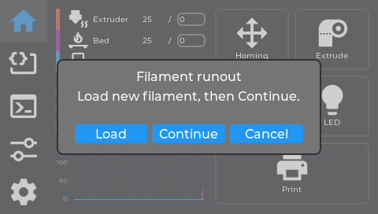
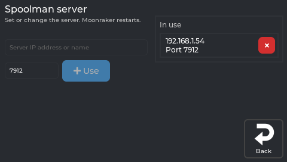
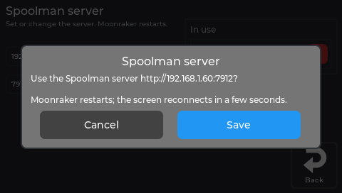

# Filament

## What this guide will help you do

Load filament, unload it, change colour, and understand what the printer does when filament
runs out mid-print.

## What you need

- Filament.
- A printer that is not printing, for loading and unloading.

## Before you begin

**The nozzle reaches 200 °C and above during all of this.** It does not look hot. Do not touch
the nozzle or the metal around it, and keep the front of the printer clear while filament
feeds.

Loading and unloading both heat the nozzle and both cool it down again by themselves
afterwards.

## Where the controls are

**Home → Extrude** opens the filament panel.

Six buttons - **Load**, **Unload**, **Cooldown** on the left; **Spoolman**, **Extrude**,
**Retract**, **Back** on the right - and three selectors in the middle: hotend target,
extrude/retract length, and extrude/retract speed.

**The hotend target here is a fixed list:** 180, 200, 220, 240, 260, 280 and 300 °C. If you
need an exact value like 215 °C, set it from the **Home** tab by tapping the temperature
instead - that opens a numpad. This selector only offers those seven.

## Loading filament

1. Cut the filament end at a clean angle. A squashed or stringy end jams.
2. Feed it into the extruder inlet until it will not go further easily. **Do this before you
   tap Load** - Load expects the filament to be in the throat already.
3. **Home → Extrude**.
4. Choose the hotend target for your filament - 200 °C suits most PLA, 240 °C most PETG.
5. Tap **Load**.
6. The nozzle heats, then filament feeds forward. If Spoolman is set up, it asks **"Use this
   filament?"** first.
7. Watch the nozzle. When the plastic coming out runs **clean and consistent in your new
   colour**, tap **Cooldown**.

**There is no separate Stop button during Load.** The on-screen message tells you to tap
**Cooldown** to stop, and Cooldown is the only button that stays active while loading. That is
the normal control, not an emergency exit.

The nozzle cools by itself once loading finishes.

## Unloading filament

1. **Home → Extrude**.
2. Choose the hotend target for the filament currently loaded.
3. Tap **Unload**.
4. The nozzle heats, retracts the filament back out of the throat, then cools down.
5. **Pull the filament out from the top of the extruder by hand** once it stops.

That last step is manual on purpose: the printer pulls the filament clear of the hot end but
does not eject the whole length.

## Changing colour

Unload, then load. A print that asks for a colour change (`M600`) shows this box and walks you
through the same steps:

*The real screen app, showing the text of NebulaOS's `M600` macro (the title scrolls).*

Expect to waste some filament - the new colour has to push the old one out
of the nozzle completely, which is exactly why you wait for the extrusion to run clean before
tapping **Cooldown**.

## Extruding and retracting by hand

For small, precise movements when the nozzle is already hot:

- **Extrude/Retract length** - how far each press moves: 5, 10, 15, 20, 25, 30 or 35 mm.
- **Extrude/Retract speed** - 1, 2, 5, 10, 25, 35 or 50 mm/s.
- **Extrude** and **Retract** each move that amount once, at that speed.

The nozzle must be hot, and Klipper enforces it. If you tap **Extrude** while it is cold, the
printer heats up first and then does the move, cooling again afterwards.

## Cooldown

Sets the hotend target to 0 immediately. It is also how you stop a Load in progress, and it
stays tappable while the nozzle is heating toward a pending Extrude or Retract, so you can
cancel that too.

## When filament runs out mid-print

If your printer has a filament sensor configured, the print pauses when filament runs out
rather than carrying on printing nothing.

To continue: load the new filament as above, then **Resume** on the print status screen.

*The screen's own runout dialog: **Load**, **Continue** or **Cancel**. Details in the [Screen reference](Screen-Reference#filament-runout-dialog).*

## Spoolman

If you use Spoolman, the **Spoolman** button opens the spool list, and loading asks which
filament you are using so it can track what you have left. The server is set under **Settings
→ Connections → Spoolman**. Spoolman is optional - everything else works without it.

*The real screen app, showing data from a printer running NebulaOS 1.0.0. Addresses are examples.*

Using a new server, or stopping, asks first, because Moonraker restarts:

*The real screen app. An example state: the address was typed in for the picture.*

There is no picture of the spool list yet: it comes from a Spoolman server, and the pictures
were made without one.

## Expected results

| Action | What you should see |
|---|---|
| Load | Nozzle heats, filament feeds, plastic comes out in the new colour, then cools |
| Unload | Nozzle heats, filament retracts, then cools; you pull it out by hand |
| Extrude / Retract | One movement of the length you selected |
| Cooldown | The target drops to 0 and the nozzle starts cooling |

## Troubleshooting

| What happens | What to do |
|---|---|
| Filament will not feed | Cut a fresh clean end, and make sure it is in the throat before tapping Load. |
| Nothing comes out, motor clicking | Nozzle not hot enough, or a blockage. Raise the target and try again. |
| The old colour keeps coming | Normal - keep going until it runs clean, then Cooldown. |
| Filament snapped inside | Unload; if nothing comes out you will need to clear it by hand. |
| Load will not stop | **Cooldown** is the stop control during Load. |
| It extrudes while cold and nothing happens | Klipper heats first, then moves. Wait. |

## Recovery and reversal

Loading and unloading are repeatable and harmless - if a load goes wrong, unload and start
again. Nothing here changes your configuration or calibration.

## Related

- [Printing](Printing)
- [Calibration guide](Calibration-Guide) - E-steps calibration affects how much filament is fed
