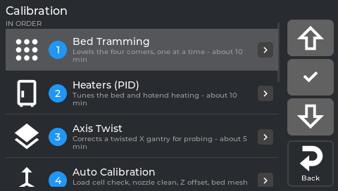

# 4. First calibration

## What this step does

Teaches NebulaOS where your bed is. Your old calibration does not carry over: even a printer that
was calibrated under its previous firmware starts fresh. One guided run, **Auto Calibration**,
gets most printers to a good first layer; the first print then fine-tunes it.

## What you need

- An **empty, clean bed** - nothing on it, no tools.
- About **7 minutes**.
- Nothing else: no paper, no tools, no computer.

**The printer moves and heats by itself during this.** Keep hands and tools clear once you tap
Start.

## Step by step

1. On the screen, tap **Tune** (the fourth tab), then **Calibration**.

   

   *The Calibration menu.*

2. Tap row **4 Auto Calibration**. Under it the screen says *"Load cell check, nozzle clean, Z
   offset, bed mesh - about 7 min, no tools needed"*.
3. Tap **Start**. The screen asks first:

   > *The printer will home, clean the nozzle, probe and mesh the bed, then restart Klipper.*
   >
   > *The bed must be empty.*

   Tap **Start** again.
4. Watch the page. It shows every step with check marks, the current one in large type with its
   live detail:

   ```
   Step 7 of 10                  ✓ Load cell check
   Measuring the Z offset        ✓ Homing
   touch 2 of 3                  ...
                                 > Measuring the Z offset
                                   Bed mesh
                                   Saving (Klipper restarts)
                                   Verifying
   ```

   The ten steps are: **Load cell check**, **Homing**, **Nozzle clean**, **Heating up** (bed 65 °C,
   nozzle 150 °C), **Settling**, **Load cell check (hot)**, **Measuring the Z offset**, **Bed
   mesh**, **Saving (Klipper restarts)**, **Verifying**.
5. During **Saving** the screen says *"Klipper restarts now to save the result. The screen
   reconnects by itself - do not switch the printer off."* Wait for it.

## What you should see

- **Done** with the date and the new values, for example *Z offset 1.669 mm (was 1.795)*, *Bed mesh
  9x9, range 0.16 mm* and *Your Z adjustment was reset to 0.*
- Back in the Calibration menu, row 4 has a green status line with the date and the result.

If it says **Failed: <step>**, the page also says *Why*, *What to do* and *Nothing was saved.* Fix
what it names and tap Start again.

## What it does not do

Auto Calibration measures the **Z offset and the bed mesh**, and checks the load cell. These stay
separate, each with its own row in the same menu, and most new printers do not need them on day
one:

- **Bed Tramming** - if one corner of the bed is much higher or lower than the others
- **Heaters (PID)** - if a temperature swings around its target
- **Axis Twist** - if the first layer is squished on one side and lifting on the other
- **Input Shaper**, **E-Steps**, **Skew Correction**, **TMC Autotune** - print quality later on

Which one fixes what you see: [Improve your prints](Improve-Your-Prints).

## Fine-tune on the first print

The last bit of the first layer is tuned by watching it, not by measuring. That is step 6,
[Your first print](Printing): while the first layer goes down, **Tune → Z Offset** nudges the nozzle
height, and every nudge is saved for the next print.

*From `extras/nebulaos_calibration.py:97-119` and `1736-1843` at extensions `f498796`, and
`src/nebulaos_calibration_status.cpp:34-35`, `194-215` and `src/guided_calibration_panel.cpp:559-561`
at screen `fd47cb6`.*

## Next step

[5. Set up your slicer](Slicer-Setup) - two lines of start and end G-code, once, before you
print anything.

Need help? [Troubleshooting](Troubleshooting) · How this works: [Calibration explained](Calibration-Explained)
