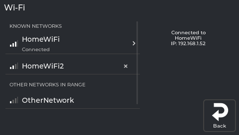
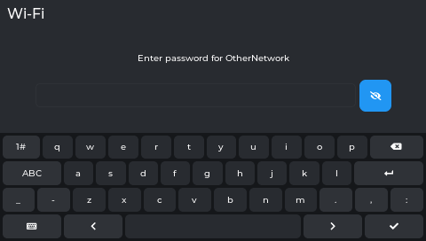
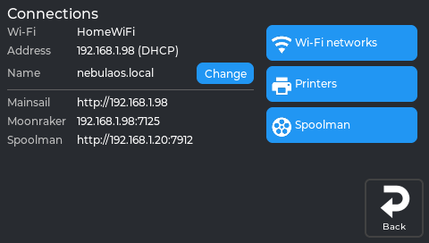

# 3. First start

## What this step does

Puts the printer on your Wi-Fi and opens it in your browser. Nothing moves and nothing heats up
during this.

## What you need

- NebulaOS installed and its screen showing - [2. Install NebulaOS](Installing-NebulaOS). If you
  came from stock Creality firmware, do the one power cycle first (it is in that step).
- Your **2.4 GHz** Wi-Fi name and password. If your router publishes separate names for its 2.4 and
  5 GHz networks, pick the 2.4 GHz one.
- A computer, tablet or phone on the same network.

The first start of NebulaOS takes about a minute. Later starts take about 15 seconds.

## Connect to Wi-Fi

1. On the printer's screen, tap **Settings** (the gear icon, last tab on the left).
2. Tap **Connections**. This page shows the current Wi-Fi network, the printer's address, its
   name, and the Mainsail, Moonraker and Spoolman addresses.
3. Tap **Wi-Fi networks**. You see two groups:
   - **KNOWN NETWORKS** - networks the printer has connected to before and remembers;
   - **OTHER NETWORKS IN RANGE** - everything else it can currently see.

   Each row shows signal strength as bars.
4. Tap your network's row.
5. Type the password. The small eye button at the end of the field shows what you have typed -
   worth using, because a mistyped password is the most common reason this fails. For an open
   network, leave the field empty.
6. Confirm.

*The Wi-Fi networks panel. An example state: the names and signal levels stand in for real ones.*

*The password field with its eye button. An example state, for a made-up network.*

**Your network is not in the list?** Some networks do not broadcast their name. Scroll to the end
and tap **Other network (hidden)...**, then type the name and password yourself.

## Find the printer's address

Back on **Settings → Connections**, the **Address** line now shows an address like `192.168.1.42`.

*Read the **Address** line here; the printer's name is just below it. The real screen app at screen `fd47cb6`, with its example data.*

The printer also answers to its own name, so you do not have to remember the numbers. NebulaOS
names a new printer `nebulaos-` followed by four characters from its own hardware, for example
`nebulaos-4f2a`, so two printers on one network do not collide. **Change** next to **Name** renames
it. The address is then `http://<name>.local`. This works on most home networks but not all - some
routers and some Android versions do not support it; then use the numbers.

## Open Mainsail

Mainsail is a web page served by the printer itself. You do not install anything and you do not
need an account or an internet connection.

1. On your computer or phone, open a web browser.
2. Type the address into the address bar - for example `192.168.1.42` or `nebulaos-4f2a.local` -
   and press Enter. Do not add `www.` and do not search for it.
3. Mainsail opens with your printer's dashboard: temperatures, a file list and controls.

Bookmark it. The screen and Mainsail show the same printer and work at the same time.

## Troubleshooting

| What happens | What to do |
|---|---|
| The password is rejected | Retype it with the eye button on. Check for a capital letter you missed. |
| Your network is not listed | It may be hidden - use **Other network (hidden)...**. Or it may be 5 GHz only. |
| It connects, then drops | Check the signal bars. One or two bars next to a metal-framed printer is often the cause. |
| No **Address** appears after connecting | Wait a few seconds and look again; the address comes from your router. |
| The page does not load | The computer or phone must be on the same network - not a guest network or mobile data. |
| `.local` does not work but the numbers do | Your network does not support `.local` names. Use the numbers. |
| The address has changed | Your router may hand out a different one after a restart. Read it again on **Settings → Connections**, or set a fixed address: [Settings → Connections](Screen-Connections#static-ip-panel). |
| Mainsail loads but cannot reach the printer | Klipper may still be starting. Wait a minute and reload. |

## Next step

[4. First calibration](First-Calibration) - one guided run, about 7 minutes.

Need help? [Troubleshooting](Troubleshooting) · How this works: [Mainsail and Moonraker](Mainsail-And-Moonraker)
