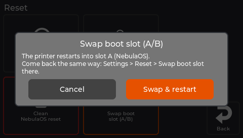

# Going back to your old firmware

## What this guide will help you do

Return the printer to the system you had before NebulaOS - stock Creality firmware or OpenKE.

## What you need

Nothing, if NebulaOS still starts. Otherwise see [Recovery](Recovery).

## Before you begin

- Your old system is still installed. NebulaOS was written into the printer's **second**
  system slot and left the first one alone.
- Your print files, `printer.cfg`, macros, Wi-Fi networks and screen settings live on a shared
  data area. They **survive** the switch, in both directions.
- **Read this before you press anything:** a stock Creality or OpenKE slot has no NebulaOS
  swap button. Once you switch into it, coming back to NebulaOS needs SSH, a reinstall with
  Creality's updater, or USB recovery - not a button on a screen.

## Steps

1. On the printer, go to **Settings → Reset → Swap boot slot**.
2. Read the confirmation. It names what is installed in the other slot, so you can check you
   are about to start what you think you are.
3. Confirm. The printer restarts into your old system.

This is blocked while a print is running.

*The confirmation names what is installed in the other slot. Read it before confirming.*

## Expected result

The printer starts into stock Creality firmware or OpenKE, looking the way it did before you
installed NebulaOS.

## Important, once you are back

Creality's system installs its own mainboard firmware when it starts from cold, and NebulaOS
reinstalls its own when you come back - automatically, at boot, whenever it finds a known
Creality version there. So moving between the two is recoverable in both directions without
you doing anything, and the power switch is fine.

The one thing to avoid is switching the printer off *while* mainboard firmware is being
installed. The screen tells you when that is happening. See [Safety first](Safety-First).

## Troubleshooting

| What happens | What to do |
|---|---|
| The swap button is greyed out or refuses | A print is running. Stop it first. |
| The printer does not come up after the switch | [Recovery](Recovery), option 3 or 4. |
| You are now on stock and want NebulaOS back | Install it again: [Installing NebulaOS](Installing-NebulaOS). |

## Coming back to NebulaOS later

Install it the same way you did the first time - [Installing NebulaOS](Installing-NebulaOS).
Your files and settings are still on the shared data area, so you are not starting from
nothing.
