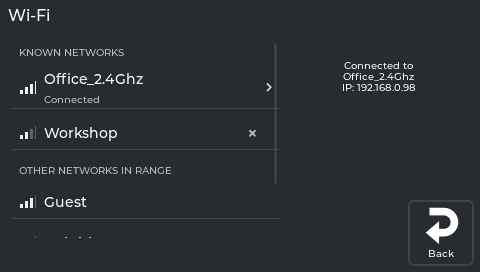

# Installing NebulaOS

## What this guide will help you do

Put NebulaOS onto your Creality Ender-3 V3 KE. When you are done, the printer starts into
NebulaOS, and your old system is still there in the other slot in case you want it back.

## What you need

- A Creality Ender-3 V3 KE. Nothing else is supported - see
  [Supported hardware](Supported-Hardware).
- The NebulaOS image file and its checksum, from
  [NebulaOS releases](https://github.com/NebulaOS-KE/NebulaOS/releases). For 1.0.0 those are:

  | File | What it is |
  |---|---|
  | `NebulaOS-Ender3V3KE-1.0.0.img` | **The one you need.** The image Creality's updater installs |
  | `NebulaOS-Ender3V3KE-1.0.0.img.sha256` | Its checksum, for the optional download check below |
  | `NebulaOS-Ender3V3KE-1.0.0.ingenic` | Only for USB recovery on a printer that will not start - see [Recovery](Recovery). **Not** for a normal install |
  | `NebulaOS-Ender3V3KE-1.0.0.ingenic.sha256` | Its checksum |
  | `nebulaos-release.json` | Machine-readable release details; the printer uses it for online updates |

  Download the `.img` and, if you want to check it, the `.img.sha256`.
- **If you are coming from stock Creality firmware:** a USB stick formatted as FAT32.
- **If you are coming from OpenKE:** your usual SFTP and SSH tools, and OpenKE's root
  password.
- About 15 minutes, and a printer you do not need to use during them.

## Before you begin

- Read [Safety first](Safety-First). The point that applies here: switching between systems is
  safe, but **do not switch the printer off while mainboard firmware is being installed** - the
  screen tells you when that is happening.
- Make sure no print is running.
- **Do not rename the image file.** Creality's updater finds the parts inside the file by its
  name. A renamed file stops with `failed to get .../ota_config.in` and installs nothing.
- Check your download if you can. On Linux or macOS, in the folder with both files:

  ```
  sha256sum -c NebulaOS-Ender3V3KE-1.0.0.img.sha256
  ```

  You want to see `OK`. If it says `FAILED`, download the file again - do not install it.

## 1. Which route are you on?

| Your printer right now | Go to |
|---|---|
| Stock Creality firmware, with Creality's touchscreen | Section 2b |
| OpenKE, usually with no Creality touchscreen | Section 2a |

If you are not sure, you are almost certainly on stock Creality firmware: section 2b.

## 2a. From OpenKE, over SSH

You need the SFTP and SSH tools you already use with OpenKE - for example WinSCP, FileZilla or
`scp` for copying, and PuTTY or a terminal for the shell. Log in as `root` with **OpenKE's**
password (the system running on the printer now, not NebulaOS's). The examples use `1.0.0`;
if you downloaded a different version, use its number.

1. Copy `NebulaOS-Ender3V3KE-1.0.0.img` to `/usr/data/` on the printer. Do not rename it.
2. In an SSH session on the printer, run:

   ```
   /etc/ota_bin/local_ota_update.sh /usr/data/NebulaOS-Ender3V3KE-1.0.0.img
   ```

   Wait for `ota update ok`. A line `sh: 1.1.0.15: bad number` on the way is harmless - it
   comes from the updater's own version check and stops nothing.
3. Then, in the same session:

   ```
   reboot
   ```

   The updater does not restart the printer by itself, so this step is required.

Now go to section 3.

## 2b. From stock Creality firmware, using the touchscreen

This is the usual route if your printer still has Creality's software on it.

1. Copy `NebulaOS-Ender3V3KE-1.0.0.img` to the top level of a FAT32 USB stick. Do not put
   it in a folder, and do not rename it.
2. Plug the USB stick into the printer.
3. Start the update from Creality's own screen, the same way you would install a Creality
   firmware update.

Creality's screen uses the same updater as section 2a, and it restarts the printer itself when
it finishes.

Now go to section 3.

## 3. First start

The first start of NebulaOS takes about a minute. Later starts take about 15 seconds. Do not
switch the printer off while you wait.

When it comes up:

1. Connect to Wi-Fi: **Settings → Connections → Wi-Fi networks**. Step-by-step in
   [Connecting to Wi-Fi](Connecting-To-WiFi).

   
2. Calibrate the printer once before printing - the calibrations from your old system do not
   carry over. [Calibration guide](Calibration-Guide).
3. If you came from OpenKE, delete the copied image to free the space it used - in an SSH
   session on the printer:

   ```
   rm /usr/data/NebulaOS-Ender3V3KE-1.0.0.img
   ```

Mainsail is now at `http://<printer-ip>` in a web browser, or
`http://<printer-name>.local`. See [Opening Mainsail](Opening-Mainsail).

Your printer has given itself a name like `nebulaos-4f2a` - four characters derived from its
own hardware, so that two printers on one network do not collide. You can change it on
**Settings → Connections → Name → Change**.

**If you ever need SSH**, the root password on a **newly installed** NebulaOS is `NebulaOS`.
You do not need SSH for normal use, and you should change that password if your printer is
reachable from beyond your own network.

**Upgrading from an earlier NebulaOS?** Your existing password is kept. The printer stores it
separately from the system image, so it survives updates - including this one. If you never
changed it, it is still the old default (`openke`), not `NebulaOS`.

Once you are in, the prompt shows the printer's name and the directory, like
`root@nebulaos-4f2a:~#`. Worth a glance if you have more than one printer - it is the quickest
way to be sure which one you are typing into.

*One screenshot is still missing here: the NebulaOS screen as it looks on the very first
start. The simulator's screenshot tour does not cover the boot and init screens, so this one
needs a photograph of a real printer starting up.*

## Expected result

- The printer starts into NebulaOS, showing the NebulaScreen interface rather than Creality's.
- **Settings → System** reports a NebulaOS version.
- Mainsail opens in a browser on the same network.
- Your old system is still installed in the other slot.

## If it stops

Every check runs **before** anything is written. If the updater prints `ota: error` before it
prints `ota: started`, then nothing was changed and your printer is still running its old
system exactly as before.

| What you see | What it means |
|---|---|
| `failed to get .../ota_config.in` | The file was renamed. Download it again and keep the original name. |
| `sh: 1.1.0.15: bad number` | Harmless. Not an error you need to act on. |
| `ota: error` before `ota: started` | Nothing was written. The old system is intact. |
| `FAILED` from the checksum command | The download is damaged. Download it again. |
| Nothing on the screen after the restart | Go to [Recovery](Recovery). |

If something else happens, please report it with the output you saw:
[Troubleshooting](Troubleshooting).

## Going back

Your old system is still in the first slot. [Going Back](Going-Back) covers the options:
the swap-boot-slot button on the NebulaOS screen, SSH, and USB recovery for a printer that
will not start at all.

Worth knowing now, so it is not a surprise later: your `printer.cfg`, macros, Wi-Fi networks,
uploaded files and screen settings live on a shared data area and **survive** a slot switch in
either direction.

## Later updates

Once NebulaOS is running, it updates itself from the screen - no USB stick and no SSH. See
[Updating NebulaOS](Updating-NebulaOS).

## Next step

[First-time setup](First-Time-Setup) - Wi-Fi, Mainsail, calibration, your slicer and your first
print, in that order.
