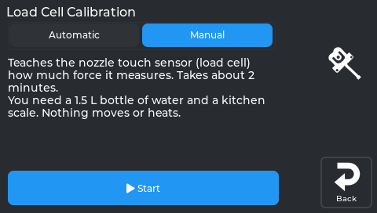
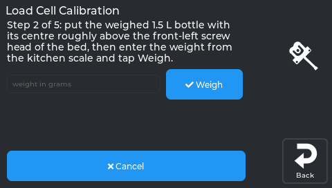
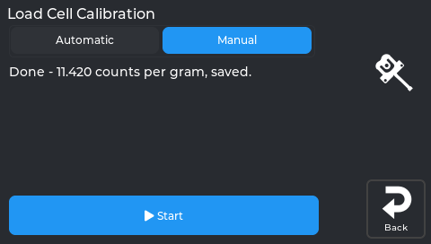

# Load cell calibration (water bottle)

The KE measures the Z offset by gently touching the bed with the nozzle. The
touch is felt by a **load cell** under the **front-left bed screw**. Once, the
printer has to learn how much force that sensor measures. That is this
calibration. It takes about 2 minutes. Nothing moves or heats.

*Load cell calibration, before it starts.*

*Entering the weight of your bottle.*

*Calibration complete.*

You need:
- a **1.5 L bottle**, full of water;
- a **kitchen scale**.

Start it from **Calibration → 3 Load Cell** on the screen, or run the
`NEBULAOS_LOAD_CELL_CALIBRATE` macro in Mainsail. If the Z offset ever needs a
calibration that is missing, a popup offers it.

## The steps

1. **Empty bed.** Remove everything from the bed. The nozzle must not touch
   it. Tap **Check**. The printer checks the sensor and takes the empty
   reading.
2. **Bottle on.** Weigh the full bottle on the kitchen scale. Stand it with
   its **centre roughly above the front-left screw head** of the bed. Set the
   weight from the scale:
   - on the screen, type it;
   - in Mainsail, use the -100 … +100 buttons. 1500 g is pre-filled.

   Tap **Weigh**.
3. **Lift it and put it back** in the same place, then tap **Continue**. The
   printer shows "Printer measures N g, your scale said M g". They should
   agree.
4. **Remove the bottle**, then tap **Continue**. The reading must return to
   zero.
5. **Optional finger test.** Press the front-left corner gently and tap
   **Measure**. The printer shows the force. Tap **Continue** when done.
6. **Apply & Save.** Klipper restarts with the new calibration.

Nothing is saved before step 6. **Cancel** works at every step.

## If a step says "Problem"

The step stays where it is. Fix the cause and tap the same button again.

| Message | What to do |
|---|---|
| The load cell sensor is not working properly | Check the cable under the front-left corner. |
| The reading is not stable | Don't touch the printer. Wait until the bottle stands still. |
| Enter the weight in grams, between 1000 and 5000 | You typed a wrong number (for example 150 instead of 1500). |
| The printer barely felt the weight | Put the bottle centred above the front-left screw head, or use two bottles. |
| The weight is too heavy | Use a lighter weight. |
| The printer measures … your scale said … | The bottle moved or touches something. Put it back and try again. |
| The bed does not return to zero | Something is stuck on or under the bed. |

## Why a bottle is good enough
- The Z offset itself does **not** depend on this calibration. The
  calibration only sets how hard the nozzle may press (75 g) and the safety
  limit (2 kg).
- A bottle a little off the screw reads low. The printer then stops a touch
  a little earlier, which is the safe side.
- A typed weight that is far too low would be unsafe, so only 1000–5000 g is
  accepted.

## After changing the front-left corner
If you shim, replace or adjust the **front-left** bed corner (see
[Bed tramming](Bed-Tramming)), calibrate the load cell again.
