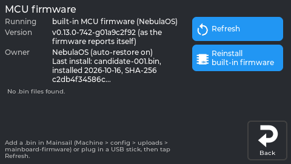
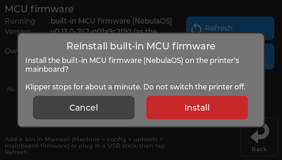

# Mainboard firmware

## What this page will help you do

Understand the small piece of firmware on the printer's mainboard, why it changes by itself when
you switch systems, and how to install a different one if you need to.

## What you need

Nothing for the normal case - NebulaOS manages this on its own. For installing a specific
firmware file: a `.bin` file, and either a USB stick or Mainsail.

## The short version

The mainboard has its own firmware, separate from the system NebulaOS replaces. Each system
needs its own version, and **each system puts its own version back automatically**:

- Creality's system installs its firmware when it starts from cold.
- NebulaOS checks the board at every boot and reinstalls its own if it finds a known Creality
  version there.

So switching between systems is safe and self-correcting, and you cannot get stuck by using
the power switch.

**The one time you need to act: after a software restart from Creality's system.** When the
printer restarts by software from Creality's system into NebulaOS - as Creality's updater does
when you install NebulaOS from the stock touchscreen - the mainboard does not accept new
firmware until its power has been cut. NebulaOS's install of its mainboard firmware fails, and
Klipper shows an MCU error. Switch the printer off, wait 10 seconds, switch it on: NebulaOS then
installs its firmware by itself. Do not switch off while that runs. There is no software way to
do this, because nothing in the printer can reset the mainboard except its power. From 1.0.1
the screen shows a notice telling you to do this.

**Firmware you installed yourself is left alone.** NebulaOS only replaces what it recognises as
a known Creality version. If you deliberately installed something else, it stays.

## The one thing worth waiting for

**Do not switch the printer off while firmware is being installed.** The screen tells you when
that is happening - it says not to switch off, and that Klipper is stopped. It takes a short
time. Wait for it.

**If it does get interrupted.** The board keeps Creality's small built-in loader in a place
firmware installs never write; only the firmware on top of it is replaced. An interrupted
install therefore leaves the loader in place and the firmware incomplete, and the printer will
not print until the firmware is written again.

What to do:

1. Switch the printer on again and let NebulaOS start.
2. NebulaOS does **not** rewrite firmware it does not recognise by itself, and a half-written
   firmware is one it does not recognise. It starts Klipper anyway and leaves the board alone.
3. Install the firmware again yourself: **Settings → Printer → MCU firmware → Reinstall
   built-in firmware**, as below. Do not switch off while it runs.
4. If the screen says the mainboard is not answering, switch the printer off, wait 10 seconds,
   switch it on, and try step 3 again.
5. If the board still does not answer, see [Recovery](Recovery) and report it with what the
   screen showed: [Troubleshooting](Troubleshooting).

## Where the controls are

**Settings → Printer → MCU firmware.**

| Option | What it does |
|---|---|
| **Built-in MCU firmware** | Reinstalls the version that came with your NebulaOS image |
| **Install MCU firmware** | Installs a `.bin` file you provide |

To provide a file, put it either on a USB stick, or upload it in Mainsail to **Machine →
config → uploads → mainboard-firmware**. The screen lists what it finds.

*The printer's own display, running NebulaOS 1.0.0. The* Last install *line shows that printer's own history.*

## Step-by-step: reinstalling the built-in firmware

Worth doing if the screen reports it cannot reach the board, or after you have been running
another system.

1. **Settings → Printer → MCU firmware**.
2. Tap **Built-in MCU firmware**.
3. Confirm.

   

   *The real screen app, showing data from a printer running NebulaOS 1.0.0.*

4. **Wait.** Klipper stops, the board is reflashed, and Klipper restarts. The screen says not to
   switch off while this runs.
5. The screen reports the firmware it now finds on the board.

## Step-by-step: installing your own firmware file

1. Put the `.bin` on a FAT32 USB stick, **or** upload it in Mainsail to **Machine → config →
   uploads → mainboard-firmware**.
2. **Settings → Printer → MCU firmware → Install MCU firmware**.
3. Pick your file from the list.
4. Confirm, and wait as above.

Once you have installed your own firmware, NebulaOS will not replace it at boot - it only
reinstalls over a version it recognises as Creality's.

## Expected result

The screen reports the board running the firmware you installed, and Klipper connects.

## Troubleshooting

| What happens | What to do |
|---|---|
| MCU error right after installing NebulaOS from stock Creality firmware | Switch the printer off, wait 10 seconds, switch it on, once. Reinstalling from the screen does not help until the power has been cut. |
| "Klipper can't reach the board" | Reinstall the built-in firmware, as above. |
| No files are listed | Check the USB stick is FAT32, or that the upload went to **uploads → mainboard-firmware**. |
| You switched off during a flash | Switch on again, then **Reinstall built-in firmware**. See "If it does get interrupted" above. |
| The firmware changed by itself after switching systems | Expected - each system reinstalls its own. See the short version above. |

## Recovery and reversal

**Built-in MCU firmware** is the way back from any firmware you installed. It is always
available and does not need a file.

## Related

- [Safety first](What-NebulaOS-Is#safety-first)
- [Going back to stock](Going-Back)
- [Recovery](Recovery)
