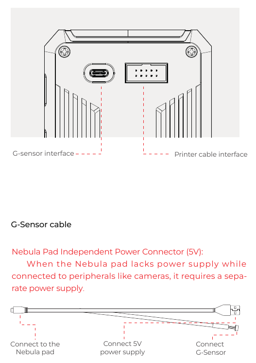
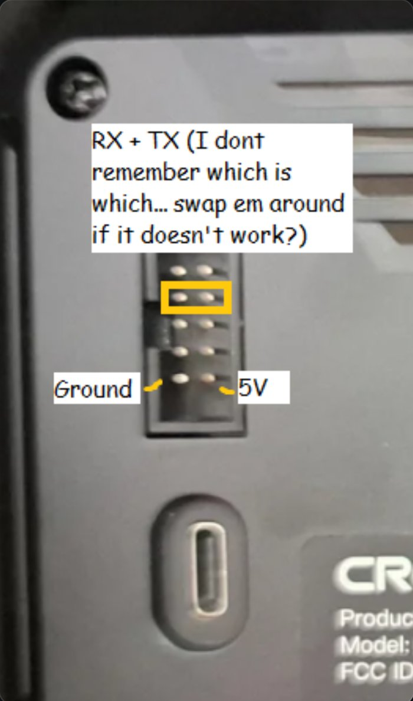
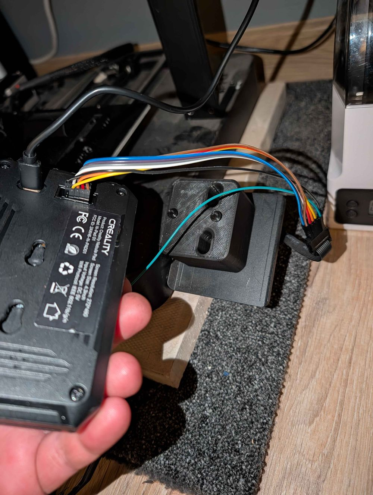
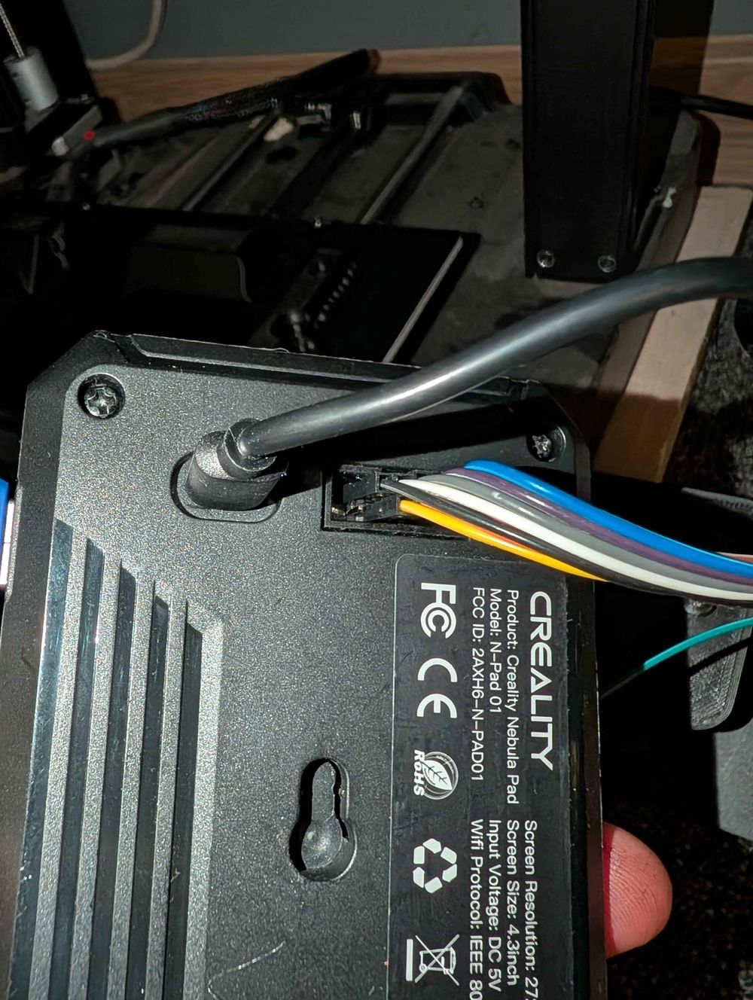
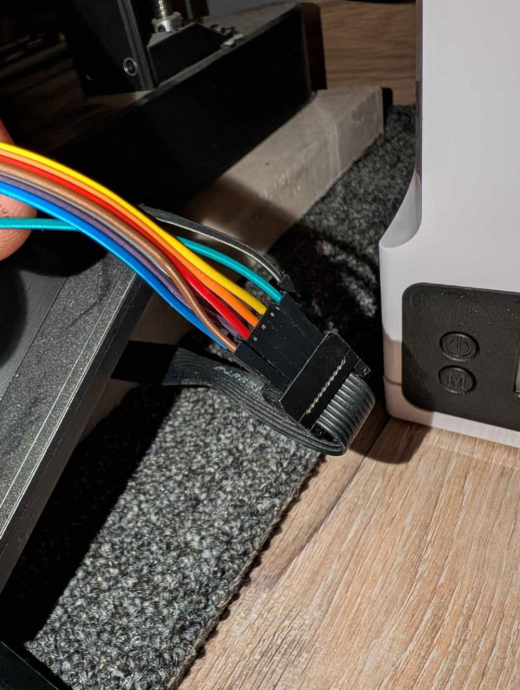

# Powering the Nebula Pad: what Creality's manual tells us

The Creality Ender-3 V3 KE comes with a Nebula Pad, a small computer that controls the
printer. It supports a USB camera, USB storage and a vibration sensor for Input Shaper.
What is much less widely known is that **Creality already documents that the Nebula Pad
can run short of power when USB accessories are connected.**

Creality even provides a connection for a separate 5 V power supply. You do not need to
open the printer to use that connection with the intended cable.

Many KE owners know the rear USB-C-shaped socket only as the place to connect the
vibration sensor. Its second purpose is easy to miss, particularly if you bought the KE
with its pad already installed rather than buying the Nebula Smart Kit separately.

This page explains that hardware feature, why it matters and how it relates to the
unexpected restarts some owners have experienced. It is relevant whether you run
Creality's original firmware, NebulaOS or another operating system.

## In short

- Most printers run fine. If yours does, there is nothing to change.
- If yours **freezes or restarts in the middle of a print**, especially with a **camera** (and a
  USB stick) connected: first try a print **without the camera**. If that runs fine, give the
  camera its own power. The easiest way is a **powered USB hub** for the camera and USB stick -
  [your options](#your-options-for-additional-power).
- Keep NebulaOS up to date (1.0.5 or newer). If it still freezes **with extra power
  connected**, send us the logs - [If you experience a freeze](#if-you-experience-a-freeze).

## Creality's own documentation

In the *Creality Nebula Smart Kit Instruction Manual*, version 2.0, printed page **02**
(page 6 of the PDF), Creality describes the G-Sensor cable:

> **Nebula Pad Independent Power Connector (5V):**
>
> When the Nebula pad lacks power supply while connected to peripherals like cameras,
> it requires a separate power supply.



*From the original Creality Nebula Smart Kit Instruction Manual V2.0, page 02.*

[Read the original manual, including the connector diagram](https://cdn.shoplazza.com/460f5a6ea69aec3b68da2eb725ad78b1.pdf#page=6).

This is not a modification developed by the NebulaOS community. It is a power input
that Creality designed into the pad and documented in its own manual. The manual
specifically mentions cameras: the same accessories the pad is marketed to support.
The underlying power limitation therefore predates NebulaOS, even though different
firmware can affect how often it becomes apparent.

## Why the pad may need its own power supply

On the KE, the Nebula Pad normally gets its electricity from the printer's mainboard.
The printer's 24 V supply is converted to 5 V on that board and sent to the pad through
the original printer cable. The pad's USB accessories also draw power from that supply.

```text
                 Printer's 24 V power supply
                             |
                      Printer mainboard
                     (24 V converted to 5 V)
                             |
                      Original pad cable
                             |
                        Nebula Pad
                       /          \
                 USB camera     USB stick
```

The screen, processor, memory, Wi-Fi, camera and storage are sharing a limited power
budget. On the KE mainboard investigated by the community, that budget is estimated
at around 2 A at 5 V, or 10 W. The actual usable capacity depends on the board and its
components; this is not a universal specification for every revision.

The problem does not have to be constant. The available voltage can dip briefly when
several components demand power at once. A camera and USB stick add to the load, and
changes in the printer's heater load can also affect the upstream power system. A dip
may be too short for you to notice the screen dimming, yet still disrupt a USB device
or potentially stop the pad's processor.

This is why two apparently identical printers can behave differently. One may run for
years with its camera connected; the other may occasionally restart with the same
accessories. A printer that works reliably does not need an extra supply simply because
another owner needs one.

## Your options for additional power

There are different ways to give the Nebula Pad more room in its power budget. You can take
the camera and USB stick off the pad's supply, or power the pad itself from a separate 5 V
supply. Options 1 and 2 need no tools and no changes to the printer; options 3 and 4 are
modifications; option 5 is not confirmed yet.

**Easiest to start with: option 2, a powered USB hub.** It needs no special cable, nothing
has to be swapped for Input Shaper, and it takes the camera's load off the pad completely.

| Option | What you need | What it does | Status |
|---|---|---|---|
| **1. Creality G-Sensor Y-cable** | The three-ended Creality cable and a regulated 5 V USB adapter | Adds power to the pad through Creality's documented input; the G-Sensor stays connectable | Creality's own solution |
| **2. Powered USB hub** | A USB hub with its own power adapter | The camera and USB stick get their power from the hub instead of the pad | **Easiest**, no changes to the printer |
| **3. USB power in the rear socket, printer's ground wire unplugged** | Jumper wires, a USB-A-to-USB-C cable and a 5 V USB adapter | The pad runs on the USB adapter | Modification, in daily use by a community member |
| **4. Buck converter, printer's 5 V wire unplugged** | Jumper wires and a 24 V → 5 V buck converter (3 A or more) | The pad runs on its own 5 V, made from the printer's 24 V supply | Modification |
| **5. Plain USB cable in the rear socket** | A USB-A-to-USB-C cable and a 5 V USB adapter | Adds a second supply next to the printer's 5 V | **Not confirmed** - see the warnings |

Look at the **back of the Nebula Pad**: next to the large rectangular connector that connects
it to the printer is a small USB-C-shaped socket. That is the G-Sensor socket, and also
Creality's documented independent power input. The two USB-A sockets on the side are where you
normally connect your camera and USB stick.

### Option 1: the Creality G-Sensor Y-cable

This is the manufacturer's intended way to add power. The cable has three ends: a
USB-C-shaped plug for the pad, a USB-A plug for the separate 5 V supply, and a small
plug for the G-Sensor. With this cable you do not need to disconnect the extra power
to run Input Shaper.

Some retail Nebula Smart Kits already include it. Check the accessories that came with
your pad; not every KE owner's cable has the extra power branch.

```text
       Regulated 5 V USB power adapter
                       |
                USB-A power plug
                       |
               Creality G-Sensor Y-cable ----- G-Sensor (when needed)
                       |
                Rear G-Sensor socket
                   [ Nebula Pad ]
                       |
               Original printer cable
                       |
                 KE mainboard
```

*Physical connection diagram, not an internal electrical schematic.*

For a compatible pad and printer, follow Creality's documented arrangement:

1. Finish your print, shut down and switch off the printer and external supply.
2. Plug the Creality Y-cable into the rear G-Sensor socket. Leave the normal printer
   connection in place; the manual does not instruct you to cut or disconnect its wires.
3. Plug the USB-A power branch into a suitable regulated **5 V** USB power adapter
   approved for this setup.
4. Leave the sensor branch empty for normal printing, or connect the G-Sensor when
   running Input Shaper. The camera and USB stick stay in their usual side USB sockets.
5. Power up according to the manufacturer's instructions and check that the printer
   and its accessories work normally.

If you do not have the cable, ask Creality or a spare-parts supplier for the **Nebula
Smart Kit G-Sensor Type-C cable with independent 5 V power input** and show them the
manual diagram above. A [translated service article](https://breva.com.ar/wiki/creality/accesorios/troubleshooting/el-sensor-de-vibracin-parpadea-despus-de-conectarlo-a-la-ender-3-v3-ke)
mentions part number `3103110575`, but the exact standalone replacement cable and
power-branch variant have not been independently confirmed. Do not buy a cable solely
on the basis of that number.

We don't know how this cable is wired inside: whether its power branch connects only 5 V, or
5 V and ground. That is why option 5 below is not confirmed.

### Option 2: a powered USB hub

The easiest option. A powered USB hub is a hub that comes with its own power adapter. It still
sends data to the pad, but the camera and USB stick draw their power from the hub instead of
from the pad.

```text
       Hub's own power adapter
                  |
             Powered USB hub ----- USB camera
                  |           \--- USB stick
                  |
          Side USB-A socket (data)
             [ Nebula Pad ]
                  |
          Original printer cable
                  |
            KE mainboard
```

1. With the printer shut down and the supplies off, connect the hub's upstream cable
   to one of the pad's side USB-A sockets.
2. Connect the camera and USB stick to the hub rather than directly to the pad.
3. Connect the hub's own power adapter, power up and check that the camera and storage work
   normally.

Choose a self-powered hub that does **not** feed power backwards into its host USB
port. An unpowered USB splitter does not help: it still draws all its power from the
pad. The G-Sensor socket stays free, so Input Shaper works as usual with its original
cable.

This does not add power to the pad itself. It removes the load of the connected accessories
from the pad's supply. If the pad still freezes with the camera on a powered hub, the other
options give the pad itself more power - and please
[report it](#if-you-experience-a-freeze): that is the most useful result for us.

### Options 3 and 4: the pad no longer powered by the printer

With option 1, the printer's 5 V and the extra supply feed the pad **at the same time**.
Which of the two does most of the work depends on which voltage is slightly higher, so the
extra supply may help less than expected. Options 3 and 4 make the pad run only on a supply you
choose.

**These are modifications.** They are for people who are comfortable with wiring and a
multimeter, and you do them at your own risk. Do not cut the original cable: use jumper wires
between the cable and the pad, so you can always go back. Work only with the printer switched
off and unplugged.

The pad's large rectangular connector carries the serial link to the mainboard (RX and TX),
**5 V** and **ground**. The community picture below shows which pins are which:



*Community picture from r/Creality. Check 5 V and ground with a multimeter on your own
printer before you connect anything.*

### Option 3: USB power in the rear socket, printer's ground wire unplugged

This is how ukiduki1 runs their KE: the printer's ribbon cable goes to the pad through jumper
wires, the **ground wire is left unplugged at the pad** (the separate wire in the pictures),
and the pad gets its power from a USB adapter with a **USB-A-to-USB-C** cable in the rear
socket. RX, TX and 5 V stay connected. Without the ground wire, the printer's 5 V has no return
path through the cable, so the pad takes its power from the USB adapter, and the USB adapter's
ground becomes the pad's ground.







*Photos: ukiduki1.*

- Use a USB-A adapter and a **USB-A-to-USB-C** cable. A USB-C charger with a USB-C-to-USB-C
  cable will usually not switch on: see [Inside the rear socket](#inside-the-rear-socket).
- The pad needs the USB adapter now. For Input Shaper, swap the power cable for the G-Sensor
  cable **and plug the ground wire back in first**, so the pad is powered by the printer again
  for that session. Afterwards, unplug the ground wire again before you reconnect the adapter.

### Option 4: a buck converter, printer's 5 V wire unplugged

A small 24 V → 5 V step-down ("buck") converter, rated **at least 3 A**, fed from the printer's
own 24 V power supply, powers the pad's 5 V pin instead of the mainboard's 5 V. The mainboard's
**5 V wire is unplugged at the pad**; RX, TX and ground stay connected, and the converter's
output ground goes to the pad's ground pin.

The pad then switches on and off with the printer as before, and the G-Sensor socket stays free
for Input Shaper.

- **Never connect two 5 V supplies to the same pin.** The mainboard's 5 V wire must be
  unplugged at the pad.
- Set and measure the converter's output **before** connecting it: 5.0-5.2 V, never more.
- The 24 V supply is connected to mains. Stay on its low-voltage side, and only work on it with
  the printer unplugged.

### Option 5: a plain USB cable in the rear socket (not confirmed)

The simplest-looking option: a 5 V USB adapter with a USB-A-to-USB-C cable in the rear socket,
and the printer's own 5 V **still connected**.

```text
       Regulated 5 V USB power adapter
                       |
              USB-A to USB-C cable
                       |
                Rear G-Sensor socket
                   [ Nebula Pad ]
                       |
               Original printer cable (5 V still connected)
                       |
                 KE mainboard
```

**We have not been able to confirm that this works or helps.** In theory it could, but:

- Both supplies are then connected to the pad at the same time. The extra adapter may take over
  only a small part of the load, or none.
- We don't know how Creality's own Y-cable (option 1) is wired. Its power branch may connect
  the adapter differently from a plain cable, for example only its 5 V and not its ground, or
  it may contain parts a plain cable does not have.
- One owner still had a freeze with a charger in this socket.

If you try it anyway: only a USB-A adapter with a USB-A-to-USB-C cable, never more than 5 V,
and unplug both supplies before changing anything. Please tell us your result.

#### Inside the rear socket

The rear socket has a USB-C shape, but only its power pins are used as USB. The other pins
carry the G-Sensor's (ADXL345) signals:

| USB-C pin | ADXL345 G-Sensor | Nebula Pad board |
|---|---|---|
| VCC | VCC | 2× voltage regulator |
| GND | GND | GND |
| D- (1/2) | SDA | DT |
| D+ (1/2) | SDO | DR |
| CC (1/2) | SCL | CLK |
| SBU (1/2) | CS | CE |

The **CC** pins are what a USB-C charger uses to detect a device before it switches its 5 V
on. In this socket they carry the sensor's clock instead. So a charger with a **USB-C-to-USB-C**
cable will usually not switch on at all; a USB-A adapter with a **USB-A-to-USB-C** cable always
supplies 5 V.

### An important difference when switching off

With a separate supply, turning off the printer's normal switch may leave the Nebula
Pad powered. On some hardware the external supply may also feed power back towards the
mainboard. Creality documents the independent input, but does not publish the isolation
circuit or reverse-current behavior for every KE board revision in this manual.

Shut down normally, then switch off or unplug **both** power sources before changing
cables or working on the printer. A common switched power strip can be convenient.
Do not assume a printer is electrically off just because its own switch is off.

## How this relates to unexpected restarts

Some users have reported that their printer stops during a print, the touchscreen
freezes, Mainsail stops responding, and the pad restarts by itself. It may then offer
to resume the print as though there had been a power cut, even though the printer was
never switched off.

That is because the pad has its own watchdog: a hardware timer that restarts the
computer when it stops responding. The [power-loss recovery](Power-Loss-Recovery)
offer indicates an interrupted print, not necessarily a loss of household electricity.

During the investigation in [GitHub issue #27](https://github.com/NebulaOS-KE/NebulaOS/issues/27),
we found that both processor cores could stop at the same instant, with no normal
software crash logged. On the development printer, freezes were associated with a
connected USB camera and happened sooner with a camera and USB stick together. Logs
also showed USB disconnections around heater switching. Other users have experienced
freezes without a camera, so this is not a diagnosis for every restart.

These findings led us to investigate the pad's power delivery, and ultimately to
Creality's own instructions for its separate power input. The documented hardware
limitation is established; whether a particular freeze was caused by a voltage dip
still needs evidence.

### What NebulaOS does about it

**NebulaOS 1.0.5** corrects several low-level hardware and kernel settings of the touchscreen
computer, gives Klipper a processor core of its own, and records much more detail in its black
box when a freeze happens. This is applied automatically; there are no settings for users to
change.

These changes make the most of the power that is there, but in testing freezes were still
reported, mostly on printers with a camera connected, and several owners found that their
printer stopped freezing once the camera was unplugged. We also measured how much of the
memory's time the USB devices use: less than 1 %, so a camera does not overload the processor
or its memory. That leaves the power supply as the most likely link, although the precise
electrical mechanism is not yet proven, and **whether extra power stops the freezes is not
confirmed yet**: one owner still had a freeze with a charger in the rear socket (option 5,
not confirmed), another had none with extra power and a freeze right after removing it.

An operating system cannot increase the capacity of the physical power supply. That is what the
manufacturer's independent power input, or the other options above, are for.

Check the [release notes](https://github.com/NebulaOS-KE/NebulaOS/releases/latest) for the
current stable release and [Keeping NebulaOS updated](Updating-NebulaOS) for system
image instructions. Updating only the applications ("Update all") does not update these boot
settings: you need the 1.0.5 **system image**.

## If you experience a freeze

If the printer is safe and has frozen completely, let the watchdog restart it rather
than immediately cutting the power. NebulaOS keeps diagnostic information across a
watchdog restart which may be lost if the power is removed.

**We only take freeze reports with extra power connected**, preferably a powered USB hub for
the camera and USB stick ([option 2](#option-2-a-powered-usb-hub)). Without extra power, a
freeze looks the same whether power is the cause or not, so it can't tell us anything new. If
your printer still freezes **with** extra power, that is exactly the report we need.

After it restarts, go to **Settings → System → Report a problem → Save logs to USB**.
Post the zip in [the freeze issue](https://github.com/NebulaOS-KE/NebulaOS/issues/FREEZE_ISSUE)
with the short form there: your NebulaOS version, what is connected, and how the pad and the
USB devices are powered. Setting **Log level** to **Debug** on the day you print gives us more
detail (it returns to Info by itself after 24 hours). Results **without** a freeze are welcome
too, for example after adding extra power. If there is an immediate safety concern, disconnect
both supplies instead.

For other types of failure, see [Troubleshooting](Troubleshooting) and
[Report a problem](Report-A-Problem).

If your printer is working reliably, there is no change to make. If you are running
into the limits of the original supply, you now know that Creality already provided
an intended means of adding power to the pad. It is a feature of the hardware, not a
special requirement of NebulaOS.

---

*Thanks to ukiduki1, Hazok652, WizardKnight, 503Dev, Tinyt0x and everyone who supplied logs
and tested the hardware in issue #27 and on Discord.*
