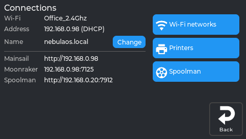

# Opening Mainsail

## What this guide will help you do

Open your printer's web interface, called Mainsail, from a computer or phone on the same
network. Mainsail is where uploading files and watching prints is easiest.

## What you need

- A printer on your Wi-Fi network - see [Connecting to Wi-Fi](Connecting-To-WiFi).
- A computer, tablet or phone on the **same** network.

## What Mainsail is

Mainsail is a web page served by the printer itself. You do not install anything and you do
not need an account or an internet connection - your browser talks directly to the printer
over your own network.

The printer's touchscreen and Mainsail show the same printer and work at the same time.
Neither replaces the other: the screen is better when you are standing at the machine,
Mainsail is better for uploading files and watching from elsewhere in the house.

## Step-by-step

1. On the printer, tap **Settings → Connections** and read the **Address** line. It looks like
   `192.168.1.42`.
2. On your computer or phone, open a web browser.
3. Type that address into the address bar - the box where you would normally type a web
   address - and press Enter.

   Type just the numbers and dots. Do not add `www.` and do not search for it.

4. Mainsail opens.



*Read the **Address** line here. The printer's name is just above it, and **Change** renames
it.*

## The easier way to remember it

The printer also answers to its own name, so you do not have to remember numbers:

```
http://<printer-name>.local
```

The name is on **Settings → Connections**, next to **Name**, and **Change** renames it. After
a rename, the printer is reachable at the new `.local` address.

**Each printer gets its own name by default.** NebulaOS names a new printer
`nebulaos-` followed by four characters derived from its own hardware, for example
`nebulaos-4f2a`. That is deliberate: if every printer were simply called `nebulaos`, two of
them on one network would collide in your router, in Mainsail and at `nebulaos.local`. A name
you choose yourself always wins over the default.

This naming trick works on most home networks, but not all - some routers and some Android
versions do not support it. If `.local` does not work for you, use the numeric address.

## Expected result

Mainsail opens and shows your printer's dashboard: temperatures, a file list, and controls.
If the printer is idle, temperatures read roughly room temperature.

## Troubleshooting

| What happens | What to do |
|---|---|
| The page does not load | Check the device is on the same Wi-Fi network, not a guest network or mobile data. |
| The address has changed | Your router may hand out a different address after a restart. Read it again on **Settings → Connections**, or set a fixed address. |
| `.local` does not work but the numbers do | Your network does not support `.local` names. Use the numeric address. |
| It loads but says it cannot reach the printer | Klipper may still be starting. Wait a minute and reload. |
| Nothing works and the screen is also dead | [Troubleshooting](Troubleshooting), then [Recovery](Recovery). |

## Bookmark it

Save the address in your browser. If you set a fixed address
([Connecting to Wi-Fi](Connecting-To-WiFi)), the bookmark keeps working permanently; with
DHCP it may occasionally change.

## Next

[First-time setup](First-Time-Setup) - calibration and your first print.
