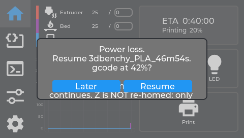

# Power-loss recovery

## What this page will help you do

Understand what happens when the power goes out during a print, and how to continue the print
instead of starting over.

You do not have to set anything up. NebulaOS does this by itself.

## What you need

Nothing. Power-loss recovery is part of NebulaOS and is always running during a print.

## How it works, briefly

While a print runs, NebulaOS keeps saving a checkpoint of where the print is - the position in
the file, the nozzle and bed temperatures, the bed mesh in use, and which objects you have
cancelled if you are using Cancel Object.

The checkpoint is stored in two places: a tiny record on a memory chip on the printer's board
that survives losing power, and a larger file on the printer's storage. The chip record is
written **last**, and only once the file is safely on disk, so the printer never trusts a
checkpoint that did not completely land. That ordering is the whole reason a power cut at the
wrong moment does not leave you with a corrupt recovery.

You do not need to know any of this to use it. It matters only because it explains why the
printer sometimes says there is nothing to recover: if the checkpoint did not fully land, it
is not offered, rather than being offered and then failing.

## Step-by-step: after the power comes back

1. Switch the printer on as usual.
2. Wait for it to start up - about a minute.
3. If a recoverable print was interrupted, the screen offers it to you, naming the file.
4. Choose:
   - **Resume** - carry on from the checkpoint.
   - **Later** - keep the checkpoint and decide afterwards. **Tune → Power Settings** still
     offers **Resume Print**, and **Discard** to forget the checkpoint and start fresh.

Look at the part before you choose. Resuming only makes sense if the print is still stuck to
the bed in the position it was in. If it came loose, or you have moved the bed or the part,
discard it.

*The real screen app. An example state: the power cut and its record were fed in for the
picture. On the 480x272 screen the end of the text runs on under the Later / Resume buttons.*

*Buttons from `src/power_panel.cpp` (`offer_resume`) at screen `fd47cb6`.*

## Expected result

After choosing **Resume**, the printer works through a deliberate order. Since NebulaOS 1.0.5 it
stops halfway and **waits for you**, so loose filament never ends up in your part:

1. **The bed heats** to the temperature of the interrupted print. The nozzle stays off, so it
   cannot ooze into the part while the bed warms up.
2. **The nozzle warms just enough to soften the plastic around it** (170 °C, or the print
   temperature if that is lower), then **lifts slowly out of the part**: the first millimetre
   very slowly, then 5 mm in total.
3. **X and Y home**, so the head parks at the side, off the bed.
4. There **the nozzle heats to the print temperature and primes** a little filament.
5. **The printer waits for you.** The screen (and Mainsail) shows: *"Nozzle purged. Remove the
   loose filament from the nozzle (careful, it is hot), then press Continue."* Pull the strand
   off with tweezers, then choose:
   - **Continue** - the nozzle goes back to the part and the print carries on where it stopped,
     at the speed the file was using.
   - **Purge more** - primes a little more, if the nozzle is not clean yet. Then it waits again.
   - **Stop** - turns the nozzle off and keeps the bed warm. The recovery is **kept**: tap
     *Resume* again whenever you are ready.
6. After **Continue**, the bed mesh from the interrupted print is reloaded, the printer returns
   to the position it had reached, and printing continues from the same point in the file.

Closed the dialog by accident? The same three buttons are on **Tune → Power Settings** while
the printer waits.

**Do not leave it waiting for more than an hour.** After an hour without anything happening the
printer switches its motors off. The nozzle height is then no longer known, so the recovery can
only be discarded.

Objects you had cancelled stay cancelled, and if you were part-way through one, that object is
started again rather than skipped.

**A timelapse keeps its earlier frames.** If you were recording a [timelapse](Timelapse), the frames taken
before the power cut are put back in front of the new ones when the print ends, so the finished
video covers the whole print instead of only the part after the resume. Nothing to switch on -
it is set up in the shipped configuration (`machine.cfg`, `timelapse_frame_path`).

**Why the order matters.** After a power cut the nozzle has cooled down *inside* the top of your
part. Lifting it cold can pull the part off the bed, and heating it fully over the part makes it
ooze into the print. So it is only softened, lifted, and heated and primed away from the part.
The wait is there because a primed nozzle always has a little strand hanging from it; if that
went back with the nozzle, it would end up in your print.

*From extensions `96a9002` (`nebulaos_power_loss_recovery.py`, `build_physical_prepare_lines`).*

## If a resume fails partway

Worth knowing, because the printer's behaviour here is deliberate and might otherwise look
like a malfunction.

If a resume starts but cannot complete, NebulaOS cleans up rather than leaving things half
done:

- **The nozzle heater is switched off,** so a hot nozzle is not left parked over your part.
- **The file is unloaded,** so the screen and Mainsail do not show a print that is not actually
  running.
- **The bed heater stays on.** This is on purpose: a warm bed keeps the part stuck down, which
  is exactly what you need in order to try again.
- **The checkpoint is kept,** so **Resume** is offered again.

So a failed resume leaves you able to retry, with the part still attached. If you would rather
not retry, choose **Discard** and turn the bed off yourself.

*From extensions `f498796` (`nebulaos_power_loss_recovery.py`,
`_undo_failed_resume`).*

## Troubleshooting

| What happens | What it means |
|---|---|
| No recovery is offered after a power cut | No complete checkpoint landed, so there is nothing to recover. Start the print again. |
| Recovery is offered but the part came loose | Choose **Discard**. Resuming onto a moved part will fail, or drive the nozzle into it. |
| Resume heats up, then stops | A step was refused. The nozzle is turned off, the bed left on, and **Resume** is offered again. |
| The printer waits with a hot nozzle and nothing happens | It is waiting for you: remove the loose filament, then **Continue** (or **Stop**). The buttons are also on **Tune → Power Settings**. |
| "The nozzle was lifted during an interrupted resume" | The power went off (or Klipper restarted) *after* the nozzle had lifted. Its height is no longer known, so this recovery can only be discarded. Start the print again. |
| Continue is refused after a long wait | The motors switched off after an hour of waiting, so Z is unknown. Discard and start again. |
| The print resumes in the wrong place | Report it with the logs: **Settings → System → Report a problem**. |
| You want the offer to go away | Choose **Discard**. |

## For advanced users: the commands behind it

The screen uses macros that call these. You can also run them from the console
(**Home → Console**) or from Mainsail:

| Command | What it does |
|---|---|
| `NEBULAOS_PLR_STATUS` | Reports the current power-loss-recovery status |
| `NEBULAOS_PLR_RESUME` | Resumes from the checkpoint |
| `NEBULAOS_PLR_DISCARD` | Discards any checkpoint |
| `NEBULAOS_PLR_CONTINUE` | While it waits: continue the print (**Continue**) |
| `NEBULAOS_PLR_PURGE` | While it waits: prime once more (**Purge more**) |
| `NEBULAOS_PLR_ABORT` | While it waits: stop, nozzle off, keep the recovery (**Stop**) |
| `NEBULAOS_PLR_PROMPT` | Shows the "remove the loose filament" dialog again |

Two further commands exist, `_NEBULAOS_PLR_LOAD_MESH` and `_NEBULAOS_PLR_SET_Z`. The leading
underscore marks them internal: they are steps of `NEBULAOS_PLR_RESUME` and are not meant to
be run on their own.

## Recovery and reversal

**Discard** is how you undo a pending offer, and it cannot be undone itself - the checkpoint is
gone afterwards. It does not touch the G-code file, so you can always start the print again
from the beginning.

## Related

- [Printing](Printing) - pausing, resuming and cancelling a print normally
- [Recovery](Recovery) - recovering the printer itself, which is a different thing
