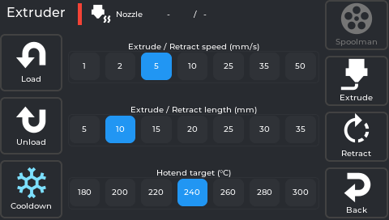
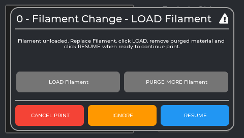
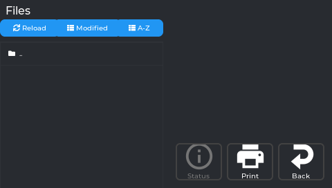
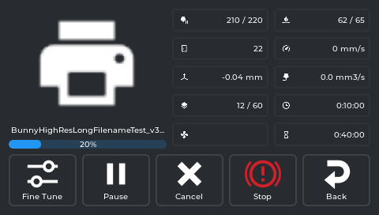
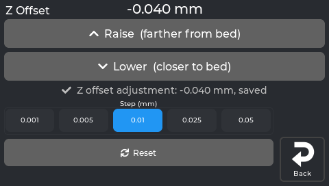
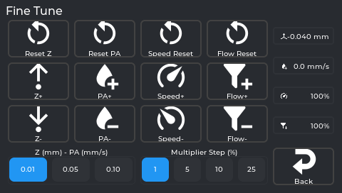
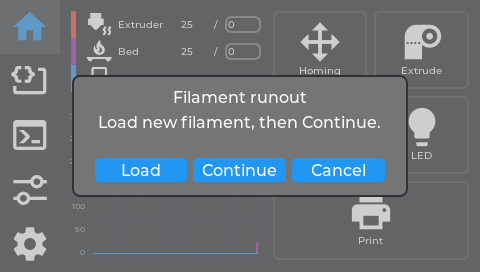

# 6. Your first print

## What this step does

Loads filament, prints a small test, and tunes the first layer while you watch it. Pick something
small and simple: a 20 mm calibration cube tells you more in 20 minutes than a six-hour model
tells you in six hours.

## What you need

- A calibrated printer - [4. First calibration](First-Calibration).
- A slicer set up for NebulaOS - [5. Set up your slicer](Slicer-Setup) - and a sliced `.gcode` file.
- Filament.

## Before you begin

**The nozzle reaches 200 °C and above while loading and printing.** It does not look hot. Do not
touch the nozzle or the metal around it.

**Learn the difference between Cancel and Stop before you need it.** They sit next to each other
on the print screen and they are not alternatives:

| Button | What it does | When to use it |
|---|---|---|
| **Pause** | Parks the toolhead and **holds temperatures**. **Resume** carries on. | A filament change, or a look at something |
| **Cancel** | Ends the print tidily. Asks you to confirm. | You have changed your mind |
| **Stop** | **Emergency stop.** Cuts all movement and all heaters instantly. | Something is going physically wrong |

**Stop needs a power-cycle or a firmware restart afterwards** before the printer does anything
again. Its label is only "Stop", so it is easy to press expecting a gentler Cancel. Use **Cancel**
unless something is actually wrong.

## Load filament

**Home → Extrude** opens the filament panel.

1. Cut the filament end at a clean angle. A squashed or stringy end jams.
2. Feed it into the extruder inlet until it will not go further easily. **Do this before you tap
   Load** - Load expects the filament to be in the throat already.
3. Choose the hotend target for your filament - 200 °C suits most PLA, 240 °C most PETG. The
   selector offers 180 to 300 °C in steps of 20; for an exact value, tap the temperature on the
   **Home** tab instead.
4. Tap **Load**. The nozzle heats, then filament feeds forward. If Spoolman is set up, it asks
   **"Use this filament?"** first.
5. When the plastic coming out runs **clean and consistent in your new colour**, tap **Cooldown**.
   During Load, **Cooldown** is the stop control - the only button that stays active.

**Unloading:** choose the target for the filament that is loaded, tap **Unload**, and when it
stops, **pull the filament out from the top of the extruder by hand**. The printer pulls it clear
of the hot end but does not eject the whole length.

**Changing colour:** unload, then load. A print that asks for a colour change (`M600`) shows this
box and walks you through the same steps:

*The real screen app, showing the text of NebulaOS's `M600` macro (the title scrolls).*

Every other control on the filament panel: [Home and printing](Screen-Home#filament-panel-extruder).

## Get the file onto the printer

Three ways, all equivalent:

- **From the slicer** - upload straight to the printer ([5. Set up your slicer](Slicer-Setup#sending-files-from-the-slicer)).
- **Mainsail** - drag the file into the file list in your browser.
- **USB stick** - plug it in; the printer's file browser reads it directly.

## Start the print

1. On the **Home** tab, tap **Print**. The file browser opens.
2. Find your file. Files on a USB stick appear alongside the ones stored on the printer.
3. Tap it, then **Print**.

The print status screen appears by itself. Before the first layer, the screen shows the start
steps: preparing, heating the bed, the bed mesh of the print area, heating the nozzle, the purge
line next to the print. Then the first layer begins.

*Every readout on this screen: [Home and printing](Screen-Home#print-status-screen).*

## Watch the first layer, and fix it live

This is the most useful thing on the screen, and it is meant to be used.

Tap the **Z-offset** readout on the print screen (or **Tune → Z Offset**) to get step buttons:
±0.001, ±0.005, ±0.01, ±0.025 and ±0.05 mm. Watch the first layer and nudge:

| What you see | What to do |
|---|---|
| Lines not fusing, gaps between them | Nozzle too high - press **−** |
| Lines translucent or completely flat | Nozzle too low - press **+** |
| Lines squished together and fused, no gaps | Correct - leave it |

Move in small steps and give the printer a few seconds to show the result. Every tap is **saved
immediately** and used for the next print too.

**Fine Tune** (a button on the print screen, also **Tune → Fine Tune**) adjusts speed, flow and
pressure advance live. Speed and flow there are percentages of what the file asked for.

Still not right after a few nudges? [Improve your prints](Improve-Your-Prints) starts from what
you see.

## When the print finishes

The printer stops heating and parks, and the status screen shows the print as complete. Let the
bed cool before removing the part - parts release far more easily cool.

If you were recording a [timelapse](Timelapse), the video is rendered now and appears in Mainsail.
**Settings → Printer → Statistics** shows your recent prints and the totals for the printer's whole
life ([Statistics](Screen-Printer#statistics-panel)).

## If filament runs out

With a filament sensor, the print pauses when filament runs out instead of printing nothing. The
screen offers **Load**, **Continue** or **Cancel**: load the new filament, then **Continue**.

*The screen's own runout dialog. Details: [Home and printing](Screen-Home#filament-runout-dialog).*

## Spoolman (optional)

If you run a [Spoolman](https://github.com/Donkie/Spoolman) server, NebulaOS can track what is left
on each spool: set the server under **Settings → Connections → Spoolman**, then **Home → Extrude →
Spoolman** shows the spool list, and loading asks which spool you are using. Everything else works
without it. Details: [Settings → Connections](Screen-Connections) and
[Home and printing](Screen-Home#spoolman-panel).

## Troubleshooting

| What happens | What to do |
|---|---|
| Filament will not feed | Cut a fresh clean end, and make sure it is in the throat before tapping Load. |
| Nothing comes out, motor clicking | Nozzle not hot enough, or a blockage. Raise the target and try again. |
| The old colour keeps coming | Normal - keep going until it runs clean, then Cooldown. |
| The print will not start | Check the printer is not already busy, and that the file sliced correctly. |
| No mesh or purge line before the print | The slicer's start G-code does not call `START_PRINT` - [5. Set up your slicer](Slicer-Setup). |
| First layer is poor | Adjust Z offset live, as above. One side consistently worse: [Axis Twist](Calibration-Explained#axis-twist). |
| The print stops partway | Check for filament runout. After a power cut, see [Power-loss recovery](Power-Loss-Recovery). |
| You pressed Stop | Power-cycle the printer, or run `FIRMWARE_RESTART` from the console. |
| The part will not come off | Let the bed cool completely first. |

## Next step

[7. Keeping NebulaOS updated](Updating-NebulaOS).

Need help? [Troubleshooting](Troubleshooting) · Every button: [Home and printing](Screen-Home)
