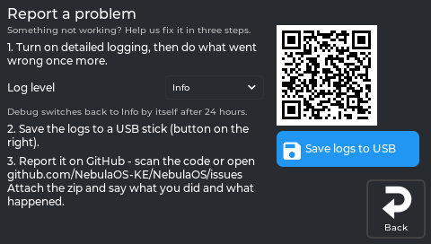
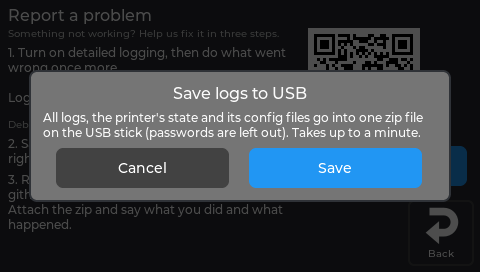

# Report a problem

Something not working, and [Troubleshooting](Troubleshooting) did not help? A report with the
printer's logs is far more likely to be solvable. The screen does most of it for you.

## On the screen: Settings → System → Report a problem

*The real screen app, showing data from a printer running NebulaOS.*

The page says *"Something not working? Help us fix it in three steps."*:

1. **Log level.** Info, Warning or Debug. For a problem you can make happen again, choose
   **Debug**, then make it happen. *"Debug switches back to Info by itself after 24 hours."*
2. **Save logs to USB.** Put a FAT32 USB stick in the printer and tap the button. It asks first:
   *"All logs, the printer's state and its config files go into one zip file on the USB stick
   (passwords are left out). Takes up to a minute."*

   

   *The real screen app, showing data from a printer running NebulaOS.*
3. **Report it on GitHub** - scan the code on the screen, or open
   [github.com/NebulaOS-KE/NebulaOS/issues](https://github.com/NebulaOS-KE/NebulaOS/issues).
   Attach the zip and say what you did and what happened.

## Where the logs are

- **On the screen:** **Settings → System → Logs** lists the log files; tap one to read it. It
  includes the Wi-Fi lines of `system.log`.
- **In Mainsail:** the log files are in its log list.
- **On the printer:** `/opt/printer_data/logs/`, for example `klippy.log`, `moonraker.log`,
  `nebulascreen.log` (rotates at 10 MB, keeps 3 old files) and `nebulaos-state.txt`, which
  summarises versions and state in one file. Over SFTP this is the `logs/` folder
  ([SSH, SFTP and security](SSH-And-SFTP)).

**What to put in the report:** the NebulaOS version (**Settings → System**), what you did, what
you expected, what happened instead, and the zip.

*From `src/report_panel.cpp:26-124` at screen `fd47cb6` and
`usr/share/nebulaos/printer_data-README.txt`, firmware `dc868e3`.*

## After the printer restarted by itself

The printer keeps a small "black box" in memory that survives a restart. If
its touchscreen computer ever freezes, it restarts within about a minute, and the black box still holds what happened just before:

- the system's last messages, and a report of what the system was doing when it froze or crashed;
- a line every 10 seconds with how busy the printer was and which programs used the processor.

At the next start NebulaOS works out why the printer stopped - switched off, restarted, froze or
crashed - and after a freeze or crash it keeps the evidence and shows a notice on the screen.

You don't have to find anything: **Save logs to USB** (above) puts all of it in the zip. If you
want to look yourself, it is on the printer under `/usr/data/nebulaos/logs/`:

| File | What it holds |
|---|---|
| `reset-history.log` | One line per start: why the previous one ended |
| `crash/` | The evidence of the last five freezes or crashes |
| `previous-boot-kernel.log` | The system's messages from the previous start |

`logs/nebulaos-state.txt` also has a **last restart** section.

A real power cut erases the memory, so after one the printer can only say it was switched off.

*From `usr/libexec/nebulaos-blackbox`, `etc/init.d/S03nebulaos-blackbox` and
`nebulaos_osconfig/logs.py`, firmware `7dbf5ca`; freeze report from kernel `95d0321e`.*

## Next

- [Troubleshooting](Troubleshooting)
- [Recovery](Recovery) - when the printer does not start at all
