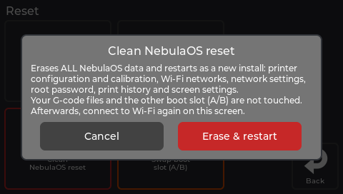
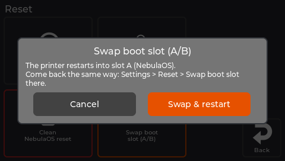

# Resetting

## What this page will help you do

Undo settings, free up space, or return the printer to a clean state - and know exactly what
each option erases **before** you press it.

Everything here is under **Settings → Reset**, except freeing up space, which is under
**Settings → System → Storage**.

## Before you begin

Read the table below rather than guessing from the button names. Two of these options delete
things you cannot get back, and two look similar but do very different jobs.

Every button asks you to confirm first. **Clean NebulaOS reset** and **Swap boot slot** are
blocked while a print is running.

## The reset options

| Button | What it does | What it erases |
|---|---|---|
| **Reset GUI settings** | Replaces the screen's settings file with the image's default copy, then restarts the screen. Klipper keeps running. | Theme, sleep timeout, which sensors are shown - screen settings only |
| **Reset touch calibration** | Clears the saved touch calibration. The screen restarts into the calibration wizard. | The touch calibration |
| **Clean NebulaOS reset** (red frame) | Restarts as if newly installed | Printer configuration and calibration, Wi-Fi networks, network settings, root password, print history and statistics, screen settings |
| **Swap boot slot (A/B)** (orange frame) | Restarts into the other system slot | Nothing - but see the warning below |

### What a clean reset does *not* touch

Your **G-code files** and the **other boot slot** survive a clean NebulaOS reset. Afterwards
you reconnect to Wi-Fi on the screen and calibrate again -
[Connecting to Wi-Fi](Connecting-To-WiFi), [Calibration guide](Calibration-Guide).

The prints you made **under NebulaOS** are gone from
[Statistics](Screen-Reference#statistics-panel), but the *Before NebulaOS* figures come back on
their own: they are read again from files that live outside the NebulaOS folder.

## Swapping boot slots

The printer has two system slots, A and B. A system image installed from **Settings → Updates
→ System image** goes into whichever slot is **not** running, so the one you are using is never
overwritten.

The confirmation tells you what is installed in the other slot. Read it - that is how you
check you are about to start what you expect.

**The one-way warning.** If the other slot runs NebulaOS, you can come straight back the same
way. If it runs Creality's system or OpenKE, those have **no NebulaOS swap button**, so getting
back needs SSH, reinstalling with Creality's updater, or USB recovery. See
[Going back](Going-Back) and [Recovery](Recovery).

Switching into a stock slot is safe, power switch included: each system reinstalls the
mainboard firmware it needs at boot. See [Safety first](Safety-First).

## Freeing up space

Two different buttons, which is deliberate. Using the wrong one is not dangerous, but it will
not do what you wanted.

### Settings → System → Storage → Free up space

Removes **NebulaOS's own leftovers**: old logs, old update backups, unfinished downloads,
uploaded system images and the download cache.

It shows you what it would free, grouped by kind, before removing anything.

**Your print files, settings and calibration are never touched.** Neither is Creality's data.

It takes up to a minute. If the printer is printing, or an update is running, it refuses and
says so.

### Settings → System → Storage → Clean up Creality files

Removes **the Creality system's data** from the data drive, and can also delete Creality's
timelapse videos. It shows what it would free first.

NebulaOS, your print files and your settings are not affected. But note: if the other slot
still holds the Creality system, that system will start as though factory reset afterwards.

**Your print statistics are kept.** The cleanup deliberately leaves Creality's lifetime print
counter and its print list in place, along with the old Moonraker database of an earlier OpenKE
or helper-script install, so the *Before NebulaOS* figures on
[Settings → Printer → Statistics](Screen-Reference#statistics-panel) stay right afterwards
(firmware `ba98eec`, `cleanup.STATISTICS_KEEP`).

**Keep these two straight.** *Free up space* tidies NebulaOS after itself. *Clean up Creality
files* reclaims space from the other system, and has a consequence for that system. They stay
separate buttons precisely so that going back to stock keeps working.

## Expected results

| Action | What you should see |
|---|---|
| Reset GUI settings | The screen restarts and looks default again |
| Reset touch calibration | The screen restarts into the touch wizard |
| Clean NebulaOS reset | The printer restarts needing Wi-Fi and calibration again |
| Swap boot slot | The printer restarts into the other system |
| Free up space | A summary of what was removed, and more free space |

## Troubleshooting

| What happens | What to do |
|---|---|
| A button is greyed out or refuses | A print is running, or an update is in progress. The message says which. |
| The screen looks wrong after a GUI reset | Restart the screen: **Settings → System → Restart GUI**. |
| Touch is inaccurate after calibrating | Run **Reset touch calibration** again and take care to tap the centre of each target. |
| You did a clean reset by mistake | Your G-code files are still there. Reconnect Wi-Fi and recalibrate. |
| Freeing space did not free much | There may be little to clean. Check **Clean up Creality files** as well. |

## Recovery and reversal

- **Reset GUI settings** and **Reset touch calibration** are harmless and repeatable.
- **Clean NebulaOS reset** cannot be undone. Your configuration and calibration are gone and
  must be redone.
- **Swap boot slot** is reversible, but possibly not from a screen - see the one-way warning
  above.
- **Free up space** and **Clean up Creality files** cannot be undone. Neither touches your
  print files.

## Related

- [Updating NebulaOS](Updating-NebulaOS)
- [Going back to your old firmware](Going-Back)
- [Recovery](Recovery)
