# Settings → Connections

Wi-Fi, the printer's address and name, other printers, and the Spoolman server. To join Wi-Fi the first time, follow [First start](First-Time-Setup); this page describes every control.

## Connections

Shows the current **Wi-Fi** network, **Address**, printer **Name** (with **Change**), and the
**Mainsail**, **Moonraker** and **Spoolman** addresses (Spoolman says "not configured" when Moonraker
has no Spoolman). Buttons:

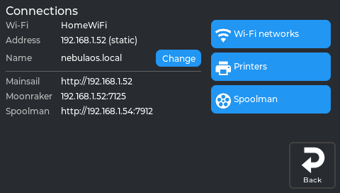

*The real screen app, showing data from a printer running NebulaOS. Addresses are examples.*

- **Wi-Fi networks** — see [Wi-Fi panel](#wi-fi-panel).
- **Printers** — see [Printers panel](#printers-panel).
- **Spoolman** — the Spoolman server the printer uses. On the right, **In use** shows the current
  server (address and port); its **✕** stops using Spoolman. On the left, type a new address (IP or
  name) and port (Spoolman's default is 7912) and tap **Use**: NebulaOS writes it into
  `moonraker.conf` (`[spoolman] server`) and restarts Moonraker; the screen reconnects after a few
  seconds. The keyboard's keyboard key hides it; tap a field to bring it back. The spool list itself
  is in the Filament panel ([Spoolman panel](Screen-Home#spoolman-panel)).

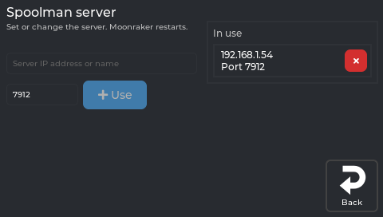

*The real screen app, showing data from a printer running NebulaOS. Addresses are examples.*

Both changes ask first, because Moonraker restarts:

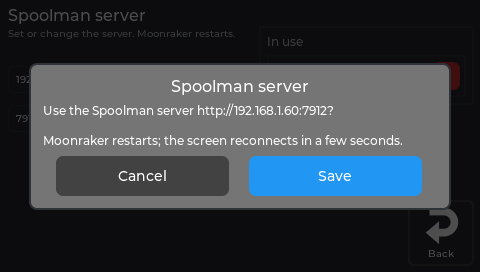

*The real screen app. An example state: the address was typed in for the picture.*

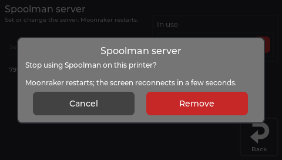

*The real screen app, showing data from a printer running NebulaOS.*

**Change** (printer name) sets the network name: the printer is then reachable as `<name>.local`.
Invalid names are flagged while you type; saving asks to confirm first.

## Wi-Fi panel

Opens from Settings → Connections → **Wi-Fi networks**. Wi-Fi is managed through NebulaOS.

Networks are grouped into **KNOWN NETWORKS** (saved) and **OTHER NETWORKS IN RANGE**, each row with
signal bars. **Other network (hidden)...** at the end connects to a network that does not broadcast
its name.

| Row type | Tapping the row | Extra |
|---|---|---|
| **Connected network** | Opens [Network Details](#network-details-panel) | A chevron (**›**) as a hint |
| **Known, not connected** | Reconnects to it | A separate **✕** to forget it (asks first) |
| **Not known** | Asks for the password (empty for an open network) | — |

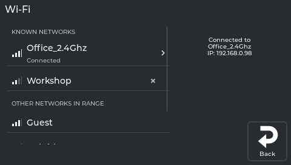

*The real screen app. An example state: the two saved names stand in for real ones, and `OtherNetwork` and the signal levels were fed in for the picture.*

The password field has an eye button to show or hide what you type.

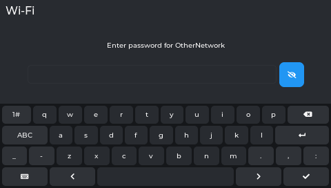

*The real screen app. An example state, for the made-up `OtherNetwork`.*

**Other network (hidden)...** asks for the name first:

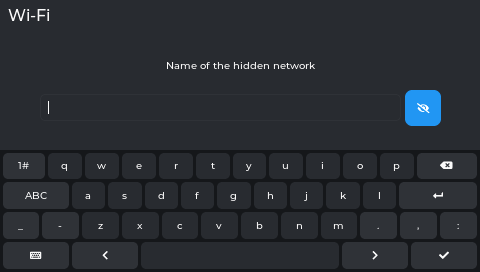

*The real screen app.*

Forgetting a saved network asks first:

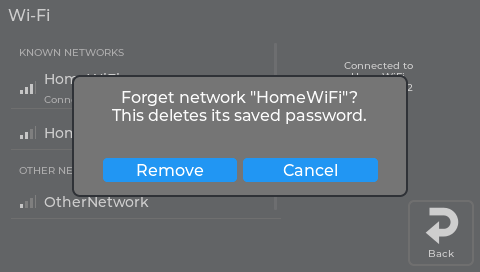

*The real screen app. The network name stands in for a real one.*

## Network Details panel

Reached by tapping the connected network's row in the Wi-Fi panel.

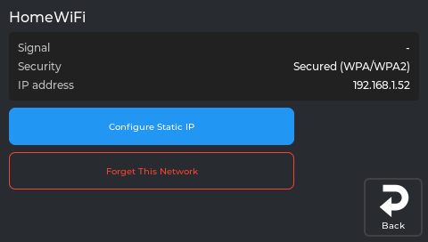

*The real screen app, showing data from a printer. Signal shows `-` here only because the picture was made without a Wi-Fi scan.*

An info card (**Signal**, **Security**, **IP address**) plus two buttons:

- **Configure Static IP** — opens the [Static IP panel](#static-ip-panel).
- **Forget This Network** (red outline) — removes the saved network.

## Static IP panel

Reached from Network Details → **Configure Static IP**. Titled **"Static IP (all Wi-Fi networks)"**:
the setting is global for the Wi-Fi interface, not per network. You need four values from your
router: **IP**, **Netmask**, **Gateway** and **DNS**. Unless you have a reason to need a fixed
address, DHCP is the simpler choice.

NebulaOS checks a new setting before keeping it - for a static address, that the gateway answers;
for DHCP, that a lease arrives - and **undoes it by itself if it does not work**. That check can
take a couple of minutes, so a slow result is not a failure.

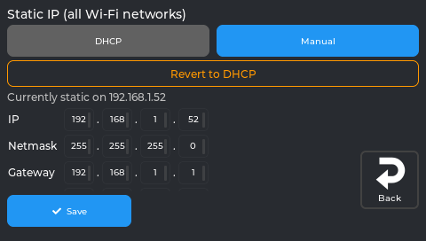

*The real screen app, showing data from a printer running NebulaOS. Addresses are examples.*

**DHCP** / **Manual** switches the view. **Manual** has four address rows — **IP**, **Netmask**,
**Gateway**, **DNS** — each as four octet boxes; a value outside 0–255 is flagged red at once.
**✓ Save** stays visible outside the scrolling area. With a static address set, **Revert to DHCP**
appears (asks first).

Tapping an octet box opens a number keypad:

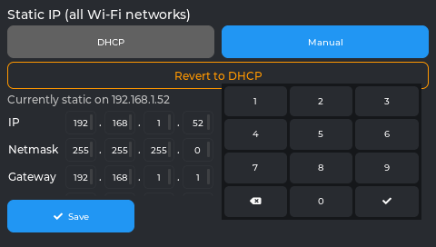

*The real screen app, showing data from a printer running NebulaOS. Addresses are examples.*

A value outside 0-255 is marked and nothing is sent:

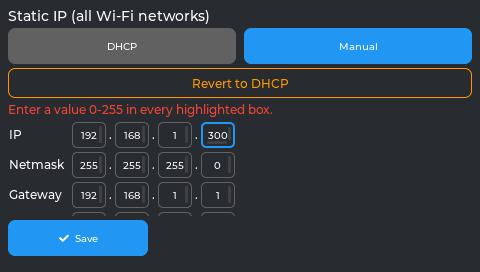

*The real screen app. An example state: 300 was typed in for the picture.*

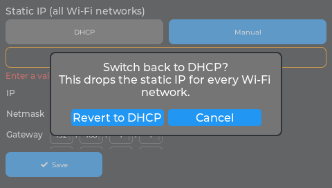

*The real screen app. Behind the question, the error line from the previous picture is still showing.*

NebulaOS checks a new setting (static: the gateway answers; DHCP: a lease) and reverts it by itself
when it does not work. This can take a couple of minutes.

## Printers panel

Opens from Settings → Connections → **Printers**. Manages Moonraker connections.

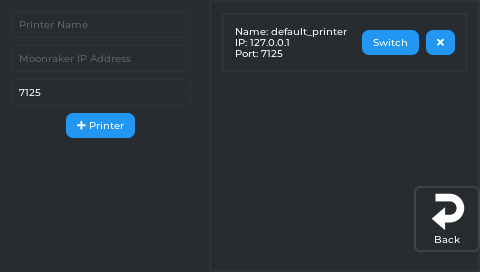

*The real screen app, showing data from a printer running NebulaOS.*

Each configured printer is a card with its name, IP and port, plus:

- **Switch** — connects NebulaScreen to that printer
- **✕** — removes it from the config (asks **Confirm** / **Cancel** first)

**Add a printer:** fill in **Printer Name**, the Moonraker IP address and the port (pre-filled with
`7125`), then tap the green **+ Printer** button.

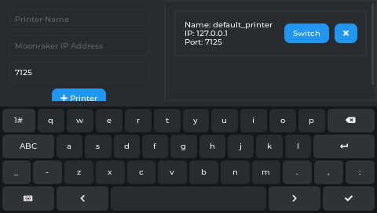

*The real screen app, showing data from a printer running NebulaOS.*

---

Previous: [Tune](Screen-Tune) · [Using NebulaScreen](Screen-Reference) · Next: [Settings → Display](Screen-Display)
