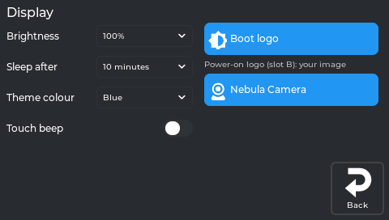
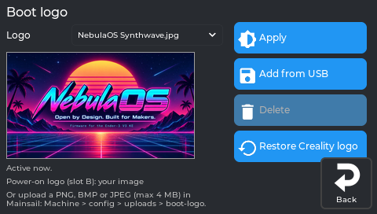
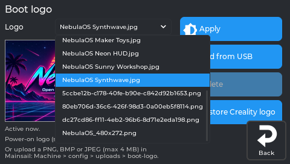
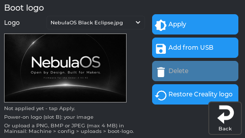
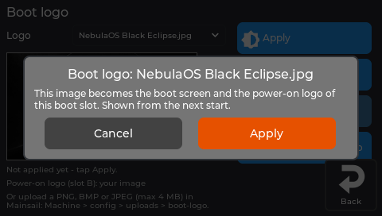
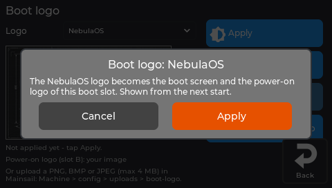
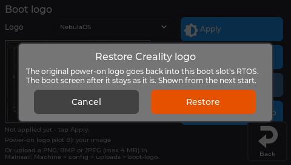
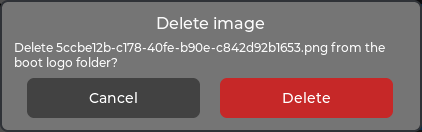
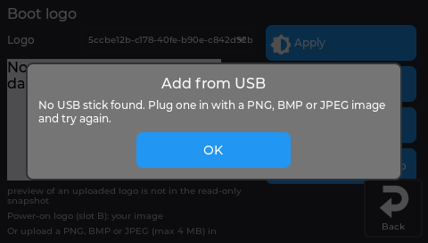

# Settings → Display

Brightness, sleep, theme colour, the touch beep, the boot logo, the Nebula Camera settings, and turning the picture for a screen mounted upside down.

## Display



*The real screen app, showing data from a printer running NebulaOS.*

| Setting | What it does |
|---|---|
| **Brightness** | Backlight level. The levels come from NebulaOS. |
| **Sleep after** | Never / 30 seconds / 1 minute / 5 minutes / 10 minutes / 30 minutes / 1 hour. Touch to wake. |
| **Theme colour** | Blue, Red, Green, Purple, Pink, Yellow. Applies immediately. |
| **Touch beep** | A short click through the buzzer on every tap. A test beep plays when you turn it on. |
| **Boot logo** | Choose the boot screen and power-on logo of this boot slot: the NebulaOS logo, an image added from a USB stick or uploaded in Mainsail (PNG, BMP or JPEG, max 4 MB), or **Restore Creality logo**. |
| **Camera** | Creality Nebula Camera settings: night mode, anti-flicker, white balance, exposure, picture sliders, **Defaults**, **Restart camera**. See [Camera](Camera). |

## Screen mounted the other way round

If your screen is mounted upside down, you can turn the picture 180°. There is no button for this
yet; it is a line in the screen's settings file.

1. In Mainsail, open **Machine** and the file `nebulascreen/nebulascreen.json`.
2. Find the line `"display_rotate": 2,` and change the `2` to `0`:

   ```json
   "display_rotate": 0,
   ```

   `2` is the normal KE mounting, `0` is turned 180°. Leave the comma at the end.
3. **Save & Close**, then restart the printer.
4. Touch calibration belongs to one orientation. If taps land in the wrong place, run
   **Settings → Reset → Reset touch calibration** and tap the targets.

To go back, set it to `2` again. Do not use `1` or `3`: those turn the picture 90°, and the screen
layout is not made for that.

## Boot logo panel

Opens from Settings → Display → **Boot logo**. Sets the picture shown while the printer starts
and the power-on logo, for **the slot you are running**.



*The real screen app, showing data from a printer running NebulaOS.* The preview is worked out by NebulaOS's own boot-display code from the shipped logo.

| Control | What it does |
|---|---|
| The dropdown | NebulaOS, plus every image you have added. The one in use is pre-selected; picking one shows a preview. |
| **Apply** | Makes the selected image the boot screen and the power-on logo. |
| **Add from USB** | Copies an image from a plugged-in stick into the printer and selects it. |
| **Delete** | Removes an image you added. The NebulaOS logo cannot be deleted. |
| **Restore Creality logo** | Puts the original power-on logo back. |

The dropdown open, with every logo on that printer - the ones NebulaOS ships and the images
uploaded to it:



*The real screen app, showing data from a printer running NebulaOS.*

Picking another logo shows its preview and *Not applied yet - tap Apply*:



*The real screen app, showing data from a printer running NebulaOS.*

**Apply** asks first, for an image and for the NebulaOS logo; it shows from the next start:



*The real screen app, showing data from a printer running NebulaOS.*



*The real screen app, showing data from a printer running NebulaOS.*

**Restore Creality logo** and **Delete** ask too:



*The real screen app, showing data from a printer running NebulaOS.*



*The real screen app; the picture is cut down to the question box.*

**Add from USB** without a stick plugged in:



*The real screen app, showing data from a printer running NebulaOS.*

There is no picture yet of the list of images on a stick, or of the result after adding one -
that needs a stick in the printer.

Images can also be uploaded in Mainsail - PNG, BMP or JPEG, up to 4 MB. See
[Resetting](Resetting) for the other things under Settings → Display.

---

Previous: [Settings → Connections](Screen-Connections) · [Using NebulaScreen](Screen-Reference) · Next: [Settings → Printer](Screen-Printer)
