# Home and printing

The **Home** tab - the first of the five tabs down the left edge - and everything its five buttons open: **Homing**, **Extrude**, **Fans**, **LED** and **Print** (the file browser and the print status screen).

## 🏠 Home tab

Your everyday screen. Inline content — no launcher grid.

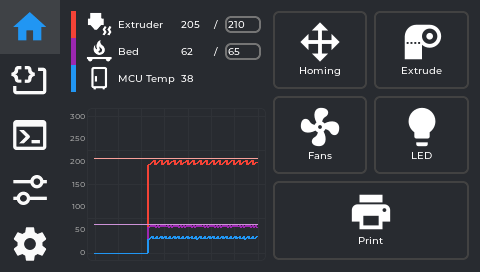

### Temperature panel

Shows live read-outs with target values for whichever sensors are configured in `nebulascreen.json`
(`monitored_sensors`) — by default **nozzle, bed, and MCU**. A **chamber** sensor also appears here,
but only if one is set up in your printer's config with the display name "Chamber" — it is not shown
by default on a stock KE.

- **Tap any temperature** to set a target (preheat). A numpad opens. The reading shows current/target
  — e.g. `45 / 210` means currently 45 °C, heating toward 210 °C.
- There are no material presets (no PLA/PETG/ABS quick-select buttons) — type the exact temperature
  you want on the numpad.
- **Tap the target** to clear it (set to 0 — cool down / off).
- Chamber and MCU are display-only (no heater to control).

### Temperature graph

A rolling line chart of all monitored temperatures, colour-coded. Useful for watching whether a heater
is stable at target or still swinging.

### Action buttons

Five icon buttons below the temperatures. Each opens a **floating panel** over the current screen:

| Button | Opens |
|---|---|
| **Homing** | Movement panel (jog + home axes) |
| **Extrude** | Filament panel (load/unload + manual extrude) |
| **Fans** | Fan speed controls |
| **LED** | Case light controls |
| **Print** | File browser |

While a print runs (not while it is paused), **Homing** and **Extrude** answer with a message
instead of opening; the calibration rows, Bed Mesh's buttons and some System buttons do the same
(`KUtils::notify_locked` at screen `fd47cb6`):

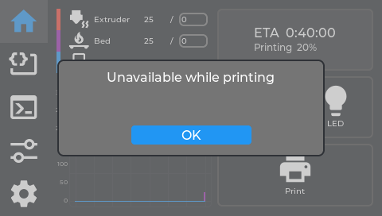

*The real screen app. An example state: the print behind it was fed in for the picture.*

---

## Homing panel (movement)

Opens from the Home tab **Homing** button.

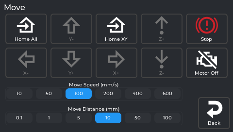

*The real screen app, showing data from a printer running NebulaOS 1.0.0.*

### Jog controls

- **Move Distance selector:** 0.1 mm / 1 mm / 5 mm / 10 mm / 50 mm / 100 mm — how far each direction tap moves.
- **Move Speed selector:** 10 / 50 / 100 / 200 / 400 / 600 mm/s — how fast that move happens.
- **X−/X+, Y−/Y+, Z−/Z+** — move the toolhead by the selected distance, at the selected speed. On the
  KE (bed-slinger), Y moves the bed.
- There is **no live position readout** on this panel — the app tracks position internally (to stop you
  jogging past the axis limits) but doesn't display X/Y/Z coordinates anywhere on screen.

> ⚠️ The printer doesn't know where it is until it homes. Moving before homing can crash the toolhead.
> Use the Home buttons below first.

### Home / Stop buttons

| Button | What it does |
|---|---|
| **Home All** | G28 — homes X, Y, and Z |
| **Home XY** | Homes X and Y only, leaving Z where it is |
| **Stop** | Emergency stop — asks "Do you want to emergency stop?" first, then cuts power to motors/heaters immediately if confirmed. Same underlying action as the print-status screen's Emergency Stop. |

There is no button to home a single axis (X, Y, or Z) by itself — only the two combined options above.

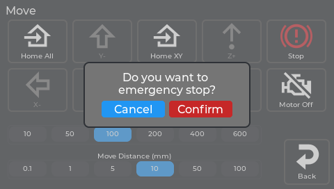

*The real screen app, showing data from a printer running NebulaOS 1.0.0.*

When something needs the printer homed - the Z offset buttons, or a command Klipper refuses with
*Must home axis first* - the screen asks to home. **Home** runs `G28`; **Cancel** closes the
question (`src/utils.cpp`, `src/notification_manager.cpp` at screen `fd47cb6`):

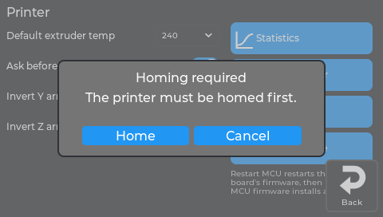

*The real screen app, showing data from a printer running NebulaOS 1.0.0 (not homed at the time).*

### Motors off

Disables stepper motors so you can move the toolhead and bed by hand. They re-engage on the next move
command or home.

### Inverted arrows

If Y or Z moves the opposite way to what you expect, swap the arrow labels in
**Settings → Printer → Invert Y arrows / Invert Z arrows**.

---

## Filament panel (extruder)

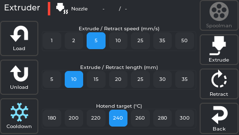

Opens from the Home tab **Extrude** button. Six buttons in total — **Load**, **Unload**, **Cooldown**
on the left; **Spoolman**, **Extrude**, **Retract**, **Back** on the right — plus three preset
selectors in the middle: **Hotend target (°C)**, **Extrude/Retract length (mm)**, and **Extrude/Retract
speed (mm/s)**.

> **Note:** the hotend target here is a fixed list (180 / 200 / 220 / 240 / 260 / 280 / 300 °C), not the
> free-entry numpad you get by tapping the temperature on the Home tab. If you want an exact value like
> 215 °C, set it from the Home tab instead — this selector only offers those 7 presets.

### Load

Heats the nozzle to the selected target, feeds filament forward. If Spoolman is active, a **"Use this
filament?"** confirmation appears first. While it's running, there's no separate Stop button — the
on-screen message tells you to **"Tap Cooldown to stop"**, and Cooldown stays active for exactly that
while every other button is disabled. After loading finishes, the nozzle auto-cools.

> Start Load when your filament is already inserted into the extruder throat. Tap Cooldown once plastic
> coming out the nozzle runs clean and consistent.

### Unload

Heats the nozzle, retracts filament fully out of the bowden/throat, then auto-cools. Remove the
filament from the top of the extruder manually after.

### Cooldown

Immediately sets the hotend target to 0. Also doubles as the way to interrupt an in-progress Load (see
above) and stays tappable while the hotend is heating toward a pending Extrude/Retract, so you can
cancel that too.

### Spoolman

Opens the [Spoolman panel](#spoolman-panel) (the spool list). The server is set in Settings → Connections → **Spoolman**.

### Manual extrude / retract

For precise manual movement once the nozzle is already hot:

- **Extrude/Retract length (mm)** — how far each press moves: 5 / 10 / 15 / 20 / 25 / 30 / 35
- **Extrude/Retract speed (mm/s)** — how fast: 1 / 2 / 5 / 10 / 25 / 35 / 50
- **Extrude / Retract** buttons — each press moves that amount once, at that speed

The nozzle must be at temperature (Klipper enforces this) — tapping Extrude/Retract while cold heats it
first, then runs the move once it's up to temperature. Also auto-cools after each operation.

---

## Fan panel

Opens from the Home tab **Fans** button.

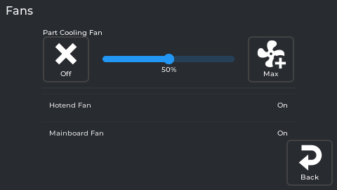

There are two kinds of row here:

- **Fans you can drive** get an **Off** button, a **0–100% slider** and a **Max** button. Changes apply
  immediately and override whatever the G-code was sending. If `nebulascreen.json`'s `fans` list names
  fans, exactly those are shown this way; if it names none (the NebulaOS default), the part-cooling fan,
  generic fans and PWM fan pins are.
- **Fans Klipper manages itself** (`heater_fan`, `controller_fan`, and fan pins that are not editable
  rows) are **read-only rows**: the name and the current state, no slider.

See [Configuration](https://github.com/NebulaOS-KE/NebulaOS-nebulascreen/blob/main/wiki/Configuration.md) for the `fans` list.

---

## LED panel

Opens from the Home tab **LED** button.

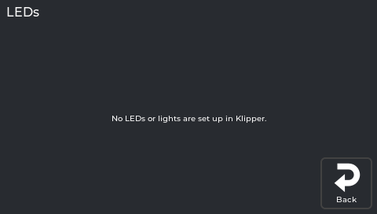

Each LED/light Klipper reports appears as a row with **Off**, a brightness slider, and **Max** — unless
it's a simple on/off light (no PWM dimming), in which case the slider is hidden and you get **Off**/**On**
only. **If your printer.cfg has no `[led]`/`[neopixel]`/output-pin light section at all, this screen
only says "No LEDs or lights are set up in Klipper."**
This is common: not every KE has a case light wired into Klipper, so don't be surprised if yours is empty.

---

## File browser (Print)

Opens from the Home tab **Print** button.

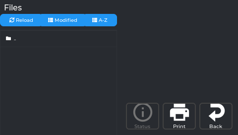

- Lists `.gcode` files from internal storage and any plugged-in USB stick. A `..` row at the top lets
  you go up a folder.
- Three buttons above the list: **Reload** (re-fetches the file list from the printer — also resets the
  sort, see below), **Modified**, and **A-Z** (the two sort options).
- **Tap a file** to preview it on the right: thumbnail (if the slicer generated one), file name,
  **Filament Weight**, **Print Time**, **Size**, and **Modified** (date/time).
- Three buttons below the preview: **Status** (jumps straight to the full print-status screen — only
  enabled while a print is actually running or paused), **Print** (starts this file), and **Back**.
- Files sort by date (newest first) by default. Tapping a sort button changes it for that visit, but
  it resets back to date/newest-first every time you re-open the file browser — it is **not** remembered
  between opens.
- USB files load full metadata (print time, filament weight) via a metascan on first access.

---

## Print status screen

Appears automatically (pops to the front) the moment a print starts, no matter which tab you're on. If
you navigate away from it back to the **Home tab** while printing, a compact progress widget appears
there in place of the usual action buttons — tap it to bring the full print status screen back. This
shortcut only appears on the Home tab, not on Macros/Console/Tune/Settings.

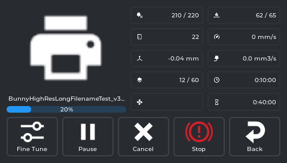

Thumbnail, file name, and a progress bar sit on the left. On the right is a fixed **5-row × 2-column**
grid, in this exact order:

| Row | Left column | Right column |
|---|---|---|
| 1 | **Extruder temp** — current, or `current / target` while a target is set | **Bed temp** — same current/target format |
| 2 | **Chamber temp** — same format. **Always shown here, even if you don't have a "Chamber" sensor configured** (unlike the Home tab, which hides it in that case) | **Speed** — current print speed in mm/s |
| 3 | **Z-offset** — tap this one specifically to open the baby-stepping panel right here | **Flow** — volumetric flow rate in mm³/s (not the same thing as the Fine Tune panel's flow **percentage**) |
| 4 | **Layers** — always `current / total` | **Elapsed** time |
| 5 | **Fan speed(s)** — if more than one fan is relevant, shown comma-separated | **Time left** (estimate) |

Pressure Advance and total filament used are **not** shown on this screen. Pressure Advance can be
adjusted live from the **Tune tab → Fine Tune** panel while a print is running; filament used is
tracked internally to estimate the time remaining, but there's no on-screen readout for it.

### Baby-stepping Z-offset while printing

Tap the **Z-offset readout** to get step buttons (±0.001, ±0.005, ±0.01, ±0.025, ±0.05 mm). Nudge while
watching the first layer:

- **Lines not fusing / gaps:** too high — lower (−)
- **Lines translucent or completely flat:** too low — raise (+)
- **Squished together and fused, no gaps:** correct

### Control buttons

Six buttons in total: **Fine Tune**, **Objects**, **Pause** (becomes **Resume** once paused), **Cancel**,
**Stop**, **Back**.

| Button | What it does |
|---|---|
| **Fine Tune** | Shortcut straight to the [Fine Tune panel](Screen-Tune#fine-tune) — same one reachable from the Tune tab. |
| **Objects** | Opens the [Exclude Object screen](#exclude-object-screen) below. |
| **Pause / Resume** | Parks the toolhead, holds temperatures. **Resume** brings it back and continues. |
| **Cancel** | Cancels the print. Asks *"Cancel the print?"* first, with a red **Cancel Print** button and **Back**. For the very last remaining object (Exclude Object), shows a "Cancel print?" confirmation. |
| **Stop** | The button's actual label is just **"Stop"**, not "Emergency Stop" — but it is the same emergency-stop action as everywhere else in the app. Cuts all movement and heaters immediately. Use only if something is going wrong physically. Requires a power-cycle or `FIRMWARE_RESTART` to recover. |

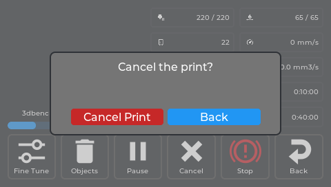

*The real screen app. An example state: the print (a real file name, at 20 %) was fed in for the picture.*

---

### Exclude Object screen

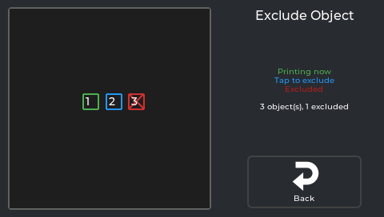

*The real screen app. The three objects are made up for the picture; a real print shows its own.*

Opens from the print status screen's **Objects** button — only useful for gcode files sliced with
object labels (the same "Label Objects" slicer setting adaptive meshing relies on). Shows each object as a shape you
can tap: green means **"Printing now"**, plain means **"Tap to exclude"**, red means **"Excluded"**.
Skipping an object stops printing it partway through without cancelling the whole job — useful if one
part of a multi-part print has failed but the rest is still going well. A counter below the legend
reads exactly **"N object(s), N excluded"**.

Tapping an object asks first; excluding cannot be undone:

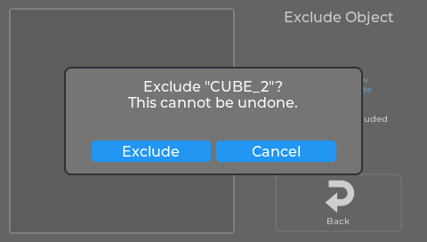

*The real screen app. An example state: the objects are made up for the picture.*

## Filament runout dialog

Not a page you open - it appears by itself when the filament sensor reports that filament has
run out during a print.

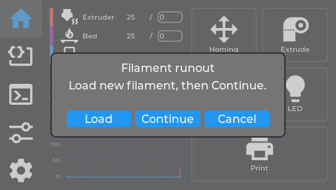

*The real screen app. The runout was simulated for the picture.*

| Button | What it does |
|---|---|
| **Load** | Feeds filament in short chunks. While feeding the button reads **Stop**, so you can halt between chunks instead of waiting out one long move. |
| **Continue** | Checks the sensor again, then resumes the print. |
| **Cancel** | Cancels the print. |

**If nothing appears when filament runs out, that may be correct.** Creality's `M600`
filament-change macro, if it is installed, already pauses the print and shows its own prompt for
the same event. Showing both would stack two dialogs on top of each other, so NebulaScreen stays
quiet and watches instead. It only steps in if `M600`'s own sequence fails partway through and no
prompt is up while filament is still missing - so a real failure never leaves you with nothing to
tap.

*From `src/filament_runout_panel.cpp` at screen `fd47cb6`.*

## Spoolman panel

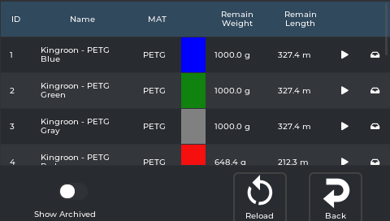

*The real screen on a printer running NebulaOS 1.0.1.*

Opens from the Filament panel. Requires a [Spoolman](https://github.com/Donkie/Spoolman) server,
set in Settings → Connections → **Spoolman** (or by hand in `moonraker.conf`).

| Feature | What it does |
|---|---|
| **Spool list** | A table with columns **ID**, **Name**, **MAT** (material), **Remain Weight**, **Remain Length**, plus a colour swatch per spool. |
| **Set active** | Each non-archived, non-active row has a ▶ icon — tap it to make that spool active. The active row shows "(active)". The active spool's filament use is deducted as you print. |
| **Archive** | A non-active, non-archived spool has an archive icon; an archived spool has an icon to bring it back. You can't archive the active spool. **Show Archived** (below the table) toggles whether archived spools are listed. |
| **Reload** | Re-fetches the spool list. |
| **Wrong-filament check** | Before a print starts (and before a manual Load), a **"Use this filament?"** popup shows the active spool. |

---

[Using NebulaScreen](Screen-Reference) · Next: [Macros and Console](Screen-Macros-Console)
