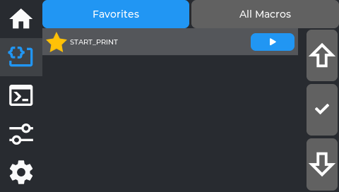
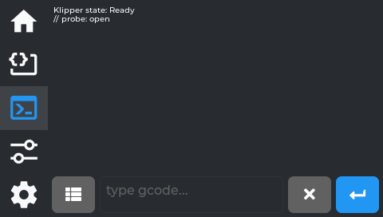
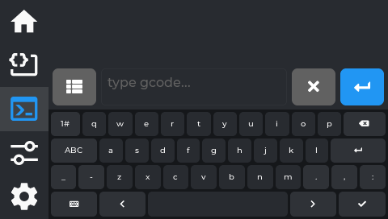

# Macros and Console

The second and third tabs.

## Macros tab

All your Klipper gcode macros, accessible from the screen. Inline content — no launcher grid.

- **Favorites / All Macros** — a segmented toggle at the top switches between the two views. Favorites
  (the default) shows only macros you've pinned; if you have none yet, it says "No favorites yet. Open
  All Macros and tap the star to add." Tapping the Macros tab again while already on it jumps back to
  Favorites.
- **All Macros is a flat, alphabetical list — not grouped by category.** Each row has a ☆ star (tap to
  pin/unpin as a favorite) and a green ▶ button that runs that macro immediately.
- **Up / ✓ / Down column** on the right — this is a separate navigation aid, not a scrollbar: **Up**/
  **Down** move a highlight cursor through the list one row at a time, and **✓** expands (or collapses)
  the currently highlighted macro's parameter inputs, scrolling it into view. You can also just tap a
  macro's row directly with your finger to expand it — the ✓ column is an alternative for precise
  selection, not the only way in.
- **Parameters** — once expanded (by tapping the row or via ✓), fill in the parameter inputs before
  running, or leave defaults as-is.

---

## Console tab

Direct gcode access. Inline content — no launcher grid. **Opens on the terminal view by default** —
tapping the Console tab again while already on it resets back to this terminal view too.

### Direct input (the default view)

Type any gcode command directly, same as the Mainsail terminal.

- **History** — last 100 entries. Temperature-spam lines (`T:210 B:60 …`) are filtered so they don't
  flood the history. Tap a history entry to re-run it.
- The small **list icon** to the left of the text field (not a separate tab) is how you get to the
  Command Browser described below.

Tapping the text field opens the keyboard:

*The real screen app.*

### Command browser

Reached by tapping the **list icon** next to the text field on the terminal view — it isn't a separate
tab of its own.

*No current screenshot of this screen yet - the simulator's capture tour does not reach it. Tracked in the screenshot inventory.*

The category list always starts with **Favorites** and **Recent**, followed by keyword-based groups
(Bed Mesh/Leveling, Probe/Calibration, Motion, Temperature/Fans, Extruder/Filament, and more), each
showing a command count. Two things worth knowing about the first two:

- **Favorites here are separate from the Macros tab's favorites** — this is its own star list, specific
  to gcode commands in this browser, with its own empty-state message ("No favorites yet. Star commands
  in any list.").
- **Recent is shared history with Fluidd** — it's not tracking only what you've run from this screen;
  it reflects command history from other interfaces too, if you use them.

The same **Up / ✓ / Down** navigation column from the Macros tab appears here too (see
[Macros tab](#macros-tab) for what it does).

Drill-down interface: tap a **category** → see commands in it. **There is no third "detail" level with
a description and its own Run button** — tapping a command inserts its name straight into the
terminal's input field and switches you back to the terminal view, keyboard already open, cursor at
the end so you can type any parameters yourself:

*No current screenshot of this screen yet - the simulator's capture tour does not reach it. Tracked in the screenshot inventory.*

Press the green **↵** button on the terminal to actually run it. This is really a fast way to look up
and insert a command name without typing it from memory, not a guided form. If tapping a command
doesn't seem to do anything, try again with a firm, clean tap — the resistive touchscreen occasionally
misses a light tap.

*No current screenshot of this screen yet - the simulator's capture tour does not reach it. Tracked in the screenshot inventory.*

Inside a category, a **filter** box appears at the bottom (only at this level, not on the category list
itself) — type to narrow the list live. Each command here also has its own ☆ star, same favoriting
behavior as the category list.

---

Previous: [Home and printing](Screen-Home) · [Using NebulaScreen](Screen-Reference) · Next: [Tune](Screen-Tune)
