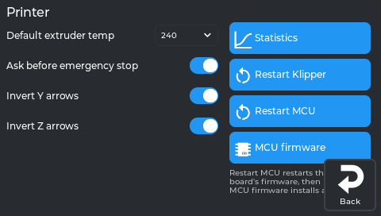
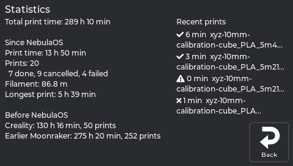

# Settings → Printer

Printer defaults, the statistics, Klipper and MCU restarts, and the mainboard firmware.

## Printer

*The real screen app, showing data from a printer running NebulaOS.*

| Setting | What it does |
|---|---|
| **Default extruder temp** | 180–300 °C. Used by Load/Unload when no target is set. |
| **Ask before emergency stop** | On: Stop asks "Do you want to emergency stop?" first. Off: acts immediately. Default on. |
| **Invert Y arrows** / **Invert Z arrows** | Swap the jog arrows in the Homing panel. |
| **Statistics** | What this printer has printed, over its whole life — see [Statistics panel](#statistics-panel). |
| **Restart Klipper** | Restarts Klipper. Asks first if a print is running (the print stops). |
| **Restart MCU** | Restarts the printer board's firmware, then Klipper (`FIRMWARE_RESTART`). Asks first if a print is running. |
| **MCU firmware** | Installs a new mainboard (MCU) firmware. |

## Statistics panel

Opens from Settings → Printer → **Statistics**. It shows what this printer has printed, over its
whole life — including the time before NebulaOS was installed. Nothing on this page changes the
printer; it only reads.

*The real screen on a printer running NebulaOS.*

### The left column

| Line | What it means |
|---|---|
| **Total print time** | The printer's whole life: what it printed before NebulaOS plus what it has printed since. |
| **Since NebulaOS — Print time** | Time spent printing since NebulaOS was installed. |
| **Prints** | How many print jobs, then the split: *done*, *cancelled*, *failed*. |
| **Filament** | Filament used since NebulaOS, in metres. |
| **Longest print** | The longest single job since NebulaOS. |
| **Before NebulaOS — Creality** | Creality's own lifetime counter, and how many prints Creality still lists. |
| **Before NebulaOS — Earlier Moonraker** | An earlier Moonraker's history, if this printer ran one (OpenKE or the community helper script). |

Each *Before NebulaOS* line says **none found** when that system never ran here, or **could not be
read** when the file exists but could not be understood.

### Recent prints

The right column lists the **four** most recent jobs, newest first, each with its print time and a
mark:

| Mark | Meaning |
|---|---|
| ✔ | finished |
| ✘ | cancelled |
| ▶ | running now |
| ⚠ | failed |

Each name is shown from its start, on at most two lines, ending in `...` when it is longer. For the full list, open
[Mainsail](Mainsail-And-Moonraker) and use its **History** page.

### How the numbers are worked out

Worth knowing, because two of these surprise people.

**Print time is printing time.** It is Klipper's print duration: from the first extrusion to the
end of the job, *not* counting heating up or time spent paused. So it is always less than the
wall-clock time you waited.

**The total is not the sum of everything.** The *Before NebulaOS* figure is the **larger** of the
two sources, never their sum. On a printer that ran OpenKE, Creality's counter and Moonraker's
history were both running and both counted the same prints; adding them would double the
printer's life. (`combine_stats` in the NebulaOS Moonraker component, firmware `3bd9675`.)

Where each figure comes from:

- **Since NebulaOS** is Moonraker's own print history — the same database
  [Mainsail](Mainsail-And-Moonraker)'s History page reads. That is why Mainsail's History lists only
  prints made under NebulaOS.
- **Before NebulaOS** is read once from the printer's data drive and then remembered, in
  `/usr/data/nebulaos/system/stats-baseline.json`. **The reading happens the first time this
  page is opened**, not when NebulaOS is installed - so a printer whose Statistics page has
  never been opened has not read anything yet. Creality's files are only ever read, never
  written: NebulaOS does not add its print time to Creality's counter. Creality's lifetime counter and print list
  come from Creality's own files; the earlier-Moonraker figures come from the old Moonraker
  database. All three are read and never written.
- A source that is missing or unreadable is looked at again next time, so installing NebulaOS
  before the import has anything to find is not a problem.

**These figures survive a cleanup.** [Clean up Creality files](Resetting#freeing-up-space) keeps
Creality's two statistics files and the old Moonraker database on purpose, so your printer's
history is not lost with the rest of the Creality system (firmware `3bd9675`,
`cleanup.STATISTICS_KEEP`).

**What does erase them:** a [clean NebulaOS reset](Resetting) removes everything NebulaOS keeps,
including its print history and the remembered *Before NebulaOS* figures. The *before* figures
are simply imported again at the next look, because the files they come from — Creality's and the
old Moonraker database — live outside the NebulaOS folder and a clean reset does not touch them
(firmware `3bd9675`, `nebulaos-clean-reset`). The prints made under NebulaOS are gone for good.

### If the page says something else

| What you see | What it means |
|---|---|
| **Adding up...** | Still waiting for the printer. It is normal for a moment. |
| **The printer could not read the statistics.** | Moonraker answered with an error. Check that Klipper and Moonraker are running — [Troubleshooting](Troubleshooting). |
| **No answer from the printer.** | The screen has no Moonraker connection. See [Connect to Wi-Fi](First-Time-Setup#connect-to-wi-fi). |
| **Recent prints — None yet.** | No print has been recorded under NebulaOS yet. |

Behind the page: `GET /machine/nebulaos/stats` (JSON-RPC `machine.nebulaos.stats`). Screen source
`src/statistics_panel.cpp` at `fd47cb6`; the import is `nebulaos-osconfig stats baseline` at
firmware `3bd9675`.

---

Previous: [Settings → Display](Screen-Display) · [Using NebulaScreen](Screen-Reference) · Next: [Settings → System](Screen-System)
