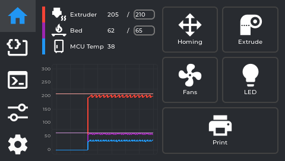
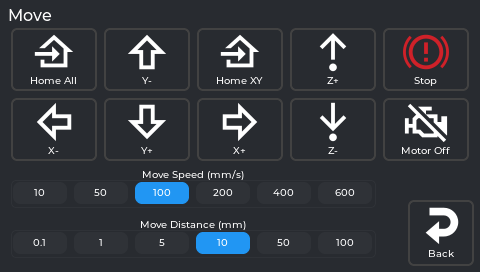
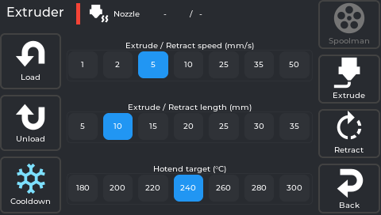
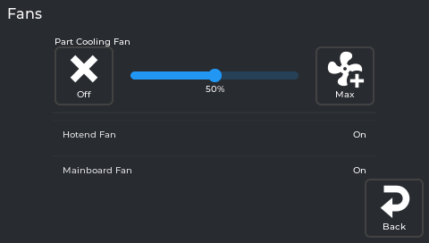
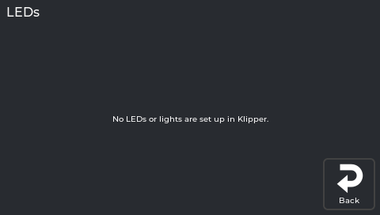
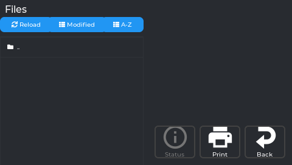
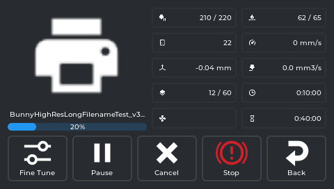
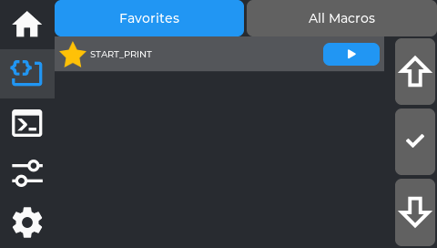
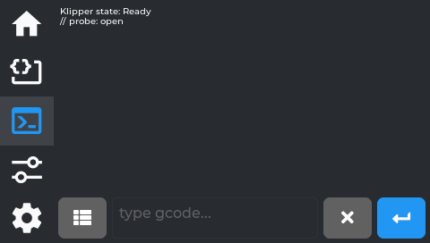
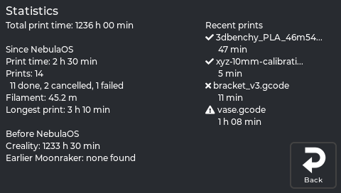

# Screen reference

Every tab, panel, button and dialog on the printer's touchscreen, in one place.

**This is the reference, not the tutorial.** If you want to be walked through a task, start
from [Home](Home) - [Printing](Printing), [Filament](Filament),
[Calibration guide](Calibration-Guide) and the rest explain the common jobs step by step. Come
here when you want to know what a specific control does.

Screenshots are real captures of the application at screen commit `36490ed`, taken at the
printer's own 480x272 resolution. A few screens have no picture yet; where that is so, the page
says it rather than showing you something else.

## Every panel, and where to find it

The complete list is generated from the source - 50 panels in all - so nothing is quietly
left out. Panels marked *detail below* are described on this page; the others are covered by
the task pages linked, or are internal screens you do not navigate to directly.

| Panel | Where it is documented | Screenshot |
|---|---|---|
| `axis_twist_panel` | [Axis twist](Axis-Twist-Compensation) - detail below | yes |
| `bedmesh_panel` | detail below | yes |
| `boot_logo_panel` | detail below | not yet |
| `calibration_menu_panel` | [Calibration guide](Calibration-Guide) | yes |
| `camera_panel` | [Camera](Camera) | yes |
| `connections_panel` | [Connecting to Wi-Fi](Connecting-To-WiFi) | yes |
| `console_panel` | detail below | yes |
| `display_panel` | detail below | yes |
| `exclude_object_panel` | [Printing](Printing) - detail below | not yet |
| `extruder_panel` | [Filament](Filament) - detail below | yes |
| `fan_panel` | detail below | yes |
| `filament_runout_panel` | detail below | not yet |
| `file_panel` | [Printing](Printing) - detail below | yes |
| `finetune_panel` | [Printing](Printing) - detail below | yes |
| `firmware_retraction_panel` | detail below | yes |
| `guided_calibration_panel` | [Calibration guide](Calibration-Guide) | yes |
| `homing_panel` | detail below | yes |
| `hostname_panel` | [Opening Mainsail](Opening-Mainsail) | yes |
| `image_panel` | [Updating NebulaOS](Updating-NebulaOS) | yes |
| `init_panel` | shown while the printer starts up | not yet |
| `led_panel` | detail below | yes |
| `limits_panel` | detail below | yes |
| `logs_panel` | detail below | not yet |
| `macros_panel` | detail below | yes |
| `main_panel` | Home tab - detail below | yes |
| `mcu_panel` | detail below | yes |
| `network_detail_panel` | [Connecting to Wi-Fi](Connecting-To-WiFi) | not yet |
| `pid_calibration_panel` | [Calibration guide](Calibration-Guide) | yes |
| `power_panel` | detail below | yes |
| `print_panel` | the Print tab's container - holds the file browser and the print status screen, both below | yes |
| `print_status_panel` | [Printing](Printing) - detail below | yes |
| `printer_select_panel` | detail below | not yet |
| `printer_settings_panel` | detail below | yes |
| `printertune_panel` | Tune tab - detail below | yes |
| `prompt_panel` | shown by the printer when it needs an answer | not yet |
| `report_panel` | detail below | not yet |
| `reset_panel` | [Resetting](Resetting) | yes |
| `setting_panel` | Settings - detail below | yes |
| `skew_correction_panel` | [Skew correction](Skew-Correction) - detail below | yes |
| `spoolman_panel` | [Filament](Filament) | not yet |
| `spoolman_server_panel` | [Filament](Filament) | yes |
| `static_ip_panel` | [Connecting to Wi-Fi](Connecting-To-WiFi) | not yet |
| `statistics_panel` | detail below | yes |
| `storage_panel` | [Resetting](Resetting) | not yet |
| `system_panel` | detail below | yes |
| `tmc_status_panel` | detail below | yes |
| `tmc_tune_panel` | [TMC Autotune](TMC-Autotune) - detail below | not yet |
| `updates_panel` | [Updating NebulaOS](Updating-NebulaOS) | needs a real printer |
| `wifi_panel` | [Connecting to Wi-Fi](Connecting-To-WiFi) | yes |
| `zoffset_panel` | [Printing](Printing) - detail below | yes |

## Getting around — the five tabs

A column of icon buttons runs down the **left edge** of the screen. Tap one to switch. Tapping the
already-active tab resets it (Macros jumps back to favourites, Console clears the input).

| Tab | What's here |
|---|---|
| 🏠 **Home** | Temperatures, graph, and the buttons you use every day |
| **Macros** | Your Klipper gcode macros |
| **Console** | Type gcode directly or browse commands |
| **Tune** | Grid of calibration tool launchers |
| **Settings** | Grid of system panel launchers |

> **Both Tune and Settings work the same way:** each is a grid of large icon buttons. Tapping one opens
> a full-screen sub-panel. Nothing is adjusted or configured inline on these tabs themselves.

---

## 🏠 Home tab

Your everyday screen. Inline content — no launcher grid.

### Temperature panel

Shows live read-outs with target values for whichever sensors are configured in `nebulascreen.json`
(`monitored_sensors`) — by default **nozzle, bed, and MCU**. A **chamber** sensor also appears here,
but only if one is set up in your printer's config with the display name "Chamber" — it is not shown
by default on a stock KE.

- **Tap any temperature** to set a target (preheat). A numpad opens. The reading shows current/target
  — e.g. `45 / 210` means currently 45 °C, heating toward 210 °C.
- There are no material presets (no PLA/PETG/ABS quick-select buttons) — type the exact temperature
  you want on the numpad.
- **Tap the target** to clear it (set to 0 — cool down / off).
- Chamber and MCU are display-only (no heater to control).

### Temperature graph

A rolling line chart of all monitored temperatures, colour-coded. Useful for watching whether a heater
is stable at target or still swinging.

### Action buttons

Five icon buttons below the temperatures. Each opens a **floating panel** over the current screen:

| Button | Opens |
|---|---|
| **Homing** | Movement panel (jog + home axes) |
| **Extrude** | Filament panel (load/unload + manual extrude) |
| **Fans** | Fan speed controls |
| **LED** | Case light controls |
| **Print** | File browser |

---

## Homing panel (movement)

Opens from the Home tab **Homing** button.

### Jog controls

- **Move Distance selector:** 0.1 mm / 1 mm / 5 mm / 10 mm / 50 mm / 100 mm — how far each direction tap moves.
- **Move Speed selector:** 10 / 50 / 100 / 200 / 400 / 600 mm/s — how fast that move happens.
- **X−/X+, Y−/Y+, Z−/Z+** — move the toolhead by the selected distance, at the selected speed. On the
  KE (bed-slinger), Y moves the bed.
- There is **no live position readout** on this panel — the app tracks position internally (to stop you
  jogging past the axis limits) but doesn't display X/Y/Z coordinates anywhere on screen.

> ⚠️ The printer doesn't know where it is until it homes. Moving before homing can crash the toolhead.
> Use the Home buttons below first.

### Home / Stop buttons

| Button | What it does |
|---|---|
| **Home All** | G28 — homes X, Y, and Z |
| **Home XY** | Homes X and Y only, leaving Z where it is |
| **Stop** | Emergency stop — asks "Do you want to emergency stop?" first, then cuts power to motors/heaters immediately if confirmed. Same underlying action as the print-status screen's Emergency Stop. |

There is no button to home a single axis (X, Y, or Z) by itself — only the two combined options above.

### Motors off

Disables stepper motors so you can move the toolhead and bed by hand. They re-engage on the next move
command or home.

### Inverted arrows

If Y or Z moves the opposite way to what you expect, swap the arrow labels in
**Settings → Printer → Invert Y arrows / Invert Z arrows**.

---

## Filament panel (extruder)

Opens from the Home tab **Extrude** button. Six buttons in total — **Load**, **Unload**, **Cooldown**
on the left; **Spoolman**, **Extrude**, **Retract**, **Back** on the right — plus three preset
selectors in the middle: **Hotend target (°C)**, **Extrude/Retract length (mm)**, and **Extrude/Retract
speed (mm/s)**.

> **Note:** the hotend target here is a fixed list (180 / 200 / 220 / 240 / 260 / 280 / 300 °C), not the
> free-entry numpad you get by tapping the temperature on the Home tab. If you want an exact value like
> 215 °C, set it from the Home tab instead — this selector only offers those 7 presets.

### Load

Heats the nozzle to the selected target, feeds filament forward. If Spoolman is active, a **"Use this
filament?"** confirmation appears first. While it's running, there's no separate Stop button — the
on-screen message tells you to **"Tap Cooldown to stop"**, and Cooldown stays active for exactly that
while every other button is disabled. After loading finishes, the nozzle auto-cools.

> Start Load when your filament is already inserted into the extruder throat. Tap Cooldown once plastic
> coming out the nozzle runs clean and consistent.

### Unload

Heats the nozzle, retracts filament fully out of the bowden/throat, then auto-cools. Remove the
filament from the top of the extruder manually after.

### Cooldown

Immediately sets the hotend target to 0. Also doubles as the way to interrupt an in-progress Load (see
above) and stays tappable while the hotend is heating toward a pending Extrude/Retract, so you can
cancel that too.

### Spoolman

Opens the [Spoolman panel](#spoolman-panel) (the spool list). The server is set in Settings → Connections → **Spoolman**.

### Manual extrude / retract

For precise manual movement once the nozzle is already hot:

- **Extrude/Retract length (mm)** — how far each press moves: 5 / 10 / 15 / 20 / 25 / 30 / 35
- **Extrude/Retract speed (mm/s)** — how fast: 1 / 2 / 5 / 10 / 25 / 35 / 50
- **Extrude / Retract** buttons — each press moves that amount once, at that speed

The nozzle must be at temperature (Klipper enforces this) — tapping Extrude/Retract while cold heats it
first, then runs the move once it's up to temperature. Also auto-cools after each operation.

---

## Fan panel

Opens from the Home tab **Fans** button.

There are two kinds of row here:

- **Fans you can drive** get an **Off** button, a **0–100% slider** and a **Max** button. Changes apply
  immediately and override whatever the G-code was sending. If `nebulascreen.json`'s `fans` list names
  fans, exactly those are shown this way; if it names none (the NebulaOS default), the part-cooling fan,
  generic fans and PWM fan pins are.
- **Fans Klipper manages itself** (`heater_fan`, `controller_fan`, and fan pins that are not editable
  rows) are **read-only rows**: the name and the current state, no slider.

See [Configuration](https://github.com/NebulaOS-KE/NebulaOS-nebulascreen/blob/main/wiki/Configuration.md) for the `fans` list.

---

## LED panel

Opens from the Home tab **LED** button.

Each LED/light Klipper reports appears as a row with **Off**, a brightness slider, and **Max** — unless
it's a simple on/off light (no PWM dimming), in which case the slider is hidden and you get **Off**/**On**
only. **If your printer.cfg has no `[led]`/`[neopixel]`/output-pin light section at all, this screen
only says "No LEDs or lights are set up in Klipper."**
This is common: not every KE has a case light wired into Klipper, so don't be surprised if yours is empty.

---

## File browser (Print)

Opens from the Home tab **Print** button.

- Lists `.gcode` files from internal storage and any plugged-in USB stick. A `..` row at the top lets
  you go up a folder.
- Three buttons above the list: **Reload** (re-fetches the file list from the printer — also resets the
  sort, see below), **Modified**, and **A-Z** (the two sort options).
- **Tap a file** to preview it on the right: thumbnail (if the slicer generated one), file name,
  **Filament Weight**, **Print Time**, **Size**, and **Modified** (date/time).
- Three buttons below the preview: **Status** (jumps straight to the full print-status screen — only
  enabled while a print is actually running or paused), **Print** (starts this file), and **Back**.
- Files sort by date (newest first) by default. Tapping a sort button changes it for that visit, but
  it resets back to date/newest-first every time you re-open the file browser — it is **not** remembered
  between opens.
- USB files load full metadata (print time, filament weight) via a metascan on first access.

---

## Print status screen

Appears automatically (pops to the front) the moment a print starts, no matter which tab you're on. If
you navigate away from it back to the **Home tab** while printing, a compact progress widget appears
there in place of the usual action buttons — tap it to bring the full print status screen back. This
shortcut only appears on the Home tab, not on Macros/Console/Tune/Settings.

Thumbnail, file name, and a progress bar sit on the left. On the right is a fixed **5-row × 2-column**
grid, in this exact order:

| Row | Left column | Right column |
|---|---|---|
| 1 | **Extruder temp** — current, or `current / target` while a target is set | **Bed temp** — same current/target format |
| 2 | **Chamber temp** — same format. **Always shown here, even if you don't have a "Chamber" sensor configured** (unlike the Home tab, which hides it in that case) | **Speed** — current print speed in mm/s |
| 3 | **Z-offset** — tap this one specifically to open the baby-stepping panel right here | **Flow** — volumetric flow rate in mm³/s (not the same thing as the Fine Tune panel's flow **percentage**) |
| 4 | **Layers** — always `current / total` | **Elapsed** time |
| 5 | **Fan speed(s)** — if more than one fan is relevant, shown comma-separated | **Time left** (estimate) |

Pressure Advance and total filament used are **not** shown on this screen. Pressure Advance can be
adjusted live from the **Tune tab → Fine Tune** panel while a print is running; filament used is
tracked internally to estimate the time remaining, but there's no on-screen readout for it.

### Baby-stepping Z-offset while printing

Tap the **Z-offset readout** to get step buttons (±0.001, ±0.005, ±0.01, ±0.025, ±0.05 mm). Nudge while
watching the first layer:

- **Lines not fusing / gaps:** too high — lower (−)
- **Lines translucent or completely flat:** too low — raise (+)
- **Squished together and fused, no gaps:** correct

### Control buttons

Six buttons in total: **Fine Tune**, **Objects**, **Pause** (becomes **Resume** once paused), **Cancel**,
**Stop**, **Back**.

| Button | What it does |
|---|---|
| **Fine Tune** | Shortcut straight to the [Fine Tune panel](#fine-tune) — same one reachable from the Tune tab. |
| **Objects** | Opens the [Exclude Object screen](#exclude-object-screen) below. |
| **Pause / Resume** | Parks the toolhead, holds temperatures. **Resume** brings it back and continues. |
| **Cancel** | Cancels the print. Shows a red Confirm dialog. For the very last remaining object (Exclude Object), shows a "Cancel print?" confirmation. |
| **Stop** | The button's actual label is just **"Stop"**, not "Emergency Stop" — but it is the same emergency-stop action as everywhere else in the app. Cuts all movement and heaters immediately. Use only if something is going wrong physically. Requires a power-cycle or `FIRMWARE_RESTART` to recover. |

---

### Exclude Object screen

*No current screenshot of this screen yet - the simulator's capture tour does not reach it. Tracked in the screenshot inventory.*

Opens from the print status screen's **Objects** button — only useful for gcode files sliced with
object labels (the same "Label Objects" slicer setting adaptive meshing relies on). Shows each object as a shape you
can tap: green means **"Printing now"**, plain means **"Tap to exclude"**, red means **"Excluded"**.
Skipping an object stops printing it partway through without cancelling the whole job — useful if one
part of a multi-part print has failed but the rest is still going well. A counter below the legend
reads exactly **"N object(s), N excluded"**.

---

## Macros tab

All your Klipper gcode macros, accessible from the screen. Inline content — no launcher grid.

- **Favorites / All Macros** — a segmented toggle at the top switches between the two views. Favorites
  (the default) shows only macros you've pinned; if you have none yet, it says "No favorites yet. Open
  All Macros and tap the star to add." Tapping the Macros tab again while already on it jumps back to
  Favorites.
- **All Macros is a flat, alphabetical list — not grouped by category.** Each row has a ☆ star (tap to
  pin/unpin as a favorite) and a green ▶ button that runs that macro immediately.
- **Up / ✓ / Down column** on the right — this is a separate navigation aid, not a scrollbar: **Up**/
  **Down** move a highlight cursor through the list one row at a time, and **✓** expands (or collapses)
  the currently highlighted macro's parameter inputs, scrolling it into view. You can also just tap a
  macro's row directly with your finger to expand it — the ✓ column is an alternative for precise
  selection, not the only way in.
- **Parameters** — once expanded (by tapping the row or via ✓), fill in the parameter inputs before
  running, or leave defaults as-is.

---

## Console tab

Direct gcode access. Inline content — no launcher grid. **Opens on the terminal view by default** —
tapping the Console tab again while already on it resets back to this terminal view too.

### Direct input (the default view)

Type any gcode command directly, same as the Mainsail terminal.

- **History** — last 100 entries. Temperature-spam lines (`T:210 B:60 …`) are filtered so they don't
  flood the history. Tap a history entry to re-run it.
- The small **list icon** to the left of the text field (not a separate tab) is how you get to the
  Command Browser described below.

### Command browser

Reached by tapping the **list icon** next to the text field on the terminal view — it isn't a separate
tab of its own.

*No current screenshot of this screen yet - the simulator's capture tour does not reach it. Tracked in the screenshot inventory.*

The category list always starts with **Favorites** and **Recent**, followed by keyword-based groups
(Bed Mesh/Leveling, Probe/Calibration, Motion, Temperature/Fans, Extruder/Filament, and more), each
showing a command count. Two things worth knowing about the first two:

- **Favorites here are separate from the Macros tab's favorites** — this is its own star list, specific
  to gcode commands in this browser, with its own empty-state message ("No favorites yet. Star commands
  in any list.").
- **Recent is shared history with Fluidd** — it's not tracking only what you've run from this screen;
  it reflects command history from other interfaces too, if you use them.

The same **Up / ✓ / Down** navigation column from the Macros tab appears here too (see
[Macros tab](#macros-tab) for what it does).

Drill-down interface: tap a **category** → see commands in it. **There is no third "detail" level with
a description and its own Run button** — tapping a command inserts its name straight into the
terminal's input field and switches you back to the terminal view, keyboard already open, cursor at
the end so you can type any parameters yourself:

*No current screenshot of this screen yet - the simulator's capture tour does not reach it. Tracked in the screenshot inventory.*

Press the green **↵** button on the terminal to actually run it. This is really a fast way to look up
and insert a command name without typing it from memory, not a guided form. If tapping a command
doesn't seem to do anything, try again with a firm, clean tap — the resistive touchscreen occasionally
misses a light tap.

*No current screenshot of this screen yet - the simulator's capture tour does not reach it. Tracked in the screenshot inventory.*

Inside a category, a **filter** box appears at the bottom (only at this level, not on the category list
itself) — type to narrow the list live. Each command here also has its own ☆ star, same favoriting
behavior as the category list.

---

## Tune tab

An **8-tile grid of icon buttons** (4 columns × 2 rows). Tapping a button opens its sub-panel
full-screen. Nothing is adjusted inline on this tab itself.

| Row | Col 1 | Col 2 | Col 3 | Col 4 |
|---|---|---|---|---|
| 1 | Fine Tune | Z Offset | Retraction | Limits |
| 2 | Bed Mesh | Power Settings | TMC Metrics | Calibration |

### Fine Tune

Not sliders — this panel is entirely **+ / − buttons**, each with a matching **Reset** button, usable
during a print or any time. There are two step-size selectors that control how much each button tap
changes: one shared between Z-offset and Pressure Advance (**0.01 / 0.05 / 0.10**), and one for Speed
and Flow together (the "Multiplier Step" — **1 / 5 / 10 / 25%**).

| Control | Buttons | What it does |
|---|---|---|
| **Speed** | Speed+ / Speed− / Speed Reset | Global speed multiplier. 100% = follow slicer speeds exactly. |
| **Flow** | Flow+ / Flow− / Flow Reset | Extrusion multiplier. Under-extruding → raise. Over-extruding → lower. |
| **Pressure Advance (PA)** | PA+ / PA− / Reset PA | Compensates for nozzle pressure lag at speed. Fixes corner bulges and blobs. |
| **Z-offset** | Z+ / Z− / Reset Z | A *third* place to baby-step Z-offset, alongside the print-status readout and the separate Z Offset panel below — all three adjust the same underlying value. |

**Firmware Retraction is not part of this panel** — it's the separate **Retraction** tile on the Tune
tab grid, described below.

### Z Offset

First-layer baby-stepping. Same as tapping Z on the print-status screen, but also usable outside a print.

- **Raise (farther from bed)** / **Lower (closer to bed)** buttons, plus a **Reset** button that sets
  the offset to exactly 0.
- Step size buttons: **0.001 / 0.005 / 0.01 / 0.025 / 0.05 mm**
- Current value shown at top
- There is no separate Save button — every tap (including Reset) applies the change at once and
  NebulaOS saves it (`NEBULAOS_Z_ADJUST DELTA=…` / `RESET=1`). The saved adjustment is applied again
  after every Klipper restart or reboot, and set back to 0 when the Z-offset calibration saves a new
  Z offset. The panel shows "Z offset adjustment: 0.050 mm, saved".
- With older NebulaOS extensions (no `nebulaos_z_adjust`), the panel sends
  `SET_GCODE_OFFSET Z_ADJUST=… MOVE=1` instead: the change is kept only until Klipper restarts, and the
  panel does not say "saved". The Fine Tune panel's Z buttons work the same way.
- **The printer must be homed first.** If it isn't, you'll get a homing prompt instead of the adjustment
  going through. An unhomed adjustment would change the live offset (so the on-screen number would
  move) but fail to move the toolhead, which would leave the displayed value out of sync with the
  nozzle. Homing first avoids that.

### Retraction

There are **two separate requirements** here, and both have to be true for this to actually do
anything to your prints:

1. **Your Klipper config needs a `[firmware_retraction]` section.** This is what decides whether this
   *panel* shows controls at all — if it's missing, the panel shows an **empty state** instead, and
   there's nothing to accidentally break.
2. **The gcode file you're printing needs to have been sliced with Firmware Retraction turned on** (in
   OrcaSlicer/PrusaSlicer etc., the retraction *type* setting — `G10`/`G11` commands, not the slicer's
   default direct-E-axis retraction). This is a **per-file slicer setting**, completely separate from
   #1. Even with `[firmware_retraction]` configured and this panel showing live values, if the specific
   file you're printing wasn't sliced with Firmware Retraction selected, none of these values are used —
   the print just uses whatever retraction the slicer itself wrote into the gcode instead.

If both are true, you get 4 rows — **Retract length** (mm), **Retract speed** (mm/s), **Unretract
extra** (mm), **Unretract speed** (mm/s) — each with −/+ buttons, plus a **Length step (mm)** selector
(0.05/0.10/0.25) and a **Speed step (mm/s)** selector (1/5/10), and a single **Reset all** button.
Changes apply **immediately** (live, via `SET_RETRACTION`) and are **runtime-only** — like the Limits
panel, nothing here is saved to `printer.cfg`, so a Klipper restart reverts everything to your config
file's values.

### Limits

Hard caps on machine speed and acceleration, each shown as a slider with its own **Reset** button
(resets that one value back to what's set in `printer.cfg`, not a fixed factory number):

| Setting (exact on-screen label) | What it is |
|---|---|
| **Velocity (mm/s)** | Hard cap on axis speed |
| **Acceleration (mm/s2)** | Hard cap on acceleration |
| **Acceleration to Deceleration (mm/s2)** | A separate Klipper acceleration cap used specifically when the toolhead needs to slow down; distinct from the general Acceleration above |
| **Square Corner Velocity (mm/s)** | How fast the toolhead turns a sharp corner without fully decelerating |

Dragging any slider (or tapping its Reset) sends the change to Klipper **immediately** — there's no
separate "apply" step. These are **runtime-only**: nothing here is written to `printer.cfg`, so a
Klipper restart puts every value back to whatever `printer.cfg` says, undoing anything you changed here.

Raising these doesn't automatically make prints faster — the slicer's own speeds must also be raised.
Going beyond what the machine can handle causes ringing artifacts.

### Bed Mesh

Opens showing a **table of raw Z values** at each probe point by default (colour-shaded — blue is low,
red is high) plus an info panel (Algorithm, Tension, and the X/Y probe range — min, max, count, points
per segment). There's no on/off toggle for mesh compensation; see **Clear Profile** below for how that
actually works.

- **3D View** button — switches to a colour surface you can rotate/zoom instead of the table. Tap again
  to switch back.
- **Calibrate** — runs `BED_MESH_CALIBRATE` (auto-homing first if the printer isn't already homed), maps
  the whole bed fresh (~2–3 min).
- **Save Profile** — saves the *current* mesh permanently under a name you choose, so you can switch
  between multiple saved meshes later.
- **Clear Profile** — runs `BED_MESH_CLEAR`, which turns mesh compensation **off** (this is the closest
  thing to an "off switch" — there's no separate toggle). Calibrating again, or loading a saved profile,
  turns it back on.
- **Saved profiles list** — each saved profile is a row with its name; tap the row to **load** it as
  active, or tap the ✕ on that row to **delete** it permanently.
- **No active mesh** — Klipper does not load a saved mesh after a restart, so after Auto Calibration
  usually none is active. The page then shows the saved one (`default` first) with *Saved mesh
  'default' - each print measures its own mesh at the start*; it is not loaded. Without any saved
  mesh: *No bed mesh yet - run Calibration > Auto Calibration.*

#### 3D View screen

*No current screenshot of this screen yet - the simulator's capture tour does not reach it. Tracked in the screenshot inventory.*

- **Drag anywhere on the mesh** to rotate it — the angle readout in the top-left (`View: X=... Y=...
  Z=...`) updates live as you drag.
- The colour scale on the left maps colour to height (red = high, blue = low); the exact range and the
  mesh size (e.g. "Mesh: 5x5") are shown with it.
- **The +/− buttons on the right have two different jobs depending on how you press them** — this is
  the only place in the app where that's true:
  - **Short tap** zooms the whole view in/out (like moving the camera closer/further).
  - **Press and hold** instead exaggerates or flattens the **height** of the surface — makes bumps
    look taller (hold +) or flatter (hold −) — without changing how sensitive the colours are. It
    keeps changing for as long as you hold it.
- **Back** here returns you to the Table view, not out of Bed Mesh entirely — tap it again from the
  table to actually leave the panel.

### Power Settings

| Section | What it does |
|---|---|
| **Power devices** | On/off buttons for smart plugs or relays configured in Moonraker's `[power]` section. NebulaOS ships none, so this section is normally not shown. |
| **Power Loss Recovery** | Shows the state of NebulaOS power-loss recovery (the Klipper object `nebulaos_power_loss_recovery`). After a power cut the screen asks by itself: "A print was interrupted by a power loss... Resume?" with **Later** and **Resume** (Mainsail shows the same question). **Resume** heats, homes X and Y, lifts, primes and continues; **Later** keeps the record for this screen. While a print runs it says the print is being recorded. After a power cut it shows the interrupted file and, when the printer allows a physical resume, a **Resume Print** button (asks to confirm); **Discard** drops the record. If the record cannot be resumed (file or printer configuration changed), it says why and offers only **Discard**. |

### TMC Metrics

Live TMC driver metrics, refreshed every second. The switch at the top starts and stops polling the
drivers (`TMCSTATUS ENABLE=1` / `ENABLE=0`); it is off when the screen starts. NebulaOS always loads the
`[tmcstatus]` module, so no config edit or restart is needed.

⚠️ **This is not just a read-only diagnostics screen.** Once enabled, each stepper shows a live graph
(`sg_result`, `i_rms` in mA, and two other computed values — the panel doesn't explain what these mean
beyond their names; the app's own advice is "refer to the TMC driver datasheet") plus **four adjustable
values**: `toff` (0–15), `tbl` (0–3), `hstrt` (0–7), `hend` (0–15) — these are raw TMC chopper-timing
register names. Tapping +/- on any of them sends the change to the driver **immediately, live** — it is
not a preview you confirm afterward. There's no indication these persist across a restart on their own.

These are low-level hardware timing values: don't adjust them unless you specifically know what you're doing (per the driver datasheet) — this isn't
needed for normal printing or normal troubleshooting. If you suspect a driver issue, **TMC Autotune**
(inside the **Calibration** hub below) is the supported way to tune your drivers.

### Calibration

One menu for every calibration routine, reached from the **Calibration** tile. It is a scrollable
list: the numbered **IN ORDER** steps are the order a new printer needs them (just do 1, 2, 3, ...;
short version: [Calibration guide](Calibration-Guide)), then an **OTHER** section. **Up / ✓ / Down**
on the right move through the list; **Back** is the tile in the bottom-right corner, like on every
page.

| # | Row | Opens |
|---|---|---|
| 1 | **Bed Tramming** | Guided four-corner tramming ([Bed tramming](Bed-Tramming)) |
| 2 | **Heaters (PID)** | PID tuning: **Bed 65 C** and **Hotend 230 C**, each saved with one Klipper restart |
| 3 | **Axis Twist** | Axis Twist Compensation wizard; its Save also removes the saved bed mesh |
| 4 | **Auto Calibration** | Load cell check, nozzle clean, Z offset, bed mesh - about 7 min, no tools needed |
| 5 | **Input Shaper** | Guided resonance measurement |
| 6 | **E-Steps** | Guided mark-extrude-measure calibration |
| 7 | **Skew Correction** | Skew Correction (needs a printed test part) |
| — | **Load Cell Calibration** *(Other)* | Automatic re-check or manual with a bottle ([Load cell calibration](Load-Cell-Calibration)) |
| — | **TMC Autotune** *(Other, optional)* | TMC Autotune - quieter motors |
| — | **Bed Mesh** *(Other)* | The same Bed Mesh panel as the Tune-tab tile — view or measure |

Under every row a status line: **Done 24 Oct - <result>** (green) when it has run, a one-line
description with the time it takes when not, or **Redo: <reason>** (orange, with a bar on the left)
when something changed since - for example *Redo: Axis Twist changed* on Auto Calibration after
Axis Twist was saved, or *Redo: a shim was added at front left* after tramming the load-cell corner.
Older NebulaOS versions without a calibration history show the descriptions only.

Every row except Bed Mesh is locked while a print is running. **Axis Twist** and **Skew Correction**
show a message instead of opening when their Klipper section (`[axis_twist_compensation]`,
`[skew_correction]`) is missing; NebulaOS ships both. **TMC Autotune** is greyed out when Klipper has
no `motor_database.cfg`.

#### The guided screens (Bed Tramming, Auto Calibration, Input Shaper, E-Steps, Load Cell Calibration)

These run NebulaOS calibration workflows in Klipper (`NEBULAOS_*` macros). Each screen shows a short
description, a **Start** button (asks to confirm) and, while the workflow runs, its live state, the
buttons for the current step and **Cancel**. Auto Calibration, Input Shaper and E-Steps show every
step with check marks (*Step 7 of 10*, the current step in large type with its live detail:
temperatures, *touch 2 of 3*, *point 41 of 81*), a notice while Klipper restarts to save (the
screen reconnects by itself), and at the end either **Done <date>** with the new values or
**Failed: <step>** with why and what to do. What each one does:

- **Bed Tramming** — measures the four bed corners and tells you which one to correct, one at a
  time: a printed shim on rigid spacers, or a screw turn on rubber or spring mounts. The printer homes
  and probes; the bed must be empty.
- **Auto Calibration** (formerly *Z-Offset & Bed Mesh*) — load cell check, nozzle clean, Z offset
  and bed mesh, saved with one Klipper restart; resets the Z adjustment to 0. About 7 minutes; the
  bed must be empty. Full walkthrough: [Calibration walkthrough](Calibration-Explained).
- **Input Shaper** — measures resonances with the accelerometer, first mounted on the toolhead (X),
  then on the bed (Y), and saves the result with one Klipper restart.
- **E-Steps** — the hotend heats; you mark the filament at the extruder entry, the printer
  extrudes a fixed length, and you type in how far the mark moved. The corrected value is applied
  for you.
- **Load Cell Calibration** — **Automatic** (default: a sensor check, no bottle; after a pass
  *Ready - Automatic needs no weight calibration; Auto Calibration uses it.*) or **Manual** (a
  1.5 L water bottle and a kitchen scale, about 2 minutes; nothing moves or heats).

#### Axis Twist

A 5-point paper test across X (`AXIS_TWIST_COMPENSATION_CALIBRATE SAMPLE_COUNT=5`). Fixes first
layers that are uneven left to right despite re-meshing. Full guide:
[Axis Twist Compensation](Axis-Twist-Compensation).

#### Skew Correction

Corrects parts that come out as slight parallelograms instead of squares.

- Enter three caliper measurements from a printed test square: **AC diagonal**, **BD diagonal**, **AD side**.
- Tap **Apply & Save** — this sends the correction *and* runs `SAVE_CONFIG` (Klipper restarts).

Full guide: [Skew Correction](Skew-Correction).

#### TMC Autotune

*No current screenshot of this screen yet - the simulator's capture tour does not reach it. Tracked in the screenshot inventory.*

Quieter, cooler steppers. For each stepper pick a **Motor** and a **Tuning Goal** (`auto`, `silent`,
`performance`, `autoswitch`), then tap **Save/Restart**. Steppers without a saved choice are
pre-selected with the KE's stock motors. Full guide: [TMC Autotune](TMC-Autotune).

---

## Settings tab

A grid of six tiles. Each opens its own page; **Back** returns to the grid.

| Tile | What's there |
|---|---|
| **Connections** | Wi-Fi, address, printer name, Mainsail / Moonraker / Spoolman |
| **Display** | Brightness, sleep, theme, touch beep, boot logo, camera |
| **Printer** | Jog and temperature defaults, print statistics, Klipper and MCU restarts, MCU firmware |
| **System** | Version info, report a problem, storage, logs, restart / reboot / shut down |
| **Updates** | App updates and system image install (USB, upload, online) |
| **Reset** | GUI settings, touch calibration, clean reset, boot slot swap |

### Connections

Shows the current **Wi-Fi** network, **Address**, printer **Name** (with **Change**), and the
**Mainsail**, **Moonraker** and **Spoolman** addresses (Spoolman says "not configured" when Moonraker
has no Spoolman). Buttons:

- **Wi-Fi networks** — see [Wi-Fi panel](#wi-fi-panel).
- **Printers** — see [Printers panel](#printers-panel).
- **Spoolman** — the Spoolman server the printer uses. On the right, **In use** shows the current
  server (address and port); its **✕** stops using Spoolman. On the left, type a new address (IP or
  name) and port (Spoolman's default is 7912) and tap **Use**: NebulaOS writes it into
  `moonraker.conf` (`[spoolman] server`) and restarts Moonraker; the screen reconnects after a few
  seconds. The keyboard's keyboard key hides it; tap a field to bring it back. The spool list itself
  is in the Filament panel ([Spoolman panel](#spoolman-panel)).

**Change** (printer name) sets the network name: the printer is then reachable as `<name>.local`.
Invalid names are flagged while you type; saving asks to confirm first.

### Display

| Setting | What it does |
|---|---|
| **Brightness** | Backlight level. The levels come from NebulaOS. |
| **Sleep after** | Never / 30 seconds / 1 minute / 5 minutes / 10 minutes / 30 minutes / 1 hour. Touch to wake. |
| **Theme colour** | Blue, Red, Green, Purple, Pink, Yellow. Applies immediately. |
| **Touch beep** | A short click through the buzzer on every tap. A test beep plays when you turn it on. |
| **Boot logo** | Choose the boot screen and power-on logo of this boot slot: the NebulaOS logo, an image added from a USB stick or uploaded in Mainsail (PNG, BMP or JPEG, max 4 MB), or **Restore Creality logo**. |
| **Camera** | Creality Nebula Camera settings: night mode, anti-flicker, white balance, exposure, picture sliders, **Defaults**, **Restart camera**. See [Camera](Camera). |

### Printer

| Setting | What it does |
|---|---|
| **Default extruder temp** | 180–300 °C. Used by Load/Unload when no target is set. |
| **Ask before emergency stop** | On: Stop asks "Do you want to emergency stop?" first. Off: acts immediately. Default on. |
| **Invert Y arrows** / **Invert Z arrows** | Swap the jog arrows in the Homing panel. |
| **Statistics** | What this printer has printed, over its whole life — see [Statistics panel](#statistics-panel). |
| **Restart Klipper** | Restarts Klipper. Asks first if a print is running (the print stops). |
| **Restart MCU** | Restarts the printer board's firmware, then Klipper (`FIRMWARE_RESTART`). Asks first if a print is running. |
| **MCU firmware** | Installs a new mainboard (MCU) firmware. |

### System

An info block with the NebulaScreen version, the NebulaOS build, boot slot, kernel, host name and
storage. Buttons:

| Button | What it does |
|---|---|
| **Report a problem** | Three steps: set the **Log level** (Info / Warning / Debug; Debug switches back to Info after 24 hours), **Save logs to USB**, and report on GitHub (QR code and address on screen). |
| **Storage** | Disk usage, **Free up space** and **Clean up Creality files** — see [Resetting](Resetting#freeing-up-space). Neither removes the figures behind [Statistics](#statistics-panel). |
| **Logs** | Read log files on the screen, including the Wi-Fi lines of `system.log`. |
| **Restart GUI** | Restarts NebulaScreen only. Klipper keeps running. |
| **Reboot** / **Shut down** | Ask first. After shutting down, switch the printer off at the power switch. |

### Updates

Lists what Moonraker's update manager knows (Klipper, Moonraker, Mainsail, NebulaOS extensions, ...)
with version and state. **Check now** refreshes the list, **Update all** installs every available
update, and each row has its own **Update** button. Klipper stops while Klipper or the extensions
update.

**System image** installs a NebulaOS (or Creality) `.img` from a USB stick or from
`config/uploads/system-image` into the boot slot that is not running, then restarts into it.
**Online** asks GitHub for a newer NebulaOS release and downloads it (checked against the
release); it then shows in the list as **Downloaded** and installs the same way. After a NebulaOS
image, the new slot gets a trial start: if Klipper and the screen do not come up, NebulaOS goes
back to the previous slot. See [Updating NebulaOS](Updating-NebulaOS).

### Reset

See [Resetting](Resetting).

---

## Filament runout dialog

Not a page you open - it appears by itself when the filament sensor reports that filament has
run out during a print.

| Button | What it does |
|---|---|
| **Load** | Feeds filament in short chunks. While feeding the button reads **Stop**, so you can halt between chunks instead of waiting out one long move. |
| **Continue** | Checks the sensor again, then resumes the print. |
| **Cancel** | Cancels the print. |

**If nothing appears when filament runs out, that may be correct.** Creality's `M600`
filament-change macro, if it is installed, already pauses the print and shows its own prompt for
the same event. Showing both would stack two dialogs on top of each other, so NebulaScreen stays
quiet and watches instead. It only steps in if `M600`'s own sequence fails partway through and no
prompt is up while filament is still missing - so a real failure never leaves you with nothing to
tap.

*From `src/filament_runout_panel.cpp` at screen `36490ed`.*

---

## Boot logo panel

Opens from Settings → Display → **Boot logo**. Sets the picture shown while the printer starts
and the power-on logo, for **the slot you are running**.

*No current screenshot of this screen yet - the simulator's capture tour does not reach it.*

| Control | What it does |
|---|---|
| The dropdown | NebulaOS, plus every image you have added. The one in use is pre-selected; picking one shows a preview. |
| **Apply** | Makes the selected image the boot screen and the power-on logo. |
| **Add from USB** | Copies an image from a plugged-in stick into the printer and selects it. |
| **Delete** | Removes an image you added. The NebulaOS logo cannot be deleted. |
| **Restore Creality logo** | Puts the original power-on logo back. |

Images can also be uploaded in Mainsail - PNG, BMP or JPEG, up to 4 MB. See
[Resetting](Resetting) for the other things under Settings → Display.

---

## Statistics panel

Opens from Settings → Printer → **Statistics**. It shows what this printer has printed, over its
whole life — including the time before NebulaOS was installed. Nothing on this page changes the
printer; it only reads.

*The figures in the picture are the simulator's example data, not a real printer.*

### The left column

| Line | What it means |
|---|---|
| **Total print time** | The printer's whole life: what it printed before NebulaOS plus what it has printed since. |
| **Since NebulaOS — Print time** | Time spent printing since NebulaOS was installed. |
| **Prints** | How many print jobs, then the split: *done*, *cancelled*, *failed*. |
| **Filament** | Filament used since NebulaOS, in metres. |
| **Longest print** | The longest single job since NebulaOS. |
| **Before NebulaOS — Creality** | Creality's own lifetime counter, and how many prints Creality still lists. |
| **Before NebulaOS — Earlier Moonraker** | An earlier Moonraker's history, if this printer ran one (OpenKE or the community helper script). |

Each *Before NebulaOS* line says **none found** when that system never ran here, or **could not be
read** when the file exists but could not be understood.

### Recent prints

The right column lists the **four** most recent jobs, newest first, each with its print time and a
mark:

| Mark | Meaning |
|---|---|
| ✔ | finished |
| ✘ | cancelled |
| ▶ | running now |
| ⚠ | failed |

File names longer than 20 characters are shortened with `...`. For the full list, open
[Mainsail](Opening-Mainsail) and use its **History** page.

### How the numbers are worked out

Worth knowing, because two of these surprise people.

**Print time is printing time.** It is Klipper's print duration: from the first extrusion to the
end of the job, *not* counting heating up or time spent paused. So it is always less than the
wall-clock time you waited.

**The total is not the sum of everything.** The *Before NebulaOS* figure is the **larger** of the
two sources, never their sum. On a printer that ran OpenKE, Creality's counter and Moonraker's
history were both running and both counted the same prints; adding them would double the
printer's life. (`combine_stats` in the NebulaOS Moonraker component, firmware `70ad0b0`.)

Where each figure comes from:

- **Since NebulaOS** is Moonraker's own print history — the same database
  [Mainsail](Opening-Mainsail)'s History page reads. That is why Mainsail's History lists only
  prints made under NebulaOS.
- **Before NebulaOS** is read once from the printer's data drive and then remembered, in
  `/usr/data/nebulaos/system/stats-baseline.json`. Creality's lifetime counter and print list
  come from Creality's own files; the earlier-Moonraker figures come from the old Moonraker
  database. All three are read and never written.
- A source that is missing or unreadable is looked at again next time, so installing NebulaOS
  before the import has anything to find is not a problem.

**These figures survive a cleanup.** [Clean up Creality files](Resetting#freeing-up-space) keeps
Creality's two statistics files and the old Moonraker database on purpose, so your printer's
history is not lost with the rest of the Creality system (firmware `70ad0b0`,
`cleanup.STATISTICS_KEEP`).

**What does erase them:** a [clean NebulaOS reset](Resetting) removes everything NebulaOS keeps,
including its print history and the remembered *Before NebulaOS* figures. The *before* figures
are simply imported again at the next look, because the files they come from — Creality's and the
old Moonraker database — live outside the NebulaOS folder and a clean reset does not touch them
(firmware `70ad0b0`, `nebulaos-clean-reset`). The prints made under NebulaOS are gone for good.

### If the page says something else

| What you see | What it means |
|---|---|
| **Adding up...** | Still waiting for the printer. It is normal for a moment. |
| **The printer could not read the statistics.** | Moonraker answered with an error. Check that Klipper and Moonraker are running — [Troubleshooting](Troubleshooting). |
| **No answer from the printer.** | The screen has no Moonraker connection. See [Connecting to Wi-Fi](Connecting-To-WiFi). |
| **Recent prints — None yet.** | No print has been recorded under NebulaOS yet. |

Behind the page: `GET /machine/nebulaos/stats` (JSON-RPC `machine.nebulaos.stats`). Screen source
`src/statistics_panel.cpp` at `36490ed`; the import is `nebulaos-osconfig stats baseline` at
firmware `70ad0b0`.

---

## Wi-Fi panel

Opens from Settings → Connections → **Wi-Fi networks**. Wi-Fi is managed through NebulaOS.

Networks are grouped into **KNOWN NETWORKS** (saved) and **OTHER NETWORKS IN RANGE**, each row with
signal bars. **Other network (hidden)...** at the end connects to a network that does not broadcast
its name.

| Row type | Tapping the row | Extra |
|---|---|---|
| **Connected network** | Opens [Network Details](#network-details-panel) | A chevron (**›**) as a hint |
| **Known, not connected** | Reconnects to it | A separate **✕** to forget it (asks first) |
| **Not known** | Asks for the password (empty for an open network) | — |

The password field has an eye button to show or hide what you type.

---

## Network Details panel

Reached by tapping the connected network's row in the Wi-Fi panel.

An info card (**Signal**, **Security**, **IP address**) plus two buttons:

- **Configure Static IP** — opens the [Static IP panel](#static-ip-panel).
- **Forget This Network** (red outline) — removes the saved network.

---

## Static IP panel

Reached from Network Details → **Configure Static IP**. Titled **"Static IP (all Wi-Fi networks)"**:
the setting is global for the Wi-Fi interface, not per network.

**DHCP** / **Manual** switches the view. **Manual** has four address rows — **IP**, **Netmask**,
**Gateway**, **DNS** — each as four octet boxes; a value outside 0–255 is flagged red at once.
**✓ Save** stays visible outside the scrolling area. With a static address set, **Revert to DHCP**
appears (asks first).

NebulaOS checks a new setting (static: the gateway answers; DHCP: a lease) and reverts it by itself
when it does not work. This can take a couple of minutes.

---

## Printers panel

Opens from Settings → Connections → **Printers**. Manages Moonraker connections.

*No current screenshot of this screen yet - the simulator's capture tour does not reach it. Tracked in the screenshot inventory.*

Each configured printer is a card with its name, IP and port, plus:

- **Switch** — connects NebulaScreen to that printer
- **✕** — removes it from the config (asks **Confirm** / **Cancel** first)

**Add a printer:** fill in **Printer Name**, the Moonraker IP address and the port (pre-filled with
`7125`), then tap the green **+ Printer** button.

---

## Spoolman panel

*No current screenshot of this screen yet - the simulator's capture tour does not reach it. Tracked in the screenshot inventory.*

Opens from the Filament panel. Requires a [Spoolman](https://github.com/Donkie/Spoolman) server,
set in Settings → Connections → **Spoolman** (or by hand in `moonraker.conf`).

| Feature | What it does |
|---|---|
| **Spool list** | A table with columns **ID**, **Name**, **MAT** (material), **Remain Weight**, **Remain Length**, plus a colour swatch per spool. |
| **Set active** | Each non-archived, non-active row has a ▶ icon — tap it to make that spool active. The active row shows "(active)". The active spool's filament use is deducted as you print. |
| **Archive** | A non-active, non-archived spool has an archive icon; an archived spool has an icon to bring it back. You can't archive the active spool. **Show Archived** (below the table) toggles whether archived spools are listed. |
| **Reload** | Re-fetches the spool list. |
| **Wrong-filament check** | Before a print starts (and before a manual Load), a **"Use this filament?"** popup shows the active spool. |
