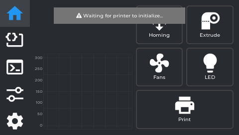
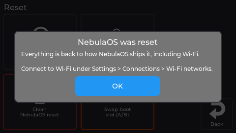
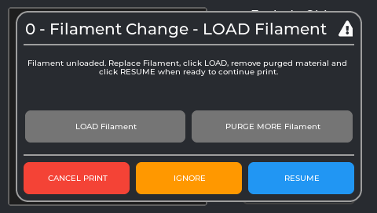

# Using NebulaScreen

NebulaScreen is the app on the printer's own touchscreen. These pages follow the screen itself:
the five tabs down the left edge in their order, then the six Settings tiles in theirs. Each page
says what every control does, when to use it, and what it changes.

| Page | What is on it |
|---|---|
| [Home and printing](Screen-Home) | Temperatures, **Homing**, **Extrude**, **Fans**, **LED**, **Print**: files, the print status screen, Exclude Object, filament runout, Spoolman spools |
| [Macros and Console](Screen-Macros-Console) | Your macros, and typing G-code |
| [Tune](Screen-Tune) | **Fine Tune**, **Z Offset**, **Retraction**, **Limits**, **Bed Mesh**, **Power Settings**, **TMC Metrics**, **Calibration** |
| [Settings → Connections](Screen-Connections) | Wi-Fi, static IP, network details, the printer's name, printers, Spoolman server |
| [Settings → Display](Screen-Display) | Brightness, sleep, theme, touch beep, boot logo, Nebula Camera |
| [Settings → Printer](Screen-Printer) | Defaults, Statistics, Restart Klipper / MCU, MCU firmware |
| [Settings → System](Screen-System) | Version, Report a problem, Storage, Logs, Restart GUI, Reboot, Shut down |
| [Settings → Updates](Screen-Updates) | App updates, System image |
| [Settings → Reset](Screen-Reset) | GUI settings, touch calibration, clean reset, boot slot swap |

Also on the screen: [Camera](Camera), [Timelapse](Timelapse) and
[Power-loss recovery](Power-Loss-Recovery).

**Looking for a job rather than a button?** [Get printing](Home) walks through the common tasks
in order, and [Improve your prints](Improve-Your-Prints) starts from what you see on the print.

Screenshots are captures of the real application at the printer's own 480x272 resolution. The
`p-` pictures are grabs of a printer's own display. The others come from the screen app with
data read from a printer (screen `123ef31`) or, for the older ones, with example data (screen
`36490ed`). Where a state cannot happen on an idle printer (a print running, a power cut, a
download), it was fed in for the picture, and the caption says so.

*Menu order and labels: `src/main_panel.cpp:34-57`, `src/printertune_panel.cpp:29-60` and
`src/setting_panel.cpp:22-42` at screen `fd47cb6`.*

## Getting around - the five tabs

A column of icon buttons runs down the **left edge** of the screen. Tap one to switch. Tapping the
already-active tab resets it (Macros jumps back to favourites, Console clears the input).

| Tab | What's here | Page |
|---|---|---|
| 🏠 **Home** | Temperatures, graph, and the buttons you use every day | [Home and printing](Screen-Home) |
| **Macros** | Your Klipper gcode macros | [Macros and Console](Screen-Macros-Console) |
| **Console** | Type gcode directly or browse commands | [Macros and Console](Screen-Macros-Console) |
| **Tune** | Grid of calibration tool launchers | [Tune](Screen-Tune) |
| **Settings** | Grid of system panel launchers | one page per tile, below |

> **Both Tune and Settings work the same way:** each is a grid of large icon buttons. Tapping one opens
> a full-screen sub-panel. Nothing is adjusted or configured inline on these tabs themselves.

## The Settings tiles

A grid of six tiles. Each opens its own page; **Back** returns to the grid.

| Tile | What's there |
|---|---|
| [**Connections**](Screen-Connections) | Wi-Fi, address, printer name, Mainsail / Moonraker / Spoolman |
| [**Display**](Screen-Display) | Brightness, sleep, theme, touch beep, boot logo, camera |
| [**Printer**](Screen-Printer) | Jog and temperature defaults, print statistics, Klipper and MCU restarts, MCU firmware |
| [**System**](Screen-System) | Version info, report a problem, storage, logs, restart / reboot / shut down |
| [**Updates**](Screen-Updates) | App updates and system image install (USB, upload, online) |
| [**Reset**](Screen-Reset) | GUI settings, touch calibration, clean reset, boot slot swap |

## Two screens you do not open

Both appear by themselves. Neither is reachable from a tab, which is why they are easy to meet
and hard to look up.

**The startup screen** (`init_panel`) is what the printer shows before Klipper is ready. It says
*"Waiting for printer to initialize..."* while it waits. If no printer is configured at all it
says so instead, and points at Settings - which is the state a screen reaches only when its
Moonraker connection has never been set up.

*The real screen app, with no printer answering yet.*

After a [clean NebulaOS reset](Resetting) it shows a one-time notice once the printer is up:

*The real screen app and its own text. An example state: the reset was fed in for the picture.*

**The question box** (`prompt_panel`) is how a macro asks you something. Klipper macros can send
a prompt - a title, some text and a set of buttons - and this screen renders whatever the macro
defines. It is not a fixed dialog with fixed buttons: what you see comes from the macro that
asked, so the same box can appear with entirely different wording and choices. Creality's `M600`
filament-change macro uses it, which is why the
[filament runout dialog](Screen-Home#filament-runout-dialog) deliberately stays out of its way.

*The real screen app, showing the text of NebulaOS's `M600` macro. The title scrolls when it is too long for the box, so it was caught mid-scroll.*

*From `src/init_panel.cpp` and `src/prompt_panel.cpp` at screen `fd47cb6`.*

## Every panel, and where to find it

The complete list is generated from the source - 50 panels in all - so nothing is quietly left
out.

| Panel | Where it is described | Screenshots (states shown) |
|---|---|---|
| `axis_twist_panel` | [Tune](Screen-Tune) - task: [Calibration explained](Calibration-Explained#axis-twist) | intro. **Not yet:** the running probe steps - they need a live `axis_twist` run |
| `bedmesh_panel` | [Tune](Screen-Tune) | no mesh, saved mesh, a real mesh, 3D view, save-profile prompt |
| `boot_logo_panel` | [Settings → Display](Screen-Display) | page, logo list, another logo selected, both Apply questions, Restore, Delete, no USB stick. **Not yet:** the USB picker with images on a stick, and the import result - they need a stick in the printer |
| `calibration_menu_panel` | [Tune](Screen-Tune) - task: [Calibration explained](Calibration-Explained) | menu, status lines |
| `camera_panel` | [Settings → Display](Screen-Display) - task: [Camera](Camera) | page, unsaved changes, Defaults, Manual exposure and Restart questions |
| `connections_panel` | [Settings → Connections](Screen-Connections) | page |
| `console_panel` | [Macros and Console](Screen-Macros-Console) | terminal, keyboard. **Not yet:** the command browser |
| `display_panel` | [Settings → Display](Screen-Display) | page, camera button with and without a camera |
| `exclude_object_panel` | [Home and printing](Screen-Home) | objects, exclude question |
| `extruder_panel` | [Home and printing](Screen-Home) - task: [Your first print](Printing) | page. **Not yet:** the busy spinner while extruding |
| `fan_panel` | [Home and printing](Screen-Home) | page |
| `filament_runout_panel` | [Home and printing](Screen-Home) | runout dialog |
| `file_panel` | [Home and printing](Screen-Home) - task: [Your first print](Printing) | file list, selected file |
| `finetune_panel` | [Tune](Screen-Tune) | page, page while printing |
| `firmware_retraction_panel` | [Tune](Screen-Tune) | page |
| `guided_calibration_panel` | [Tune](Screen-Tune) - task: [Calibration explained](Calibration-Explained) | the steps of every guided calibration |
| `homing_panel` | [Home and printing](Screen-Home) | Move page, emergency stop question, "Homing required" |
| `hostname_panel` | [Settings → Connections](Screen-Connections) | typing, invalid name, confirm |
| `image_panel` | [Settings → Updates](Screen-Updates) - task: [Keeping NebulaOS updated](Updating-NebulaOS) | page, install questions, refused, writing, restarting, failed, rolled back, stopped, next power-on; online: available, up to date, downloading, download stopped, downloaded; installed after the trial start |
| `init_panel` | this page, below | waiting for the printer, "NebulaOS was reset". **Not yet:** the other one-time NebulaOS notices |
| `led_panel` | [Home and printing](Screen-Home) | "No LEDs or lights are set up" |
| `limits_panel` | [Tune](Screen-Tune) | page |
| `logs_panel` | [Settings → System](Screen-System) | the log list with a log open (the real screen) |
| `macros_panel` | [Macros and Console](Screen-Macros-Console) | list. **Not yet:** the search keyboard |
| `main_panel` | [Home and printing](Screen-Home) | idle, printing, "Unavailable while printing" |
| `mcu_panel` | [Settings → Printer](Screen-Printer) - task: [Mainboard firmware](Mainboard-Firmware) | page, confirm, busy, done, failed, reinstall question |
| `network_detail_panel` | [Settings → Connections](Screen-Connections) | page |
| `pid_calibration_panel` | [Tune](Screen-Tune) - task: [Calibration explained](Calibration-Explained#heaters-pid) | page, running, done, bed and hotend start questions |
| `power_panel` | [Tune](Screen-Tune) - task: [Power-loss recovery](Power-Loss-Recovery) | page, the power-loss resume offer. **Not yet:** the page's own Resume question. Power devices: none - NebulaOS ships no `[power]` devices, so that part is never shown |
| `print_panel` | [Home and printing](Screen-Home) | file list |
| `print_status_panel` | [Home and printing](Screen-Home) - task: [Your first print](Printing) | printing, the start steps, Pause during the start, cancel question |
| `printer_select_panel` | [Settings → Connections](Screen-Connections) | list, add-printer keyboard. **Not yet:** the remove question |
| `printer_settings_panel` | [Settings → Printer](Screen-Printer) | page, Restart Klipper refused |
| `printertune_panel` | [Tune](Screen-Tune) | tiles |
| `prompt_panel` | this page, below | the M600 question box |
| `report_panel` | [Settings → System](Screen-System) | page, Save logs question. **Not yet:** saving and its result - they only follow Save |
| `reset_panel` | [Settings → Reset](Screen-Reset) - task: [Resetting](Resetting) | page and all four questions |
| `setting_panel` | this page, below | tiles |
| `skew_correction_panel` | [Tune](Screen-Tune) - task: [Calibration explained](Calibration-Explained#skew-correction) | page, keypad |
| `spoolman_panel` | [Home and printing](Screen-Home) | spool list (the real screen) |
| `spoolman_server_panel` | [Settings → Connections](Screen-Connections) | in use, typing, none, save question, remove question |
| `static_ip_panel` | [Settings → Connections](Screen-Connections) | page, keypad, invalid value, back-to-DHCP question |
| `statistics_panel` | [Settings → Printer](Screen-Printer) | page (the real screen) |
| `storage_panel` | [Settings → System](Screen-System) - task: [Resetting](Resetting#freeing-up-space) | page, both clean-up questions. **Not yet:** "Deleting..." and the results - they only follow OK |
| `system_panel` | [Settings → System](Screen-System) | page, reboot and shut down questions |
| `tmc_status_panel` | [Tune](Screen-Tune) | page |
| `tmc_tune_panel` | [Tune](Screen-Tune) - task: [Calibration explained](Calibration-Explained#tmc-autotune) | the KE defaults |
| `updates_panel` | [Settings → Updates](Screen-Updates) - task: [Keeping NebulaOS updated](Updating-NebulaOS) | page (the printer's own display), update one and update all questions. **Not yet:** updating and its result - they only follow Update |
| `wifi_panel` | [Settings → Connections](Screen-Connections) - task: [First start](First-Time-Setup) | network list, password, hidden network, forget question |
| `zoffset_panel` | [Tune](Screen-Tune) | saved, save error, older extensions |

"Not yet" means no picture exists; the page still describes that screen from the source.
