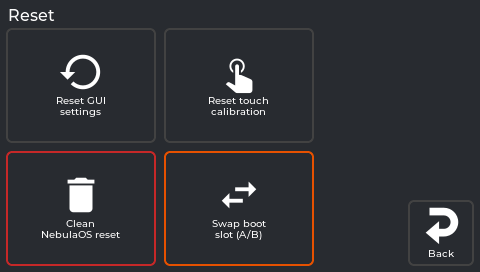

# Settings → Reset

The last Settings tile: four buttons, from harmless to drastic. Every one asks first and says what
it does. The clean reset and the slot swap are refused while a print runs.

*The real screen app, showing data from a printer running NebulaOS.*

| Button | What it does | What it erases |
|---|---|---|
| **Reset GUI settings** | Replaces the screen's settings file with the image's default copy, then restarts the screen. Klipper keeps running. | Theme, sleep timeout, which sensors are shown - screen settings only |
| **Reset touch calibration** | Clears the saved touch calibration. The screen restarts into the calibration wizard. | The touch calibration |
| **Clean NebulaOS reset** (red frame) | Restarts as if newly installed | Printer configuration and calibration, Wi-Fi networks, network settings, root password, print history and statistics, screen settings |
| **Swap boot slot (A/B)** (orange frame) | Restarts into the other system slot | Nothing - but read [Going back to stock](Going-Back) first: the other slot may not hold what you expect |

What each question says, what survives, and how to undo it: [Resetting](Resetting). The slot swap
is explained in [Going back to stock](Going-Back) and [Two system slots](Two-System-Slots).

*From `src/reset_panel.cpp:27-30` and `157-184` at screen `fd47cb6`.*

---

Previous: [Settings → Updates](Screen-Updates) · [Using NebulaScreen](Screen-Reference)
