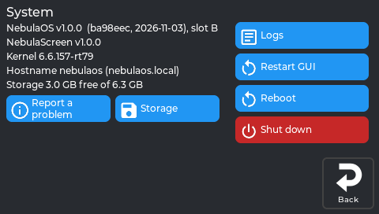
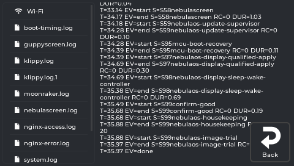
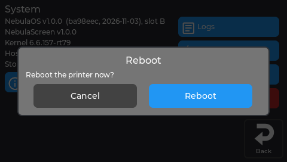
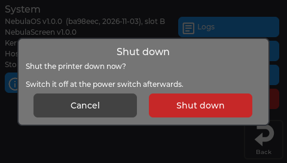
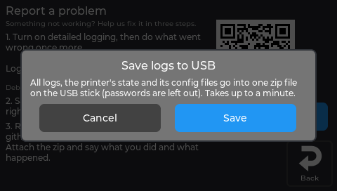

# Settings → System

Version information, Report a problem, storage, the logs, and restarting or shutting down.

## System

An info block with the NebulaScreen version, the NebulaOS build, boot slot, kernel, host name and
storage. Buttons:

*The real screen app, showing data from a printer running NebulaOS 1.0.0.*

| Button | What it does |
|---|---|
| **Report a problem** | Three steps: set the **Log level** (Info / Warning / Debug; Debug switches back to Info after 24 hours), **Save logs to USB**, and report on GitHub (QR code and address on screen). |
| **Storage** | Disk usage, **Free up space** and **Clean up Creality files** — see [Resetting](Resetting#freeing-up-space). Neither removes the figures behind [Statistics](Screen-Printer#statistics-panel). |
| **Logs** | Read log files on the screen, including the Wi-Fi lines of `system.log`. |
| **Restart GUI** | Restarts NebulaScreen only. Klipper keeps running. |
| **Reboot** / **Shut down** | Ask first. After shutting down, switch the printer off at the power switch. |

**Logs** lists the printer's log files on the left; tap one to read it on the right:

*The real screen on a printer running NebulaOS 1.0.1. The open log is `boot-timing.log`.*

*The real screen app, showing data from a printer running NebulaOS 1.0.0.*

*The real screen app, showing data from a printer running NebulaOS 1.0.0.*

**Save logs to USB** (in Report a problem) also asks first:

*The real screen app, showing data from a printer running NebulaOS 1.0.0.*

---

Previous: [Settings → Printer](Screen-Printer) · [Using NebulaScreen](Screen-Reference) · Next: [Settings → Updates](Screen-Updates)
