# Tune

The fourth tab: live adjustments, the bed mesh, the drivers and the **Calibration** menu.

## Tune tab

An **8-tile grid of icon buttons** (4 columns × 2 rows). Tapping a button opens its sub-panel
full-screen. Nothing is adjusted inline on this tab itself.

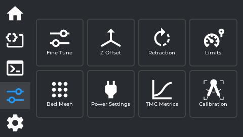

| Row | Col 1 | Col 2 | Col 3 | Col 4 |
|---|---|---|---|---|
| 1 | Fine Tune | Z Offset | Retraction | Limits |
| 2 | Bed Mesh | Power Settings | TMC Metrics | Calibration |

### Fine Tune

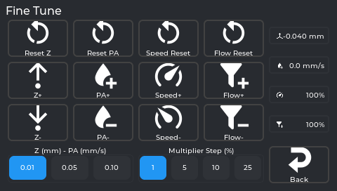

Not sliders — this panel is entirely **+ / − buttons**, each with a matching **Reset** button, usable
during a print or any time. There are two step-size selectors that control how much each button tap
changes: one shared between Z-offset and Pressure Advance (**0.01 / 0.05 / 0.10**), and one for Speed
and Flow together (the "Multiplier Step" — **1 / 5 / 10 / 25%**).

| Control | Buttons | What it does |
|---|---|---|
| **Speed** | Speed+ / Speed− / Speed Reset | Global speed multiplier. 100% = follow slicer speeds exactly. |
| **Flow** | Flow+ / Flow− / Flow Reset | Extrusion multiplier. Under-extruding → raise. Over-extruding → lower. |
| **Pressure Advance (PA)** | PA+ / PA− / Reset PA | Compensates for nozzle pressure lag at speed. Fixes corner bulges and blobs. |
| **Z-offset** | Z+ / Z− / Reset Z | A *third* place to baby-step Z-offset, alongside the print-status readout and the separate Z Offset panel below — all three adjust the same underlying value. |

**Firmware Retraction is not part of this panel** — it's the separate **Retraction** tile on the Tune
tab grid, described below.

### Z Offset

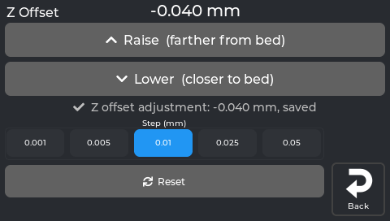

First-layer baby-stepping. Same as tapping Z on the print-status screen, but also usable outside a print.

**This is not the `z_offset` from `printer.cfg`.** The number here is Klipper's live gcode
offset - the baby-stepping adjustment on top of the probe's calibrated offset. On a system
without NebulaOS's `nebulaos_z_adjust` (OpenKE, for instance) that live offset is forgotten at
every Klipper restart, which is why such a screen shows `0.000 mm` after a reboot. NebulaOS
re-applies its saved adjustment at every Klipper start, so it keeps showing yours.

- **Raise (farther from bed)** / **Lower (closer to bed)** buttons, plus a **Reset** button that sets
  the offset to exactly 0.
- Step size buttons: **0.001 / 0.005 / 0.01 / 0.025 / 0.05 mm**
- Current value shown at top
- There is no separate Save button — every tap (including Reset) applies the change at once and
  NebulaOS saves it (`NEBULAOS_Z_ADJUST DELTA=…` / `RESET=1`). The saved adjustment is applied again
  after every Klipper restart or reboot, and set back to 0 when the Z-offset calibration saves a new
  Z offset. The panel shows "Z offset adjustment: 0.050 mm, saved".
- With older NebulaOS extensions (no `nebulaos_z_adjust`), the panel sends
  `SET_GCODE_OFFSET Z_ADJUST=… MOVE=1` instead: the change is kept only until Klipper restarts, and the
  panel does not say "saved". The Fine Tune panel's Z buttons work the same way.
- **The printer must be homed first.** If it isn't, you'll get a homing prompt instead of the adjustment
  going through. An unhomed adjustment would change the live offset (so the on-screen number would
  move) but fail to move the toolhead, which would leave the displayed value out of sync with the
  nozzle. Homing first avoids that.

### Retraction

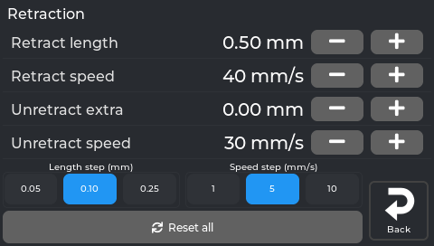

There are **two separate requirements** here, and both have to be true for this to actually do
anything to your prints:

1. **Your Klipper config needs a `[firmware_retraction]` section.** This is what decides whether this
   *panel* shows controls at all — if it's missing, the panel shows an **empty state** instead, and
   there's nothing to accidentally break.
2. **The gcode file you're printing needs to have been sliced with Firmware Retraction turned on** (in
   OrcaSlicer/PrusaSlicer etc., the retraction *type* setting — `G10`/`G11` commands, not the slicer's
   default direct-E-axis retraction). This is a **per-file slicer setting**, completely separate from
   #1. Even with `[firmware_retraction]` configured and this panel showing live values, if the specific
   file you're printing wasn't sliced with Firmware Retraction selected, none of these values are used —
   the print just uses whatever retraction the slicer itself wrote into the gcode instead.

If both are true, you get 4 rows — **Retract length** (mm), **Retract speed** (mm/s), **Unretract
extra** (mm), **Unretract speed** (mm/s) — each with −/+ buttons, plus a **Length step (mm)** selector
(0.05/0.10/0.25) and a **Speed step (mm/s)** selector (1/5/10), and a single **Reset all** button.
Changes apply **immediately** (live, via `SET_RETRACTION`) and are **runtime-only** — like the Limits
panel, nothing here is saved to `printer.cfg`, so a Klipper restart reverts everything to your config
file's values. If your slicer's start G-code passes the retraction values (see
[Set up your slicer](Slicer-Setup#retraction-the-slicer-or-the-printer)), every new print starts from the
slicer's values instead.

### Limits

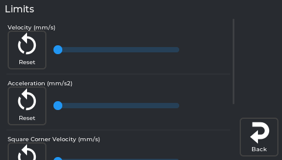

Hard caps on machine speed and acceleration, each shown as a slider with its own **Reset** button
(resets that one value back to what's set in `printer.cfg`, not a fixed factory number):

| Setting (exact on-screen label) | What it is |
|---|---|
| **Velocity (mm/s)** | Hard cap on axis speed |
| **Acceleration (mm/s2)** | Hard cap on acceleration |
| **Acceleration to Deceleration (mm/s2)** | A separate Klipper acceleration cap used specifically when the toolhead needs to slow down; distinct from the general Acceleration above |
| **Square Corner Velocity (mm/s)** | How fast the toolhead turns a sharp corner without fully decelerating |

Dragging any slider (or tapping its Reset) sends the change to Klipper **immediately** — there's no
separate "apply" step. These are **runtime-only**: nothing here is written to `printer.cfg`, so a
Klipper restart puts every value back to whatever `printer.cfg` says, undoing anything you changed here.

Raising these doesn't automatically make prints faster — the slicer's own speeds must also be raised.
Going beyond what the machine can handle causes ringing artifacts.

### Bed Mesh

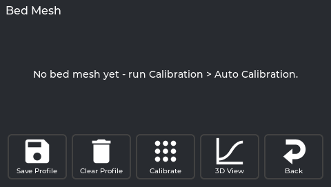

Opens showing a **table of raw Z values** at each probe point by default (colour-shaded — blue is low,
red is high) plus an info panel (Algorithm, Tension, and the X/Y probe range — min, max, count, points
per segment). There's no on/off toggle for mesh compensation; see **Clear Profile** below for how that
actually works.

- **3D View** button — switches to a colour surface you can rotate/zoom instead of the table. Tap again
  to switch back.
- **Calibrate** — runs `BED_MESH_CALIBRATE` (auto-homing first if the printer isn't already homed), maps
  the whole bed fresh (~2–3 min).
- **Save Profile** — saves the *current* mesh permanently under a name you choose, so you can switch
  between multiple saved meshes later.
- **Clear Profile** — runs `BED_MESH_CLEAR`, which turns mesh compensation **off** (this is the closest
  thing to an "off switch" — there's no separate toggle). Calibrating again, or loading a saved profile,
  turns it back on.
- **Saved profiles list** — each saved profile is a row with its name; tap the row to **load** it as
  active, or tap the ✕ on that row to **delete** it permanently.
- **No active mesh** — Klipper does not load a saved mesh after a restart, so after Auto Calibration
  usually none is active. The page then shows the saved one (`default` first) with *Saved mesh
  'default' - each print measures its own mesh at the start*; it is not loaded. Without any saved
  mesh: *No bed mesh yet - run Calibration > Auto Calibration.*

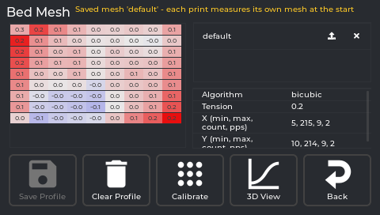

*The real screen app, showing a saved mesh measured on a printer running NebulaOS.*

**Save Profile** asks for a name. At 480x272 the keyboard covers the name field, so what you type is not visible while you type it:

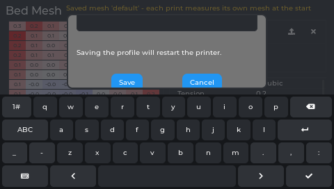

*The real screen app.*

#### 3D View screen

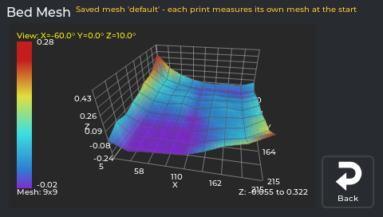

*The real screen app, showing a mesh measured on a printer running NebulaOS. The "Z: ... to ..." label runs into the axis numbers at this size.*

- **Drag anywhere on the mesh** to rotate it — the angle readout in the top-left (`View: X=... Y=...
  Z=...`) updates live as you drag.
- The colour scale on the left maps colour to height (red = high, blue = low); the exact range and the
  mesh size (e.g. "Mesh: 5x5") are shown with it.
- **The +/− buttons on the right have two different jobs depending on how you press them** — this is
  the only place in the app where that's true:
  - **Short tap** zooms the whole view in/out (like moving the camera closer/further).
  - **Press and hold** instead exaggerates or flattens the **height** of the surface — makes bumps
    look taller (hold +) or flatter (hold −) — without changing how sensitive the colours are. It
    keeps changing for as long as you hold it.
- **Back** here returns you to the Table view, not out of Bed Mesh entirely — tap it again from the
  table to actually leave the panel.

### Power Settings

| Section | What it does |
|---|---|
| **Power devices** | On/off buttons for smart plugs or relays configured in Moonraker's `[power]` section. NebulaOS ships none, so this section is normally not shown. |
| **Power Loss Recovery** | Shows the state of NebulaOS power-loss recovery (the Klipper object `nebulaos_power_loss_recovery`). After a power cut the screen asks by itself: "A print was interrupted by a power loss... Resume?" with **Later** and **Resume** (Mainsail shows the same question). **Resume** heats, homes X and Y, lifts, primes and continues; **Later** keeps the record for this screen. While a print runs it says the print is being recorded. After a power cut it shows the interrupted file and, when the printer allows a physical resume, a **Resume Print** button (asks to confirm); **Discard** drops the record. If the record cannot be resumed (file or printer configuration changed), it says why and offers only **Discard**. |

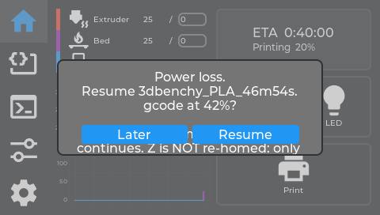

*The real screen app. An example state: the power cut and its record were fed in for the picture. On the 480x272 screen the text runs on under the Later / Resume buttons.*

Power devices: NebulaOS ships none, so there is no picture of that section.

### TMC Metrics

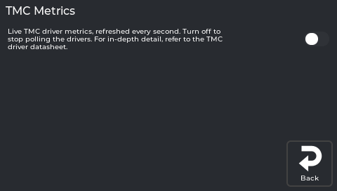

Live TMC driver metrics, refreshed every second. The switch at the top starts and stops polling the
drivers (`TMCSTATUS ENABLE=1` / `ENABLE=0`); it is off when the screen starts. NebulaOS always loads the
`[tmcstatus]` module, so no config edit or restart is needed.

⚠️ **This is not just a read-only diagnostics screen.** Once enabled, each stepper shows a live graph
(`sg_result`, `i_rms` in mA, and two other computed values — the panel doesn't explain what these mean
beyond their names; the app's own advice is "refer to the TMC driver datasheet") plus **four adjustable
values**: `toff` (0–15), `tbl` (0–3), `hstrt` (0–7), `hend` (0–15) — these are raw TMC chopper-timing
register names. Tapping +/- on any of them sends the change to the driver **immediately, live** — it is
not a preview you confirm afterward. There's no indication these persist across a restart on their own.

These are low-level hardware timing values: don't adjust them unless you specifically know what you're doing (per the driver datasheet) — this isn't
needed for normal printing or normal troubleshooting. If you suspect a driver issue, **TMC Autotune**
(inside the **Calibration** hub below) is the supported way to tune your drivers.

### Calibration

One menu for every calibration routine, reached from the **Calibration** tile. It is a scrollable
list: the numbered **IN ORDER** steps are the order a new printer needs them (just do 1, 2, 3, ...;
every routine in detail: [Calibration explained](Calibration-Explained)), then an **OTHER** section. **Up / ✓ / Down**
on the right move through the list; **Back** is the tile in the bottom-right corner, like on every
page.

| # | Row | Opens |
|---|---|---|
| 1 | **Bed Tramming** | Guided four-corner tramming ([Bed tramming](Calibration-Explained#bed-tramming)) |
| 2 | **Heaters (PID)** | PID tuning: **Bed 65 C** and **Hotend 230 C**, each saved with one Klipper restart ([details](Calibration-Explained#heaters-pid)) |
| 3 | **Axis Twist** | Axis Twist Compensation wizard; its Save also removes the saved bed mesh ([details](Calibration-Explained#axis-twist)) |
| 4 | **Auto Calibration** | Load cell check, nozzle clean, Z offset, bed mesh - about 7 min, no tools needed ([details](Calibration-Explained#auto-calibration-z-offset-and-bed-mesh)) |
| 5 | **Input Shaper** | Guided resonance measurement ([details](Calibration-Explained#input-shaper)) |
| 6 | **E-Steps** | Guided mark-extrude-measure calibration ([details](Calibration-Explained#e-steps-rotation-distance)) |
| 7 | **Skew Correction** | Skew Correction (needs a printed test part) ([details](Calibration-Explained#skew-correction)) |
| — | **Load Cell Calibration** *(Other)* | Automatic re-check or manual with a bottle ([Load cell calibration](Calibration-Explained#load-cell-calibration)) |
| — | **TMC Autotune** *(Other, optional)* | TMC Autotune - quieter motors ([details](Calibration-Explained#tmc-autotune)) |
| — | **Bed Mesh** *(Other)* | The same Bed Mesh panel as the Tune-tab tile — view or measure ([details](Calibration-Explained#bed-mesh)) |

Under every row a status line: **Done 24 Oct - <result>** (green) when it has run, a one-line
description with the time it takes when not, or **Redo: <reason>** (orange, with a bar on the left)
when something changed since - for example *Redo: Axis Twist changed* on Auto Calibration after
Axis Twist was saved, or *Redo: a shim was added at front left* after tramming the load-cell corner.
Older NebulaOS versions without a calibration history show the descriptions only.

Every row except Bed Mesh is locked while a print is running. **Axis Twist** and **Skew Correction**
show a message instead of opening when their Klipper section (`[axis_twist_compensation]`,
`[skew_correction]`) is missing; NebulaOS ships both. **TMC Autotune** is greyed out when Klipper has
no `motor_database.cfg`.

**Heaters (PID)** asks before each run:

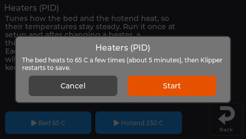

*The real screen app.*

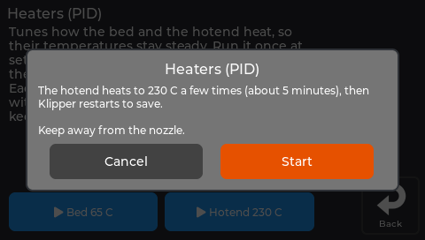

*The real screen app.*

#### The guided screens (Bed Tramming, Auto Calibration, Input Shaper, E-Steps, Load Cell Calibration)

These run NebulaOS calibration workflows in Klipper (`NEBULAOS_*` macros). Each screen shows a short
description, a **Start** button (asks to confirm) and, while the workflow runs, its live state, the
buttons for the current step and **Cancel**. Auto Calibration, Input Shaper and E-Steps show every
step with check marks (*Step 7 of 10*, the current step in large type with its live detail:
temperatures, *touch 2 of 3*, *point 41 of 81*), a notice while Klipper restarts to save (the
screen reconnects by itself), and at the end either **Done <date>** with the new values or
**Failed: <step>** with why and what to do. What each one does:

- **Bed Tramming** — measures the four bed corners and tells you which one to correct, one at a
  time: a printed shim on rigid spacers, or a screw turn on rubber or spring mounts. The printer homes
  and probes; the bed must be empty.
- **Auto Calibration** (formerly *Z-Offset & Bed Mesh*) — load cell check, nozzle clean, Z offset
  and bed mesh, saved with one Klipper restart; resets the Z adjustment to 0. About 7 minutes; the
  bed must be empty. Step by step: [First calibration](First-Calibration).
- **Input Shaper** — measures resonances with the accelerometer, first mounted on the toolhead (X),
  then on the bed (Y), and saves the result with one Klipper restart.
- **E-Steps** — the hotend heats; you mark the filament at the extruder entry, the printer
  extrudes a fixed length, and you type in how far the mark moved. The corrected value is applied
  for you.
- **Load Cell Calibration** — **Automatic** (default: a sensor check, no bottle; after a pass
  *Ready - Automatic needs no weight calibration; Auto Calibration uses it.*) or **Manual** (a
  1.5 L water bottle and a kitchen scale, about 2 minutes; nothing moves or heats).

#### Axis Twist

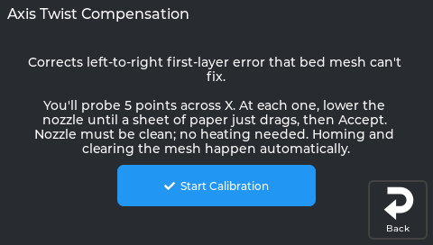

A 5-point paper test across X (`AXIS_TWIST_COMPENSATION_CALIBRATE SAMPLE_COUNT=5`). Fixes first
layers that are uneven left to right despite re-meshing. Full guide:
[Calibration explained → Axis Twist](Calibration-Explained#axis-twist).

#### Skew Correction

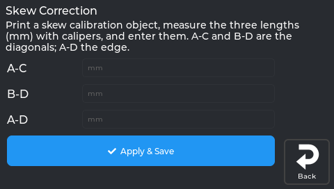

Corrects parts that come out as slight parallelograms instead of squares.

- Enter three caliper measurements from a printed test square: **AC diagonal**, **BD diagonal**, **AD side**.
  Tapping a field opens a number keypad.
- Tap **Apply & Save** — this sends the correction *and* runs `SAVE_CONFIG` (Klipper restarts).

Full guide: [Calibration explained → Skew Correction](Calibration-Explained#skew-correction).

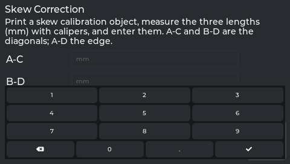

*The real screen app.*

#### TMC Autotune

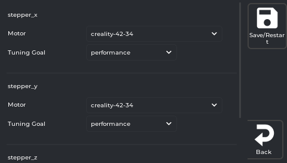

*The real screen app, with NebulaOS's shipped configuration and motor list. A printer that has saved its own choices shows those instead.*

Quieter, cooler steppers. For each stepper pick a **Motor** and a **Tuning Goal** (`auto`, `silent`,
`performance`, `autoswitch`), then tap **Save/Restart**. Steppers without a saved choice are
pre-selected with the KE's stock motors. Full guide: [Calibration explained → TMC Autotune](Calibration-Explained#tmc-autotune).

---

Previous: [Macros and Console](Screen-Macros-Console) · [Using NebulaScreen](Screen-Reference) · Next: [Settings → Connections](Screen-Connections)
