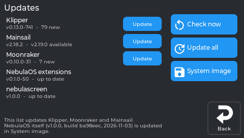
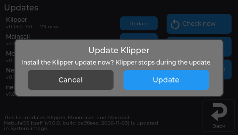
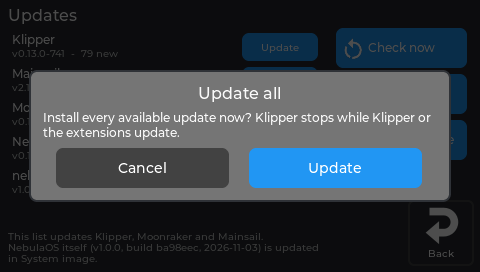

# Settings → Updates

App updates through Moonraker, and system images (USB stick, upload, online). The task, step by step: [Keeping NebulaOS updated](Updating-NebulaOS).

## Updates

Lists what Moonraker's update manager knows (Klipper, Moonraker, Mainsail, NebulaOS extensions, ...)
with version and state. **Check now** refreshes the list, **Update all** installs every available
update, and each row has its own **Update** button. Klipper stops while Klipper or the extensions
update.

*The printer's own display, running NebulaOS.*

Each update asks first:

*The real screen app, showing data from a printer running NebulaOS.*

*The real screen app, showing data from a printer running NebulaOS.*

**System image** installs a NebulaOS (or Creality) `.img` from a USB stick or from
`config/uploads/system-image` into the boot slot that is not running, then restarts into it.
**Online** asks GitHub for a newer NebulaOS release and downloads it (checked against the
release); it then shows in the list as **Downloaded** and installs the same way. After a NebulaOS
image, the new slot gets a trial start: if Klipper and the screen do not come up, NebulaOS goes
back to the previous slot. See [Updating NebulaOS](Updating-NebulaOS).

---

Previous: [Settings → System](Screen-System) · [Using NebulaScreen](Screen-Reference) · Next: [Settings → Reset](Screen-Reset)
