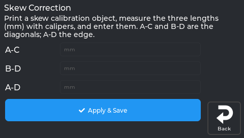
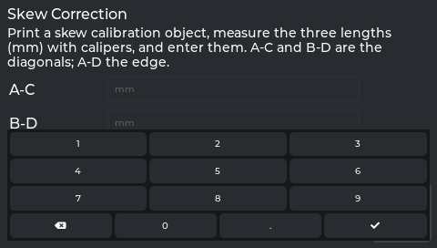

# Fixing Parts That Come Out Skewed (Skew Correction)

Do your prints come out as a slight **parallelogram** instead of a true square? A box whose lid won't sit
square, holes that look a touch oval, a 100 mm part that measures 100 mm on each side but isn't quite
*square*? That's **skew** — and NebulaScreen can correct it entirely from the printer's screen.



*The Skew Correction screen.*

You don't need a computer or a slicer for this. Print one test frame from the screen, measure it with
calipers, type in three numbers, and you're done.

---

## Will this actually help me?

**Yes, if:** your printer's axes aren't perfectly at 90° to each other (extremely common, usually by a
tiny amount). The tell-tale sign: a printed square has **two diagonals of different lengths**, or parts
that should be square come out leaning.

**Probably not worth it, if:** you only print models, figurines, or decorative things. Skew is a fraction
of a degree — you'll never see it on a dragon, only on parts that must *fit* something. If you don't print
functional/engineering parts, you can happily skip this.

### The 30-second test for whether you even have skew

Print any square (or the test frame below), pop it off the bed, and measure the **two diagonals** corner-to-corner
with calipers. If they're the same length → you have no meaningful skew, nothing to fix. If they differ by
more than ~0.2–0.3 mm → skew correction will tidy that up.

### Why it happens (in plain English)

A 3D printer assumes its X and Y axes meet at a perfect 90° corner. In reality the frame can be off by a
hair. Every layer then prints as a very slightly leaning parallelogram instead of a rectangle. No amount of
bed leveling or meshing fixes it, because it's a *geometry* problem, not a height problem. **Skew correction**
measures the error from a test print and shears every move by the opposite amount, so squares come out square.

---

## Before you start

- ⏱️ **Time:** ~15 minutes (a short test print + three caliper measurements).
- 🧰 **You need:** a pair of calipers (digital is easiest), and filament loaded. No computer, no tools.
- ↩️ **Safe to try:** it changes nothing until you enter measurements and tap **Apply & Save**. Undoing
  it isn't a screen button — it's one console command (`SET_SKEW CLEAR=1`, see
  [Undoing / clearing it](#undoing--clearing-it) below) — but it is quick and fully reversible.

> **Requirement:** Klipper needs a `[skew_correction]` section. NebulaOS ships one in its machine config
> (`/etc/nebulaos/klipper/machine.cfg`). Without it, tapping the row shows *"Skew correction isn't
> enabled. Add [skew_correction] to printer.cfg."* for a few seconds — see [Enabling it](#enabling-it).

---

## Step 1 — Print a calibration square

You need one flat, square print to measure. **Slice it with your own normal profile** — that way the
extrusion is dialed in for your printer and filament, and the corners come out crisp.

What to print: any **XY skew calibration** model, or simply a **large flat square** (a single- or
double-wall frame, a few layers tall). **Bigger is better** — a ~150 mm square gives far more measurement
resolution than a small one, because skew error grows with distance. Popular ready-made options on
Printables/Thingiverse search for *"skew calibration"* (e.g. a frame with labeled A/B/C/D corners), but a
plain 150 mm square box-bottom works just as well.

Slice it, print it, let it cool, and gently pop it off the bed. **Keep track of which corner was at the
front-left of the printer** — that's corner **A**. (Mark it with a pen as you lift it off if that helps.)

---

## Step 2 — Measure the three lengths

Lay the frame flat. The corners are named like this, **as the part sat on the bed** (printer front toward you):

```
   D (back-left) ───────────── C (back-right)
   │                                       │
   │                                       │
   │                                       │
   A (front-left) ──────────── B (front-right)
```

With your calipers, measure these three, outer corner to outer corner, as accurately as you can (to 0.01 mm
if your calipers allow):

| Measure | From → to | What it is |
|---|---|---|
| **A–C** | front-left → back-right | one diagonal |
| **B–D** | front-right → back-left | the other diagonal |
| **A–D** | front-left → back-left | the left edge |

> 🎯 **This is the whole trick:** measure carefully and consistently. If there's no skew, A–C and B–D come
> out equal. The *difference* between them is exactly what the printer corrects.

---

## Step 3 — Enter them on the screen

### Option A — from the screen (easiest)


1. On the printer: **Tune → Calibration → 7 Skew Correction**.
2. Tap each field and type the millimetre value (the keypad has a decimal point): **A-C**, **B-D**, **A-D**.

   

   *The real screen app.*

3. Tap **Apply & Save**.

That sends `SET_SKEW` and saves it permanently (the printer restarts briefly to lock it in). Done — every
print from now on comes out square. 🎉

### Option B — from the Klipper console (Mainsail/Fluidd)

Same three measurements, typed directly instead:

```
SET_SKEW XY=<AC>,<BD>,<AD>
SAVE_CONFIG
```

Replace `<AC>`, `<BD>`, `<AD>` with your measured millimetre values, in that order.

*(Want to confirm either way? Re-print the frame and re-measure the diagonals — they should now match.)*

---

## Undoing / clearing it

If you ever want to remove the correction, run this in the Klipper console (Mainsail/Fluidd) and `SAVE_CONFIG`:

```
SET_SKEW CLEAR=1
```

That zeroes the correction. Re-running Steps 1–3 overwrites it with fresh measurements any time.

---

## Enabling it

NebulaOS enables this already: its machine config contains a bare `[skew_correction]` section. If you
still get *"Skew correction isn't enabled"* (for example with your own Klipper config), add this line to
`printer.cfg` above the `#*# <---- SAVE_CONFIG ---->` marker and restart Klipper:

```ini
[skew_correction]
```

Your saved skew values live in the `SAVE_CONFIG` block of `printer.cfg`.

---

## How much can it fix?

Skew correction handles the small, consistent frame-squareness error that's baked into the machine. It does
**not** fix a part that physically rocks, a loose belt, or a bent axis — fix mechanical problems first. Think
of it as the final polish for dimensional accuracy once the hardware is sound.

> **Note:** Klipper's `[skew_correction]` can actually correct three planes — XY, XZ, and YZ — but the
> on-screen **Skew** panel only exposes **XY**, since that's the plane nearly every Cartesian printer
> actually needs (X and Y are driven by separate motors that can be slightly non-perpendicular; X/Z and
> Y/Z rarely are on a machine like the KE). If you have a rare case that needs XZ or YZ too, you can set
> those from the console the same way — `SET_SKEW XZ=<AC>,<BD>,<AD>` / `SET_SKEW YZ=<AC>,<BD>,<AD>`,
> measured the same way but with the frame stood on its corresponding edge — the screen just won't show
> or edit those values for you.
