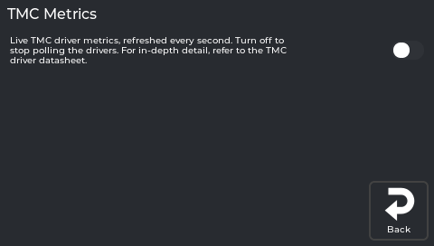

# Quieter, Cooler Steppers (TMC Autotune)

NebulaScreen has a **TMC Autotune** screen (**Tune → Calibration → 8 TMC Autotune**) that tunes your
stepper drivers from the *motor type* — quieter motion, cooler drivers, and a touch smoother surface,
applied automatically on every boot. You pick the motor and a goal from two dropdowns and tap Save. No
tuning math, no datasheets.

*TMC status readings.*

## What NebulaOS provides

- The autotune add-on (`autotune_tmc.py`, `motor_constants.py`, `motor_database.cfg`) from
  [andrewmcgr/klipper_tmc_autotune](https://github.com/andrewmcgr/klipper_tmc_autotune), shipped in
  NebulaOS-klipper-extensions.
- `[nebulaos_tmc_autotune]` in the NebulaOS Klipper config. It adds the command
  `NEBULAOS_TMC_AUTOTUNE`, which the screen uses to add or remove `[autotune_tmc <stepper>]` sections
  before `SAVE_CONFIG`. Autotune itself only runs once such a section exists.

The row is greyed out only when Klipper has no `motor_database.cfg`; on NebulaOS it is there.

A couple of things this is *not*:

- It is **not** related to **TMC Metrics** (the live driver dashboard) — separate button, separate
  feature.
- It does **not** need a print running, and it is locked while one runs.

---

## Will this actually help me? (Honest answer for the KE)

**Yes, but moderately.** The Ender-3 V3 KE uses **TMC2208** drivers on X, Y, and Z. The 2208 supports the
chopper-timing and stealthChop/PWM tuning that autotune computes from the motor specs — so you *will* get
**quieter, cooler, slightly smoother** motors. That part is real.

What the 2208 *doesn't* have is **CoolStep** and **StallGuard** (those are 2209-and-up features). So:

- You won't see a **"Sensorless Threshold"** field on the KE. The panel only shows it for drivers that
  support StallGuard (2209/2130/2240/2660/5160); on the 2208 it's hidden. So you've nothing to set there.
- Don't expect a transformative change. Think "noticeably calmer and cooler," not "a different printer."

If your motors are already quiet and you have no thermal concerns, this is a nice-to-have, not a must-do.

---

## Before you start

- ⏱️ **Time:** a few minutes, plus a Klipper restart.
- ↩️ **Safe to try:** nothing changes until you tap Save, and it's reversible (see
  [Undoing it](#undoing-it)).

---

## Pick your motors and tune

*No current screenshot of this screen yet - the capture tour does not reach it. Tracked in the screenshot inventory.*

For each axis, choose the **Motor** from the dropdown, then a **Tuning Goal**, then tap **Save/Restart**.

**Recommended on the KE** (these are the stock motors):

| Stepper | Motor | Tuning Goal |
|---------|-------|-------------|
| `stepper_x` | `creality-42-34` | **performance** |
| `stepper_y` | `creality-42-34` | **performance** |
| `stepper_z` | `creality-42-40` | **silent** |

The Tuning Goal dropdown has **four** choices:

- **`auto`** — picks for you based on the motor: **performance** for X/Y, **silent** for Z.
  On the KE this lands on exactly the recommended table above, so `auto` is a perfectly good "just do the
  right thing" choice.
- **`performance`** — spreadCycle at all speeds (crisp, accurate motion, a bit more audible). Good for the
  moving X/Y.
- **`silent`** — stealthChop at all speeds (quietest). Ideal for the Z lead-screw, which doesn't need the
  precision.
- **`autoswitch`** — **experimental.** Runs stealthChop at low speed and switches to spreadCycle once the
  motor moves fast enough. The idea is "quiet when slow, strong when fast." It's flagged experimental in the
  add-on and isn't needed on the KE — stick with `auto`/`performance`/`silent` unless you're deliberately
  experimenting.

You'll see just the two dropdowns per axis — there's no "Sensorless Threshold" field on the KE, because
the 2208 drivers don't have StallGuard (the panel hides it).

Steppers without a saved choice are pre-selected with these stock motors; nothing is written until you
save.

Tap **Save/Restart**. The screen sends `NEBULAOS_TMC_AUTOTUNE STEPPER=… MOTOR=… GOAL=…` for each stepper,
then `SAVE_CONFIG`: Klipper writes the `[autotune_tmc …]` sections into its auto-save block, restarts,
and applies the tuned driver registers. From then on they are applied on every boot.

> The motor names come from the bundled motor database. If you've swapped to non-stock motors, pick the
> closest match in the dropdown (or look your motor up in `motor_database.cfg`).

---

## Undoing it

To turn a single axis back to stock, set its **Motor** to *"Not Configured"* and tap **Save/Restart** —
the screen removes that `[autotune_tmc]` section (`NEBULAOS_TMC_AUTOTUNE STEPPER=… REMOVE=1`).

---

## Troubleshooting

- **Row greyed out** — Klipper reports no `klippy/extras/motor_database.cfg`. Check the Klipper log for
  an error mentioning `autotune_tmc` or `motor_constants`.
- **Save fails with "Unknown command NEBULAOS_TMC_AUTOTUNE"** — the `[nebulaos_tmc_autotune]` section
  is missing from the Klipper config (it is in the NebulaOS `platform.cfg`).
- **Where's the Sensorless Threshold field?** — it isn't shown on the KE. The screen only displays it
  for drivers with StallGuard (2130/2209/2240/2660/5160); the KE's TMC2208 drivers don't have it.
