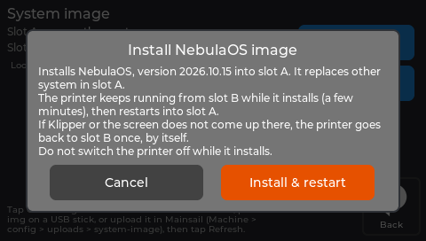
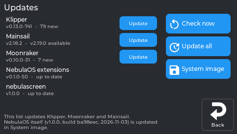
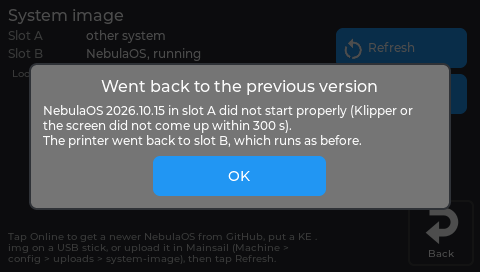

# Updating NebulaOS

## What this guide will help you do

Install a newer NebulaOS, or update individual parts of it, from the printer's own screen. No
USB stick and no computer needed once the printer is on your network.

## What you need

- A printer on your Wi-Fi network - [Connecting to Wi-Fi](Connecting-To-WiFi).
- A printer that is not printing. Updates are refused while it is busy printing, heating or
  calibrating, and the screen says which.
- For a whole-system update: a download of well over 100 MB, and a few minutes. The screen
  shows the exact size before you start.

## Before you begin

Two kinds of update exist, and they are not the same thing:

| What | Where | How often |
|---|---|---|
| **The whole system** - kernel, system, screen app, everything in the image | **Settings → Updates → System image** | Once per NebulaOS release |
| **Apps** - Klipper, Moonraker, Mainsail, the NebulaOS extensions, the screen app | **Settings → Updates**, the list | When a component has a newer version |

**Your settings survive both.** Configuration, calibration, `printer.cfg`, macros, uploaded
files and Wi-Fi networks live on a separate data area and are kept through every update.

## Updating the whole system

A system image is written into the boot slot that is **not** running, so the system you are
using is never overwritten. [Two system slots](Two-System-Slots) explains what that means for
your old system - it is the page to read before your first update. The printer then restarts into the new slot. An **online** update
and a **USB stick** install are the same operation - only where the file comes from differs.

**On a printer that came from stock, the first update replaces your old system**, because the
slot that is not running is the one holding it. See
[Going back](Going-Back#the-one-thing-that-can-remove-your-old-system).

**If the new system does not come up properly, NebulaOS goes back by itself** - within about
5 minutes, or after 3 restarts that never confirm. See
[Recovery](Recovery#1-automatic-the-trial-start). That safety net is why a system update is
less frightening than it sounds.

### Online, the easy way

1. **Settings → Updates → System image → Online.** The printer asks GitHub for the latest
   NebulaOS release - it reads `nebulaos-release.json` from the releases page, which is how it
   knows what is available without you choosing a file.
2. If a newer version exists, it shows the version and the exact download size. Tap
   **Download**.
3. When it finishes, the download appears in the list as **Downloaded**. Tap **Install** next
   to it.
4. NebulaOS checks the file again, asks you to confirm, installs it over a few minutes, and
   restarts.

Once the new system has started properly, the downloaded file is deleted automatically.

**A note on the clock.** HTTPS needs the printer's clock to be roughly right, and the printer
sets it from the internet once Wi-Fi is up. Right after a first start this can take a minute,
so if **Online** fails immediately on a freshly installed printer, wait a moment and try again.

### From a USB stick or from Mainsail

1. Put the `.img` file on a FAT32 USB stick, **or** upload it in Mainsail to **Machine →
   config → uploads → system-image**.
2. **Settings → Updates → System image** lists it.
3. Tap **Install**.

Both NebulaOS and Creality `.img` files are accepted here. **Installing a Creality image
replaces the other slot with Creality's system, and there is no automatic way back from it** -
only SSH or USB recovery. See [Recovery](Recovery).

## Updating apps

**Settings → Updates** lists what Moonraker's update manager knows about, with each
component's version and state.

- **Check now** refreshes the list.
- **Update all** installs every available update.
- Each row has its own **Update** button.

*The printer's own display, running NebulaOS 1.0.0.*

While a check or an update is running the buttons are greyed out and a line of text says what
is happening. Klipper stops while Klipper or the NebulaOS extensions update - that is expected.
The same list appears in Mainsail under **Machine → Update Manager**.

Worth knowing how these track upstream:

- Klipper follows upstream Klipper, and the NebulaOS extensions follow their `production`
  branch.
- **The extensions check at every Klipper start that Klipper still provides what they need,
  and stop with a clear message if it does not.** A mismatch announces itself instead of
  failing mid-print. The system image keeps its own matched versions as a fallback.
- **Mainsail** updates itself from its own repository (`mainsail-crew/mainsail`, channel
  `stable`). NebulaOS 1.0.0 ships **2.18.2**; that is the version in the image, not a ceiling -
  Moonraker's update manager moves it on without a system image.
- The screen app updates from its own releases. A system image brings its own copy of the
  screen app, and after a system image install that copy is used again.

## Expected result

- **Settings → System** reports the new version.
- The printer behaves as before, with your files and settings intact.
- For an app update, the row shows the new version and no longer offers **Update**.

## Troubleshooting

| What happens | What to do |
|---|---|
| Updates are refused | The printer is printing, heating or calibrating. Wait and try again. |
| **Online** fails right after a first start | The clock is not set yet. Wait a minute. |
| The download stops partway | Try again - an incomplete download is discarded, never installed. |
| The install stops with **Stopped:** and a reason (for example, a print started) | Nothing changed on the system you are running. Wait until the printer is free and install again. |
| A downloaded file will not install | Its size or checksum did not match, so it was rejected. Download it again. |
| The new system starts, then goes back to the old one | The automatic trial decided it had not come up properly. See [Recovery](Recovery). |
| The screen is blank after an update | Wait five minutes for the automatic fallback before doing anything. Then [Recovery](Recovery). |

## Recovery and reversal

- A system image goes into the other slot, so **[Going back](Going-Back)** returns you to
  whatever is in it - the previous NebulaOS once you have updated at least once, your old
  system only if you have not.
- A failed system update undoes itself automatically.
- **If an install stops, nothing changed on the system you are running. Just install again.**
  It can stop on its own if the printer becomes busy - a print starts, for example - before it
  switches over.
- **Until an install completes, you cannot switch back to the system that was in the other
  slot.** The install was already writing that slot when it stopped, so it is cleared rather
  than left half-written.
- App updates are managed by Moonraker's update manager and can be re-run from the same list.

## Freeing up space afterwards

Updates leave backups and downloads behind. **Settings → System → Storage → Free up space**
removes NebulaOS's own leftovers - old logs, old update backups, unfinished downloads, uploaded
system images and the download cache - and shows what it will free before doing it. Your print
files, settings and calibration are never touched. See [Resetting](Resetting).

## Related

- [Resetting](Resetting)
- [Recovery](Recovery)
- [Going back to your old firmware](Going-Back)
